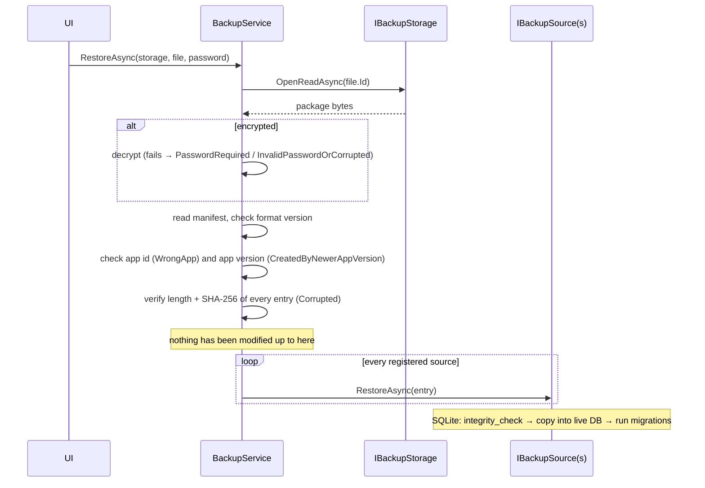

# Data and backup

Apps are **local-first**: all data is stored in a SQLite database on the device and the app works without network.
To make sure data is never lost, the app creates backup packages with optional password encryption that the
user keeps or shares. The libraries can also store them in cloud storage **owned by the user** (Google Drive or
OneDrive). In Zanance they are offered only in builds with configured OAuth clients, as an explicit choice of the
user, and local and cloud backups both offer optional password encryption (D-62 supersedes the mandatory cloud password in D-35).
The device remembers only the protection choice, defaulting to on; passwords are never saved. A password may be
reused, but encrypted backup creation requires entry and confirmation each time. Connected cloud account access
does not encrypt the portable file: anyone obtaining an unprotected package can read it.

First-run restore uses the same validation, preview, confirmation and safety-copy flow before any account is created.
Restored accounts complete onboarding without a duplicate account, preserving profile preferences. Empty backups
still need onboarding. Theme is device-wide and not restored from a package (D-62).

## Local database

| Topic | Rule |
|---|---|
| Engine | SQLite (Microsoft.Data.Sqlite) with EF Core 10 |
| Location | `FileSystem.AppDataDirectory/<app>.db` (private app storage) |
| Base class | `LocalDbContext` (Vafadar.Data) |
| Registration | `services.AddLocalDatabase<TContext>(path)` registers `IDbContextFactory<TContext>`, the auditing interceptor and the database as a backup source |
| Context lifetime | Short-lived contexts from `IDbContextFactory` (`await using var db = await factory.CreateDbContextAsync()`); there are no request scopes in a mobile app |
| Schema changes | Always through EF Core migrations; applied by `MigrateLocalDatabase<TContext>()` when the app creates its first window (`App.CreateWindow`), not while the app is built – Android builds it in `Application.onCreate`, also for a notification, with a time limit (D-46) |
| Identifiers | `Guid` version 7 (`Entity` base class): time-ordered, and unique across devices and restores – ready for sync |
| Audit fields | Entities implementing `IAuditableEntity` get `CreatedAt` / `UpdatedAt` (UTC) automatically |
| Moments in time | `DateTimeOffset`, stored as UTC ticks (`UtcTicksDateTimeOffsetConverter`) so SQL can filter and sort them |
| Calendar dates | `DateOnly` (stored as `yyyy-MM-dd` text, sortable) |
| Money | **`long` in minor units** (e.g. cents) plus a currency code. SQLite has no decimal type; EF stores `decimal` as text and cannot sum or compare it in SQL |
| Enums | Stored as integers; never renumber released values |

### Migrations

```powershell
# Add a migration (run from the repository root)
dotnet tool restore
dotnet ef migrations add <Name> --project src/Apps/Zanance/Vafadar.Zanance.Data

# Inspect the SQL a migration produces
dotnet ef migrations script --project src/Apps/Zanance/Vafadar.Zanance.Data

# After every model change: regenerate the compiled model the app loads at startup
dotnet ef dbcontext optimize --project src/Apps/Zanance/Vafadar.Zanance.Data `
    --startup-project src/Apps/Zanance/Vafadar.Zanance.Data `
    --output-dir CompiledModel --namespace Vafadar.Zanance.Data.CompiledModel
```

The `*.Data` projects contain an `IDesignTimeDbContextFactory`, so the EF tools do not need to start the MAUI app.

**Compiled model** (Zanance, D-44): building the EF model from `OnModelCreating` took about four seconds of every cold
start on an Android emulator. `Vafadar.Zanance.Data/CompiledModel` holds the generated model, which EF Core picks up
through its `DbContextModel` assembly attribute; the EF tools still build the model from code. A test
(`Compiled_model_matches_the_model_in_code`) fails when the compiled model is out of date. It is built on the calling
thread (`Microsoft.EntityFrameworkCore.Issue31751`): EF's default second thread hangs the app under Mono. At startup
`MigrateLocalDatabase` only runs `Migrate()` when the history lists a pending migration, because `Migrate()` also
compares the whole model with the migrations; the tests start from an empty database and keep that check.
Migrations must be backward compatible with existing user data: add columns with defaults, migrate data in the
migration, never drop user data silently.

## Backup design

### What a backup is

A backup is a single file, `pro.vafadar.zanance_20260925T143000Z.vbak`:

```text
┌────────────────────────── .vbak ───────────────────────────┐
│ optional encryption envelope (AES-256-GCM)                  │
│ ┌──────────────────── ZIP package ────────────────────────┐ │
│ │ manifest.json    format version, app id, app version,   │ │
│ │                  created at, device, entries + SHA-256  │ │
│ │ data/database.sqlite   consistent SQLite snapshot       │ │
│ │ data/<other source>    e.g. attachments (future)        │ │
│ └─────────────────────────────────────────────────────────┘ │
└─────────────────────────────────────────────────────────────┘
```

* **Sources** (`IBackupSource`) provide the content. `SqliteDatabaseBackupSource` uses SQLite's online backup API,
  which produces a consistent snapshot even while the app is writing (copying the file directly could capture a
  half-written state).
* **Storages** (`IBackupStorage`) only move files: `LocalFolderBackupStorage`, `GoogleDriveBackupStorage`,
  `OneDriveBackupStorage`. Adding another provider (e.g. Dropbox) means implementing four methods.
* **`BackupService`** orchestrates: create package → encrypt (optional) → upload → apply retention (keep the newest
  10 by default). Only one backup or restore runs at a time.

### Encryption

| Property | Value |
|---|---|
| Cipher | AES-256-GCM (authenticated: any modification is detected) |
| Key derivation | PBKDF2-HMAC-SHA256, 600,000 iterations, random 16-byte salt per backup |
| Header | `VBE1` · iterations · salt · nonce · tag, authenticated as associated data |
| Password normalization | Unicode NFC; Arabic Yeh/Kaf → Persian; Persian/Arabic-Indic digits → ASCII (the same password typed on different Persian keyboards works) |
| Password storage | **None.** A forgotten password cannot be recovered – the UI must say so clearly |

### Restore



* Everything is validated **before** any existing data is touched.
* A backup from an **older** app version is restored and then migrated to the current schema.
* A backup from a **newer** app version is refused ("update the app first"), because an older schema could lose data.
* Backups restore across platforms (Android ↔ iOS ↔ Windows): the app id is configured explicitly
  (`ZananceApp.AppId`), not taken from the platform package name.

### Storage providers compared

| | Google Drive | OneDrive |
|---|---|---|
| Location | Hidden `appDataFolder` | Visible `Apps/<app name>` folder |
| Permission (scope) | `drive.appdata` – only the app's own folder | `Files.ReadWrite.AppFolder` – only the app's own folder |
| User can see files | No (only storage used, under Drive → Settings → Manage apps) | Yes, and can download/delete them |
| Shared between apps | Per Google Cloud project (file names carry the app id, so apps can share a project) | Per Entra app registration (same) |
| Upload | Resumable upload (no practical size limit) | Simple upload (up to 250 MB) |
| Account | Any Google account | Personal Microsoft account and work/school accounts |

Both are free for the user within their existing quota and cost the developer nothing.

### Cloud backup in Zanance (D-35, D-50)

| Step | What happens |
|---|---|
| Offered | Only when the build has the OAuth client of the provider for that platform (`MicrosoftEntraClientId` for all; `GoogleOAuthClientIdAndroid`, `GoogleOAuthClientIdIos`, `GoogleOAuthClientIdWindows`). Both providers work on Android, iOS and Windows. A build without clients has no cloud section (and on Android no `INTERNET` permission) |
| Connect | The user taps *Connect*, reads where the backups go and that only the app folder is visible, then signs in with the provider's own screen ([authentication](authentication.md)) |
| Back up | *Back up now* follows the protection choice under *Create backup*: when on, enter and confirm a password; when off, upload a package without file encryption (D-62). Retention (`MaxBackupsToKeep`) applies in the cloud folder as well |
| Restore | *Show backups* lists the files; tapping one downloads it and runs the normal restore flow (password if encrypted, preview, safety copy, confirmation) |
| Disconnect | Signs out and removes the cached tokens (Google: the grant is revoked); backups stay in the user's account |

Backups are per local profile: each profile backs up its own database into its own **backup set**
(`BackupOptions.FileSet`, file names `{appId}~{profile}_{time}.vbak`; the main profile keeps the plain name). Listing,
retention and the last backup time count only the open profile's set, so one profile never prunes or shows another
profile's backups, locally or in the shared cloud folder. The cloud connection itself is shared by the profiles of a
device. There is no automatic cloud backup yet.

### Scheduling

* **Manual**: "Back up now" and "Restore" in each app's backup settings.
* **Automatic** (planned in `Vafadar.Maui.Backup`, not in Zanance yet): when the app starts or resumes and `IsAutomaticBackupDue()`
  (default: daily), a backup runs in the background to the storage the user configured. Later, Android WorkManager /
  iOS background tasks can run it while the app is closed.
* **Local export**: `CreatePackageAsync` produces the file so the user can share or save it anywhere (e-mail,
  USB, another cloud).

### Android system backup

Android's built-in Auto Backup (`android:allowBackup="true"`) additionally backs up app data to the user's Google
account and restores it on a new phone. It is kept enabled as an extra safety net (Zanance: owner decision D-16, including the financial data) and
disclosed in the privacy policy and the [privacy matrix](../privacy/privacy-matrix.md). iOS includes app data in
iCloud / computer backups by default.

### Limits and future work

* Packages are built in memory – fine for databases up to tens of megabytes. Streaming can be added if an app ever
  stores large media.
* Backup is not sync: restoring replaces the data on the device. Multi-device sync is discussed in
  [web-and-shared-data.md](web-and-shared-data.md).

## App access and screenshot preference (D-63)

Zanance stores a versioned PBKDF2-SHA256 app PIN verifier and durable attempt state in platform SecureStorage,
separately from all profile databases. No plain PIN is stored. The independent PIN gates the UI, pending links and
sensitive operations; it does not encrypt SQLite, attachments, safety copies or exports. The PIN and screenshot
choice are not in portable backups and restore does not overwrite this device gate. Android excludes SecureStorage
ciphertext from OS cloud backup/device transfer to avoid restoring ciphertext without its Keystore key. A restored
required marker without its verifier fails closed and requires device-authenticated recovery. Other OS-backup data
remains under the existing policy pending the commercial security decision. iOS keychain follows OS persistence
rules, including possible retention after uninstall; verify on a signed device before release.

D-65 plan/debt setup does not add database or portable-backup fields. Positive debt input maps to the existing
signed reference-date opening balance. A repayment reminder is an ordinary Schedule transfer with unknown principal
and automatic posting off until explicitly saved; it is not a ledger installment or an interest calculation.

## Restore discovery and portable display choices (D-67)

IBackupService.DiscoverBackupsAsync lists the current app id and its `~profile` file sets newest-first. It is used only
for user-facing restore discovery. ListBackupsAsync and retention stay current-set-specific; discovery never widens
a delete operation. Inspection still checks the package app id, version and checksums before replacement.

SettingsBackupSource backs up only LocalizationService.PortableKeys into display-settings.json. Null values clear
an explicit override on restore; arbitrary keys are ignored. Missing optional sources in older packages retain the
current settings. The app initializes localization on the UI thread after the restore completes. Device security
and authentication are never part of this source. No schema migration or compiled-model regeneration is needed.


## Proposed database encryption (SEC-01)

[ADR 0010](../adr/0010-database-encryption.md) is proposed for owner review. Independent proof code lives outside
application references under experiments/Zanance.Encryption. Main database connections and backups remain unchanged;
the existing unkeyed temporary snapshot/safety-copy paths must be redesigned before a production encryption claim.

## Goal contribution reminder persistence (D-70)

The existing ContributionPlan.ReminderEnabled opt-in is stored/replaced with its contribution plan and is already
part of database backup/restore; no schema change. Platform notification permission is not portable. The optional
planner evaluates current balance/funded earmark/held quantity and saved recurrence dates, then the device
coordinator groups, privacy-filters and replaces future requests. No contribution, transfer or ledger write occurs.
A reminder-only editor change clones the existing rule so calendar, anchor and ending are not rewritten.

## Period review reminder persistence (D-71)

Settings.ReviewReminderEnabled is profile-scoped and off by default. PeriodReviewReminder adds a non-null SQLite
INTEGER column with default false; compiled model is regenerated. The existing database backup captures the choice
and restore migration defaults old packages to off. Notification permission is device-local and is never imported.
Scheduling uses the review's display calendar, MonthStartDay and earliest account date; current ReviewProgress
suppresses completed periods. No ledger entry or review step is changed. Finishing uses UpdateSettingsAsync so
concurrent preference changes cannot be lost. Native requests share the bounded queue with other reminder types.

## Aggregate import linking (D-72)

Import overlaps require an explicit decision per aggregate, matched by account, kind, category and inclusive dates.
For an existing remainder only this import's accepted new details are subtracted; an incoming aggregate can cover
existing and new details. Repeated/present/consumed own-CSV ids count once. A detail cannot reduce two aggregates or
be assigned again by a later linked import. Foreign amounts, reimbursements, refund dependencies and plan/group
relationships require separate review; there is no guessed redistribution or automatic merge.

ImportAggregateLinks adds only ImportLinks (Id = batch id, versioned StateJson, audit times); regenerate the compiled
model after this additive migration. A linked import stores imported-row metadata, original/applied aggregates and
the exact covered details in a source-generated JSON journal. Explicit constructor binding preserves ledger ids in
trimmed builds. Journal writes, reductions/removals and accepted entries commit in one SQLite transaction. No new
file, credential, device-security preference or attachment-byte copy is created.

Undo is durable across restart and database backup/restore. Recheck applied aggregates and relevant details before
restoring originals and deleting batch entries. Later edits/dependent imports/refunds or missing identities reject
Undo without changes; dependent imports must be undone newest first. Ignore audit times in semantic comparison,
since a later successful Undo updates them. Full original creation times, identity, tags and other metadata survive.
Consumed aggregates keep their own-CSV ids and original import history through the journal. Orphan attachment cleanup
protects a consumed original aggregate while its Undo journal exists. Journals remain until that import is undone or
all profile data/the profile is deleted, and are included in database backups, not CSV exports. Ordinary imports
without aggregate changes use the existing batch mechanism. No production database-encryption policy changes.

## Large read snapshots (D-75)

GetEntriesAsync captures a short-lived DbContext for the current LocalDatabaseLocation before queuing one worker.
Microsoft.Data.Sqlite async I/O is synchronous (see the [provider documentation](https://learn.microsoft.com/dotnet/standard/data/sqlite/async)); the worker performs materialization so the caller's UI thread can continue.
The context is never queried concurrently and is disposed only after completion or cancellation. Capturing before
queueing prevents a later profile switch from redirecting the queued read. Writes, migrations, auditing and the
startup placement in App.CreateWindow remain unchanged. No model change or compiled-model regeneration is needed.

AccountEntryIndex is an in-memory routing index over an unchanged read snapshot, not persisted data or a copied
balance algorithm. Each endpoint receives the original transfer object once, in original order; LedgerCalculator
still applies opening-date, review, currency and overflow rules. Home, total balances and forecast starts use
those slices. Rebuild the index for a new ledger snapshot.

### Settings suggestion reads (D-106)

The three-complete-financial-month suggestion reads its exact inclusive date window through ZananceStore.GetEntriesAsync.
The existing entry-date index and captured off-UI SQLite context are retained. All entries within the window reach
the unchanged calculator; account/currency/plan/refund rules remain there. This is a read optimization only, with no
model/migration, archive/export/backup content or security change.

Repeat navigation (D-111) uses a detached in-memory EntryPlanDraft containing parsed minor units and original ISO
currencies. It never writes the ledger or a schedule; current accounts/currencies are rechecked before filling
Plan. Only explicit Plan Save stores its existing Schedule. The original transaction-only details remain on the
navigation stack; no new schema, migration or portable draft/backup data is introduced.

D-118 account writes capture commercial facts for the actual opened SQLite connection's file. When enabled after
approval, the owned writer transaction covers existing state, permission/count, SaveChanges and commit. Reject stale
or wrong-file snapshots and roll back failures before Changed. Provider capture uses cached state, with no network
or startup database work. Current registration is inactive; backup content/schema and all stored data are unchanged.
Read-only selection after imports/restores and the remaining ENT-02/03 boundaries are separate unfinished work.

D-119 extends the same actual-file write boundary to templates and saved filters. Quota/permission reads precede
new-row sort changes and confirmed duplicate removal; edits/replacements reuse existing slots. Failed replacement
rolls back the complete original query, and Changed follows commit. No schema, migration, backup content,
permission or SDK changes. Current test builds remain unrestricted; other ENT-02/03 boundaries are unfinished.

D-120 extends actual-file cached-access transactions to Goal Save, whole Plan batches and existing history splits.
Active/paused resources count; net slot growth and new paid tools are checked before write effects. Split/resume
uses the stored predecessor, preserves earlier rows and moves later links atomically. Failed relocation restores
all original metadata. No schema/migration, backup content, startup work, permission or SDK changes. Current
deployment remains unrestricted; contribution/allocation/occurrence and other ENT-02/03 paths remain unfinished.

D-121 extends actual-file cached-access transactions to current-period budget Save/confirmed Replace. Canonical
definitions ignore copied dates/calendars; existing updates count stored identity. Failed new limits restore the
complete prior budget/limits. No schema, migration, compiled model, backup format, permissions or paid portable data
change. Current registration is inactive. Explicit read-only selection/future activation remain unfinished:
[evidence](../../src/Apps/Zanance/docs/quality/budget-write-policy.md).

D-122 extends actual-file cached-access checks to holding writes. Existing transactions now cover full-history/id
validation, event/group/derived-price writes and access rechecks. Imports preserve owned data and Undo preserves
the complete group; neither revives paid facts. Explicit read-only classification remains ENT-03 work. No schema,
migration/compiled model, backup format, permission or SDK changes. Current registration is inactive:
[evidence](../../src/Apps/Zanance/docs/quality/holding-write-policy.md).

D-123 extends actual-file cached-access checks to earmarks, releases, contribution writes and goal deletion.
The whole editor saves goal, normalized Home pins and contribution draft in one writer transaction, including
inactive deployment. Preserve stored plan identity and complete rule/category metadata. Failures/access retirement
roll back all rows, with Changed only after commit. Contributions/earmarks never post money. No model/schema,
migration/compiled model, portable backup, permission or SDK changes. Explicit selected read-only/automation and
remaining ENT-02/03 paths stay open: [evidence](../../src/Apps/Zanance/docs/quality/goal-contribution-write-policy.md).

D-124 binds restore's actual context before asynchronous input and reuses it for native replacement/migration.
Cached optional callbacks check before native snapshot/replacement/output; no writer transaction wraps the SQLite
backup API. Zanance's specialized database source checks retained BackupRestore rights without quotas/paid facts,
preserving other registered sources. Import/Undo guard their existing actual-file writer and roll back journals on
SQL/access failure. No schema/migration/compiled-model, format, permission or SDK changes. Migration after native
replacement can still fail; preserve established safety-copy recovery and distinguish it from whole-package atomicity.
[Evidence](../../src/Apps/Zanance/docs/quality/recovery-write-policy.md).

D-125 brings category rules under cached exact-file rights and the actual writer before pattern matching.
New text/kind is automation; same-text/kind replacement and deletion preserve owned-data rights. Serialize
replacement even with deployment inactive; preserve existing-id CreatedAt and recheck after SQL before commit.
Failures restore the complete previous rule without Changed or ledger writes. No schema/migration/compiled model,
format, permission or SDK changes. Suggestion delivery and selected read-only classification remain open:
[evidence](../../src/Apps/Zanance/docs/quality/category-rule-write-policy.md).

D-126 acquires the actual ledger Save writer before reads, even with commercial deployment inactive.
Complete group classification includes untouched stored siblings and distinct holding/transfer groups. Validate
refunds against final batch state and edited purchases, widening exact minor units before totals. Entry, occurrence
paid-total and attachment ownership changes share commit/recheck/rollback with Changed only after commit.
No schema/migration/compiled model, portable format, permission or SDK changes. Delete/Undo and other commercial
paths remain unfinished: [evidence](../../src/Apps/Zanance/docs/quality/ledger-write-policy.md).

D-127 guards ledger Delete/Restore before reads under the actual writer, including inactive builds. The returned
in-memory deletion batch binds its original file and explicit stored refund relationships; no global mutable
refund map, guessed link or receipt-byte copy remains. Wrong-profile Undo refuses before writes. Missing entries,
refund links, occurrence states and paid totals commit together after cached recheck; failure retains retry data.
Receipts retain the existing orphan/startup-purge policy. This short offer is not a durable journal or portable
format change. Plain row enumerables restore rows without implicit refund links. No schema, SDK or permission
change: [evidence](../../src/Apps/Zanance/docs/quality/ledger-undo-write-policy.md).

D-128 binds the actual transaction notice to a guarded command. Failed Undo reports through existing native
feedback, retains the original deadline and makes no list refresh. Successful Undo followed by a failed refresh
does not reoffer the committed operation. Real application-command SQLite tests compare all 24 tables through
failure and retry; installed Release verifies the failure dialog with unchanged committed deletion and receipts.
No schema, migration, compiled model, SDK, permission or portable-format change:
[evidence](../../src/Apps/Zanance/docs/quality/transaction-undo-feedback.md).

D-129 makes the short committed deletion container independent of callers and EF retry mutations. Keep original
currencies and complete expected unlinked refund state only in that in-memory batch. Before restoring missing rows,
compare semantic/creation identities and account currencies under the existing writer; stale dependencies reject
the entire operation, preserving newer rows. Existing source-generated ledger metadata supports trimmed Release.
This is not a new durable journal or portable format. Receipt rows/bytes and the established purge policy remain.
No schema/migration/compiled-model/SDK/permission change: [evidence](../../src/Apps/Zanance/docs/quality/ledger-undo-conflicts.md).

## Scoped resource selection and retained bills (D-131)

CommercialWriteAccess holds an optional immutable value-equal account selection for its exact financial file/scope.
The actual SQLite writer evaluates original account states for new ledger work, including transfer destinations;
no preference/schema or backup field stores commercial selection or paid rights. Overdue correction classification
rereads the stored recurrence/slice/effective state and paid ledger. Advance settlement recomputes stored advances
and refunds and compares the reviewed plan/advance metadata and net paid total before the existing complete-batch
validator/writer commits. SQL or cached-access change rolls back with no Changed. Current registration stays inactive.

## Retained manual debt closure (D-132)

Selected-account enforcement classifies explicit Loan/Lent closure from the known current stored balance and
complete final batch under the actual SQLite writer. Exact payment/Fees effects extinguish the original principal;
edits/deletes/adjustments cannot manufacture it. New borrowing counterpart rights remain separate. Widen temporary
effect sums; keep stored money and the existing ledger calculator unchanged. No schema, backup or paid-data change;
current commercial registration remains inactive. See the app's quality/retained-debt-closing.md evidence.

## Atomic explicit occurrence links and correction writes (D-133)

PlanStore binds retained state corrections, repair and history-free deletion to CommercialWriteTransaction with
requireTransaction, exact-file cached membership, post-SQL freshness and Changed after commit. Explicit Link rereads
the stored rule/slice and entry relationships before updating markers and state within that writer. Complete SQL
or cached-access failure rolls back both. No extra ledger entry, changed actual monetary metadata or schema change.
New Settle/PayPart and generated-entry Unsettle still have separate boundaries; their atomic/automation follow-up
is not inferred from this slice. Current commercial registration remains inactive.

## Atomic new occurrence payments (D-134)

ZananceStore.SaveOccurrencePaymentAsync binds stored plan/rule/slice/state and actual linked partial money to
CommercialWriteTransaction before the shared private ledger save pipeline. Reuse Core effective occurrence
rules for classification; preserve explicit actual money/date. Save final state within the same transaction as
entries and partial paid totals. SQL failure or retired cached facts rolls back all writes before Changed.
Independent writers preserve one final settlement. Legacy repair remains for older interrupted data; no schema
or production-source activation. Generated-entry Unsettle and automation binding remain unfinished boundaries.

## Reopening the exact reviewed occurrence (D-135)

ZananceStore.ReopenOccurrenceAsync binds actual settled state/reviewed EntryId and actual entry markers to one
CommercialWriteTransaction. Generated payments reuse private DeleteEntriesUnderWriterAsync, preserving the
existing group/refund/receipt/paid-total/file-bound Undo rules and already atomic state reopening. Never reacquire
a second writer after Changed. Manual/imported money stays; ExecuteUpdate releases only the verified link with
the opened/suppressed state. Exact membership and post-SQL freshness apply, without selecting retained accounts.
No schema/activation change. Selected-plan automation and occurrence exception feedback remain unfinished.

## File-scoped pool retirement (D-137)

LocalDatabasePools.ClearFile normalizes the path and clears only the default and explicit ReadWriteCreate,
ReadWrite and ReadOnly connection strings used by the local factory/diagnostics. It does not enumerate arbitrary
variants. Their owners use SqliteConnection.ClearPool with their exact connection. MoveTo clears the previous
file; deleting an inactive profile clears its file before known sidecar/backup deletion. Restore instead clears
GetDbConnection on its captured context after CloseConnectionAsync and migrates that same context. Never use
ambient current location or ClearAllPools after asynchronous input. Actual authorization, integrity check, unpooled
snapshot handling and online backup remain unchanged. No schema or portable security-state change.

## Actual automatic occurrence writes (D-138)

PlanStore.TryPostAutomaticallyAsync uses ZananceStore.PostAutomaticOccurrenceAsync under CommercialWriteTransaction, rebuilding actual stored rule/state/accounts before SaveEntriesUnderWriterAsync. Actual linked partial/full entries override discovery assumptions; no new writer or post-commit state write. Posted/NeedsReview/NoLongerDue distinguish committed money, retained review and retired candidates. Enabled snapshots demand exact membership, selected original plan and AdvancedPlans; original states consume slots and choice never grants a capability. PlanSelection is immutable exact-scope cached input, never portable or persistent here. Current registration stays inactive. Generation/reminders, other selected bindings and selection persistence/UI remain unfinished. No model/migration change.

## Selected future plan work (D-139)

PlanStore.GetWorkSnapshotAsync captures the actual SQLite file's cached access, demands retained History, reads
complete original schedules/states and checks retirement before publishing PlanWorkSnapshot. PlanWorkPolicy owns
only private identity sets; it never changes financial objects or filters calculation inputs. Dated ended slices
follow only unique non-overlapping continuations. A selected resource grants no feature/membership/host right.
New generic/full/partial occurrence money checks original markers and selected/advanced plan work under the same
writer as account checks and ledger validation. Effective past-due reviewed payments keep D-131 rights. No schema,
compiled-model, portable preference, SDK, permission or commercial activation change. Actual reminder/snooze delivery
and choice persistence/UI remain open. [Evidence](../../src/Apps/Zanance/docs/quality/selected-plan-occurrences.md).

D-139 also applies D-82 navigation retirement to profile/onboarding root replacement, before old native handlers
are detached. Keep current forms, deferred display rebuilds and the startup lock cover unchanged.

## Scoped Plan notification work (D-140)

PlanWorkSnapshot retains the actual captured file and cached-rights guard inside Data, exposing only a local SHA256
notification identity. Validate before native effects and after native await; a retired publication cancels its
pending queue. Missing membership cancels pending delivery. Filter before planner/group caps; calculations continue
using complete originals. Versioned bounded links carry exact original members through native ReturningData.
Rebuild snoozes from fresh rows/rights/privacy, resolving an original date directly even after a move beyond the
range window. Legacy unscoped caches do not establish group or profile ownership. No database migration or portable
preference addition; selection persistence/activation and remaining resource bindings are still separate work.

## Durable financial selections (D-141)

Persist explicit account and plan choices in one additive profile-local ResourceSelections table, keyed by
resource kind and the verified financial scope kind/id. A fresh revision rejects stale and ABA drafts. Reviewed Save
rechecks actual file, membership/rights, original identities/names/states, row revision and capacity under the same
SQLite writer; no-op saves preserve revision and publish no Changed. Never archive/end or erase financial data to
represent read-only availability. Stored choices override cached fallback selections, never verified capabilities.

New account/unarchive and Plan creation join an existing bounded choice atomically when capacity remains. Explicit
archive/ending releases only its own chosen identity; a validated split transfers only the actual selected
predecessor slot. Pauses still count. Current work/reminder snapshots capture the stored revision and retire pending
publication after a change; choices trigger the existing reminder refresh. Retained corrections remain possible even
with malformed choice input, which grants no bounded new work until explicit reviewed repair.

Commercial registration remains inactive: no guessed main-profile identity, fake paid facts, new limits or purchase
activation. Inactive/unlimited loading writes nothing and requires no bounded choice. Choices are financial-profile
preference data in the normal database backup, not security, entitlement or credential facts; restore does not retag
a foreign financial scope. The chooser UI, remaining resource bindings and external/release gates remain open.

The additive AddResourceSelections migration creates only its composite-key choice table; all first-schema rows
and old history remain. Regenerate the compiled model after every model change. Whole-row comparison now covers
25 tables, including ResourceSelections. Historical D-140 24-table evidence remains revision-specific.

## Choice-form review metadata (D-142)

ResourceChoiceItem additionally retains account type/currency and Plan entry kind for the actual displayed identity.
Reviewed Save rechecks these original display facts under the same writer; changing one retires the old review.
These are projected existing columns, not new entities/columns or portable entitlement facts. No migration or compiled
model regeneration is needed here. The form writes only the D-141 choice row explicitly and never posts financial
entries or rewrites original states. Current registration remains inactive. [Evidence](../../src/Apps/Zanance/docs/quality/active-item-chooser.md).

## Goal selection writer (D-143)

ResourceSelections also uses the existing Goals quota key; no model/schema change or new migration/compiled model.
ResourceChoiceItem projects goal kind/currency from existing columns for optimistic review. Stored choices override
cached fallback under the actual file's SQLite writer. New/reopened goals join chosen slots atomically; completion,
archive/delete removes only their id. Invalid choices need explicit repair while corrections/releases stay possible.
Positive earmarks independently check feature and usable original goal/account choices; never ledger balances.
Release registration remains inactive. [Evidence](../../src/Apps/Zanance/docs/quality/goal-resource-choices.md).

## Goal work snapshot and native routing (D-145)

Read complete original goals, saved contribution rules and allocations from the actual opened database, with
new-work eligibility kept separate from original financial progress. Selection never changes funding/protection,
resumes a paused goal or grants a paid tool. Free balance-goal activity, advanced goal work and contribution reminders
are independent rights. Missing, empty, malformed, foreign and historical choices keep their original data.

New paid contribution work checks the actual chosen goal under the same SQLite writer. A paired new goal can join
its slot before that check; reject failed activity before pin/protection normalization. Retained amount corrections,
reminder disabling/removal and negative earmark releases stay available. These operations never post ledger money.

Prepare goal reminders only for eligible original progress before the pending cap. Keep saved opt-in, generic/details
privacy, fixed 09:00 device-local rule dates, existing permission and the shared bounded queue. Native returning data
contains bounded original goal/date members and an opaque actual-file identity. Taps resolve that file after unlocking,
open the existing single detail or Goals root, and never switch profiles or grant new work. Retained history remains
readable after a choice change. Existing legacy historical links remain supported.

Validate actual file, cached rights, persisted choice revision and original goal/rule/allocation input stamp before
and after native publication; clear a retired queue, including failed snapshot preparation. The stamp is transient,
invariant and reflection-free, not a new schema, portable preference or credential. Current commercial registration
remains inactive and unrestricted. Goal-view contribution affordances and other remaining bindings follow separately.

No EF model/schema change; no migration or compiled-model regeneration is required.

[Evidence](../../src/Apps/Zanance/docs/quality/goal-work-reminders.md).

## Reviewed goal-view writes (D-146)

Each actual detail command passes its captured GoalWorkSnapshot to the original store. The same SQLite writer rechecks file/rights/choice, all original goal/rule/allocation metadata (including equal-time note/pin changes) and account/holding units/availability before mutation. Stable identity comes from the actual factory-bound connection setting, since native SQLite DataSource resolution can differ between auto-closed reads and open writers. Another configured profile file is still rejected. Legacy callers keep their existing boundary; no model/schema change occurs. Native color/query partials are excluded from actual-source application tests. Complete original calculation inputs are never filtered by the new-work projection.

[Evidence](../../src/Apps/Zanance/docs/quality/goal-work-views.md).

## Reviewed paired goal and explicit budget writers (D-147)

Keep the original goal identity/state, archived references, hidden contribution method, complete saved recurrence
rule/end/calendar/holiday choices, all unchanged spending-cut categories and the retained price assumption. Metadata-only
corrections never create a contribution plan for a legacy goal without one. A new draft saves its explicit named monthly
anchor. Show the actual rule/end/next dates and original method even in Simple mode; multiple saved categories remain
explicit rather than silently becoming the first category.

Construction performs no database read. Cover complete initial/retry publication; preserve explicit dirty fields and their
numeric parse culture/unit. Live captions never replace selections or reinterpret raw input. Changed currency/measurement
facts require actual reentry. Explicit reload merges only dirty fields into fresh original values, displays the current
saved target/rule/note and requires the review action when original inputs changed. It never silently accepts an overwrite.
Shell's empty native modal-attachment query retains an already opened identity; another explicit identity is rejected.

Separate original corrections from new paid contribution/reminder configuration. Paused selected paid configuration stays
paused and never prompts or delivers a reminder. Retained corrections/disabling remain available. Production commercial
registration is still inactive and unrestricted. No choice, display change, opening, permission or navigation posts money.

The paired writer rechecks the captured actual file/rights/choice and complete goal/rule/allocation/reference stamps before
mutation. Clone the complete original goal; never mutate it before a successful write. A successful save retires the draft
before returning, so navigation failure cannot resubmit it. One busy guard spans consent, permission, write and navigation.
An explicit holding/quote-reference change confirms clearing only the previous assumed price; cancellation keeps the draft.

Apply to budget remains a separate explicit confirmation. Its original monthly category limit, full budget metadata/all
limits, financial period/day and category wording are rechecked inside the actual SQLite writer. Change only the confirmed
category limit, never a goal, contribution, allocation, account or ledger entry. Concurrent equal-time edits and duplicate
commands are rejected; unrelated name/display changes do not reenable the same already applied cut.

Canonical Build-AndroidApk.ps1 produces artifacts/android/zanance-d147-release.apk, package pro.vafadar.zanance,
nondebuggable Release, intact ZIP, full ARM64/x64 assembly stores and application AOT, verified v2/v3 signature with
the existing local test certificate. Bytes: 81491883. SHA-256: `d3aa44afc6f55aae1ea3b4a0fe82700c5120ad196343afcd7cdcfbdf0d6879aa`.
No schema/model/migration, portable preference, security policy, credential, SDK, paid grant or permission change.

Evidence: `src/Apps/Zanance/docs/quality/goal-editor-work.md`.

## Canonical budget choices (D-148)

BudgetDefinitions uses the existing exact-scope ResourceSelections row with a canonical definition encoding,
not hashed row ids. Each value contains currency, period kind and sorted original account identities; no dates,
paid or membership facts. BudgetChoiceStore captures complete original period/limit metadata and date/month-start
plus actual file/access/revision; Save rechecks under the SQLite writer. New budget changes transfer only the last
retired definition's chosen slot; deletion and SQL rollback include choice changes. Current registration stays
inactive. No EF property/schema/compiled-model or backup format change; restored scopes are never guessed/retagged.

## Reviewed budget display grouping (D-149)

The native row relays one real original period id to a captured definition, never stores a Guid hash or display
caption. CanonicalIdentity supplies scope-independent grouping only; persistence requires the captured verified
scope/file. Original reference account metadata joins the immutable read/publication/writer-time comparison,
including equal-time changes. No schema/model or backup-format change; production registration remains inactive.

## Guarded original budget alert batches (D-150)

The actual ZananceStore access source supplies a full BudgetChoiceSnapshot and separate current work rights.
Immutable alert candidates retain original monetary calculations; bounded complete original account/category/
ledger inputs and privacy are rechecked before/after native effects. Shared original carry follows canonical
account definition as well as period/currency/calendar. Device levels commit only after final batch validation;
failed batches remove exact attempted native ids. No schema/model or backup-format changes.

## Original budget notification identity (D-151)

Actual-file budget snapshot identity is a device-local digest, independent of stored entitlement scope and portable data. Typed original Guid resolution requires the current actual file and History rights after unlock and at page load. It never grants new work or changes money/preferences. See Zanance docs/quality/budget-reminder-routing.md.

## Paired budget form reviews (D-152)

BudgetEditorReview captures immutable original periods/limits and complete original accounts/categories/preferences, including the distinct absent Settings state. Reader publication and Save/Replace/Delete use the same complete validation overload; reviewed writes acquire the actual SQLite writer before checking. Caller mutation, changed references/preferences/limits/date/file/access/choice revision/value retire the review. BudgetEditPolicy is the shared correction/new-tool feature rule; it grants neither capacity nor membership. A detached Budget(Guid) constructor retains original identity without adding EF properties or schema. No migration, compiled-model, portable backup or credential change is introduced. Original budget navigation hands id plus opaque actual-file scope to the editor.

D-153: budget view actions reuse the complete BudgetEditorReview and paired writer overloads. Immutable displayed
source/replacement packets reject concurrent/retired data through confirmation. No schema, compiled-model, backup
format, security or credential change; inactive registration remains unchanged.


D-154: QuickResourceReview pairs complete original templates/queries/references/raw nullable preferences and
optional source entry with both resource choices. ResourceChoiceStore checks canonical value/revision and full
resource JSON packets. Actual reviewed Save/Delete writers serialize slot creation, confirmed replacement and
choice release in the same transaction; malformed values remain for explicit repair. No EF property/schema
changes are made. Saved queries grant only history; account/ledger writers still own new money.

## Original Home template destinations (D-155)

TemplateVisit holds the original reviewed actual-file/full packet only in memory. Data creation/resolution validates file/access/choices and complete original resources/references; the actual destination also validates its own publication. A same-id row in another file or a changed packet never replaces the original request. No EF property/schema/migration or portable preference/grant is added. Home reads the legacy layout fallback without creating Settings; only explicit customization writes it.

## Reviewed original device profile catalogue (D-156)

ProfileService reads the legacy original list/name until first explicit mutation, then reads the single
`profiles.work.catalogue` packet from device preferences. Format 1 has eight fields: version, nullable Base64
main name/list, encoded catalogue path, device scope, encoded exact original chosen ids, catalogue revision and
choice revision. The original main id stays empty; `~` is only its encoded choice sentinel. Full raw packet,
legacy values, current id/file and cached access are retained in an immutable review. Synchronous per-main-file
gates serialize reviewed catalogue mutations across service instances. One Set publishes catalogue/choice;
it is not a cross-process or physical power-loss guarantee. Original startup/backup-set readers use the same
packet. Malformed choice data requires explicit repair without erasing original catalogue metadata.
Separate choice revision prevents rename from repairing an invalid choice implicitly. Authentication success
alone is not a committed switch: recheck complete facts, commit current id, otherwise restore previous path.
No EF/schema/compiled model or portable backup change. Actual per-file financial policy binding remains open.

## Actual-file original profile work composition (D-157)

`DecorateZananceCommercialAccess` retains the existing unkeyed singleton source behind a private DI key and
preserves externally owned instance versus container-owned factory/type lifetime. `ProfileCommercialAccessSource`
depends on that original port, existing device preferences, cached device facts and the stable main path; it never
depends on ProfileService or opens a database. Current inactive capture returns before any catalogue/device read.
An enabled personal capture requires matching independent verified tiers and actual paths. Shared membership is
unchanged. The exact original catalogue file mapping, not the current preference, supplies activity eligibility.

`PersonalProfileWork` stores nullable original identity (null unknown, empty actual main), independent new-work
eligibility/review need and a complete length-prefixed nullable-field SHA-256 review stamp in CapabilityContext.
Existing CommercialFileAccess equality and paired-writer/snapshot guards retire that context on catalogue,
legacy metadata, choice revision/value or device-provider changes. Financial scope and all resource choices
remain the verified original values. New work uses PlanPolicy; complete financial history and calculations never
filter by profile availability. Separately verified backup/restore/correction rights survive malformed catalogue
metadata without repairing it or guessing an identity. No EF/schema/compiled-model or portable-format change.
Remaining operation/import/native acceptance and production activation are separate.

## Original catalogue reminder publication (D-158)

The actual app passes ProfileService through IProfileCatalogueChanges to ReminderService after construction.
One lifetime owns financial/resource/catalogue/native-action subscriptions. Coalesced delay uses TimeProvider;
PendingRefresh is the actual task including final native/database guards. Async disposal drains it before an
independent owned database is removed. No database/provider read occurs merely to subscribe.

PlanWorkSnapshot projects period-review permission from its captured original context. Revalidation uses the
same actual path/access, complete immutable preference packet and a nullable first-account-date scalar query;
missing Settings remains missing. Original live display and local day retire stale batches. Every SDK Show result
is accepted explicitly. Partial pending batches are withdrawn and existing delivered requests remain separate.
Snooze preferences commit after native acceptance and complete current-input checks. No EF/compiled model or
portable schema change. Broader original Plan/Goal financial-input retirement remains a following slice.

## Coherent original reminder financial inputs (D-159)

Plan/Goal snapshots retain full original packets and raw resource choices. ReminderFinancialSnapshot reads
complete original accounts and only the needed dated ledger/quantity data in a deferred SQLite transaction.
The same reader validates original rules, financial packets, preferences and first-data date before/after
native publication. Native preparation alone rejects modified in-memory packets; existing explicit reviewed
Goal draft writers remain unchanged. No model/migration or portable format change.
See `src/Apps/Zanance/docs/quality/reminder-input-work.md`.

## Original write feedback and file-local transient names (D-160)

The presentation layer translates CommercialWriteRejectedException without reimplementing financial or
commercial authorization. Original atomic writers still decide and revalidate scope/capacity. Keep saved-return
failures distinct from pre-write rejection. Quick-resource name drafts compare original file identity inside
Data; they never become preferences or financial rights. No schema/model/migration or portable format change.
See `src/Apps/Zanance/docs/quality/commercial-feedback.md`.

Original file guards use the actual connection configuration; Android open-connection aliases cannot
retire the same file. DatabaseFileIdentity preserves exact foreign-file rejection without new I/O or grants.

## Captured pre-Save readiness (D-161)

Core WorkRestriction is a captured explanation, not authorization. GoalWorkPolicy preserves its original
rights/selected counts; Data retains malformed bounded choices explicitly. BudgetChoiceSnapshot.CanSave
delegates to its original net-definition SaveRestriction computation. Presentation translates those facts
without another quota algorithm; atomic writers still revalidate actual-file rights. No model/schema change.
See `src/Apps/Zanance/docs/quality/pre-save-readiness.md`.

## Read-only original access presentation (D-162)

CommercialAccessStore obtains DatabaseFileIdentity.ConfiguredPath without opening SQLite or creating rows.
Its original cached CommercialFileAccess packet is checked at read/publication, including activation changes.
Comparison uses pure Core policy with an independent fictitious scope that never reaches a real writer/provider.
Captured tier does not establish purchase/cadence/renewal/role facts. No schema/model/migration or portable change.
See `src/Apps/Zanance/docs/quality/product-plan-comparison.md`.

## Original editor copies and committed publication (D-163)

Entity edit-copy methods preserve original fields/IDs; Schedule clones the existing mutable rule. No EF
property/model metadata or schema changes. Actual Account/Plan commit precedes original notification; its
typed failure carries accepted-write semantics without hiding the subscriber error or retrying. Application
flows use original native ports and actual writers.
See `src/Apps/Zanance/docs/quality/editor-write-feedback.md`.

## Reviewed atomic original archive (D-164)

A deferred reader captures original account/related plans; a required actual writer rechecks full packets,
file, day and cached access before the shared Account/Plan policies. State, Plans, exact default and choices
commit together with no settings creation, ledger money or schema change. Original stores publish after
commit; typed failure retains the accepted outcome.
See `src/Apps/Zanance/docs/quality/account-archive.md`.

## Original editor readiness reader (D-165)

Account and Plan forms now explain original feature/capacity/selection decisions before an attempted
Save. The read-only review uses each original writer's actual configured file and cached access. Active
reads capture complete original rows and persisted choices in a deferred SQLite reader; inactive test
access performs no financial-row/choice read or paid activation. A missing persisted choice counts all
original eligible rows, matching the writer instead of a cached fallback subset. Original correction,
retained advanced-rule and historical net-slot behavior stays available.

The original advanced Plan classification is shared through Core PlanEditPolicy. Save and readiness build
the same detached candidate; readiness does not parse money, validate financial input, mutate original
state or grant a write. Explicit Refresh access keeps every raw amount/date/note/reminder/selection.
A failed or retired read disables Save with translated feedback; an actual writer rejection still retains
the draft and requires explicit fresh review. Atomic writers remain the final authority. No EF property,
schema/migration, permission, SDK/network, credential or portable-format change. Test limits stay inactive.

## Original committed data-file outcomes (D-166)

Original ledger import, holdings import and durable Undo now retain the original accepted result across
post-commit change-subscriber failure. A typed completed notification carries the exact counts/batch or
Undo result; original atomic writers, metadata, overlap rechecks, rights and rollback stay unchanged.
The application retires the accepted reviewed payload before any history/failure follow-through and
removes an accepted Undo row before fallible reload. A retained old command cannot repeat that batch.
A complete history read publishes only after success, preserving other original rows on failure.

Structured pre-write rejection is shown beside the retained preview in all six languages. Successful
follow-through failures state the completed outcome instead of pretending it rolled back. Picker
cancellation keeps the existing file/preview/choices. One busy lifetime spans Undo consent/write and
export authentication; explicit fresh review retires failed original evidence without silently saving.
Picker, existing app-lock confirmation and UTF-8 BOM cache/share effects are native adapters. Actual
non-UI application sources are compiled and tested through explicit ports, never stand-in MAUI controls.
Pinned complete feedback/review/import actions reserve a growing row outside the viewport. Original
history identity and growing Undo action have separate rows. No new feature policy, paid activation,
schema/model/migration, SDK/permission/network, credentials or portable-format change.

## Restore completion checkpoint (D-167)

BackupRestoreSession records all original sources returning before native display/onboarding/lock/work/
root effects. Retire accepted input immediately; completion retry does not enter safety/primary restore.
Later-source BackupException can follow a committed earlier source: uncertain replacement requires fresh
inspection/consent, not an invented rollback claim. Native effects use IBackupRestoreRuntime; original
source/safety/automatic-post/security policy stays authoritative. No model or portable-format change.
See [evidence](../../src/Apps/Zanance/docs/quality/restore-outcomes.md).

## Coherent forecast work and immutable snapshots (D-169)

ForecastWorkStore uses a deferred original SQLite reader with unsaved Settings defaults and captured
actual-file access. Snapshot batches use CommercialWriteTransaction; accepted notification outcomes
carry exact ids. ForecastWorkspace retires accepted drafts before fallible follow-through. New scopes
contain only the saved currency; SnapshotComparer excludes foreign accounts in legacy scopes without
mutating stored metadata. No migration or portable format change.
See [evidence](../../src/Apps/Zanance/docs/quality/forecast-work.md).

## Original receipt read reviews (D-170)

ReceiptWorkStore captures actual-file cached access and existing expense/attachment in a deferred
reader. Complete entry JSON and metadata/content fingerprint reject same-timestamp mutation. Recheck
current factory file/access before publication and before typed EntryEditor application. Neither the
review nor bounded recognition original is portable; saved compact attachment policy is unchanged.
No writer, migration or monetary/parser algorithm is added. [Evidence](../../src/Apps/Zanance/docs/quality/receipt-work.md).

## Original loan financial review and writer (D-171)

LoanWorkStore uses a coherent deferred reader with nullable original Settings and complete financial
packets. SaveLoanInstallmentAsync revalidates and computes the original installment inside the existing
CommercialWriteTransaction/SaveEntriesUnderWriterAsync. Recheck after inserts excluding only exact own
new ids; reject trigger/input retirement. Only this writer uses typed committed SaveResult, preserving
ordinary ledger notification semantics. No schema or portable format change.
[Evidence](../../src/Apps/Zanance/docs/quality/loan-work.md).

## Original report snapshots and portable PDF (D-172)

ReportWorkStore uses one deferred SQLite reader and complete original inputs, immutable packet/day
and cached actual-file access. It does not create Settings or filter financial facts by quota activity.
Original carry and goal progress reuse existing calculators. Original contribution Save optionally
validates this packet before/after the same writer transaction, excluding only its accepted rule.
ReportExportSession holds native consent/render/cache/share and rejects retired file/data/scope;
the detached original projection never mutates the live page. Basic balances and per-account currency
remain portable data, separate from paid wealth analysis. No schema or key/provider policy is added.

## SQLCipher portable boundary preparation (D-186)

Memory-only export/read-only import/encrypted staging primitives are implemented independently;
current backup composition is unchanged. See [portable boundary](sqlcipher-portable-snapshot.md).
Do not activate without per-profile keys, access and crash-safe verification/commit/recovery.

## Generation protocol model (D-188)

[Explicit checkpoints](sqlcipher-generation-checkpoints.md) bind ordered selection to one profile
and two distinct generations. This model does not persist keys/files, change app composition or
certify crash durability. Actual coordinator/restart/recovery acceptance remains required.

## Resumable generation coordination (D-189)

DatabaseGenerationMigration and IDatabaseGenerationMigrationSession coordinate the captured
writer lease, idempotent native effects and stored readback. Native key/selector/cleanup adapters
are still required; existing application and portable backup composition are unchanged.
See [protocol and remaining durability obligations](sqlcipher-generation-checkpoints.md).

## Accepted encryption recovery policy (D-192)

Automatic local profile keys, optional separate recovery and Zanance backup recovery are approved.
Android/iOS sensitive data leave OS backup/transfer with completed encryption integration, not an
interim measure. Portable password choice remains optional. See [device keys](sqlcipher-device-keys.md).

## Android key primitive (D-193)

Original Android Keystore adapter authenticates bound DEKs and refuses missing keys without
replacement. Separate Release process proof passes; no main activation or schema change.
See [device keys](sqlcipher-device-keys.md) for exact envelope/access/lifetime/evidence scope.
Durable storage, migration/recovery and approved final OS backup policy still require integration.

## Android opaque envelope persistence (D-194)

Original private-file key store creates exclusively and flushes file/directory; bounded
no-follow reads authenticate original binding. This is not a live selector or backup conversion.
[Device-key guide](sqlcipher-device-keys.md) records process proof and remaining crash/recovery gates.

## Native transactional migration journal (D-195)

SqliteDatabaseGenerationJournal owns a versioned protocol file containing only identities/phase,
with explicit creation, rollback DELETE/synchronous EXTRA and next-phase compare-and-commit.
It is not an EF financial entity/model or a portable backup member. Native process-kill rollback
and committed selection pass Windows/independent Release Android. Main composition unchanged.
[Generation guide](sqlcipher-generation-checkpoints.md) records complete scope and remaining work.

## Captured native generation migration (D-196)

Concrete session connects native Android keys, original coherent memory exporter/verifier, encrypted
candidate/rollback, transactional selector and exact obsolete plaintext cleanup. Separate actual-model
Release process interruption/resume proves these effects together. No main adoption or EF model
change; provider/startup/catalogue/all-profile backup/recovery/OS exclusion remain. See generation guide.

## Protected EF factory publication (D-197)

LocalDatabaseLocation.MoveToProtected publishes verified path, captured connection creator and
reviewed cipher version atomically. After this publication MoveTo cannot return to unkeyed mode.
The creator supplies a new closed unpooled ReadWrite keyed connection to the exact existing path;
it owns key acquisition/access checks and mutable credential lifetime. Protected options are not
cached by path. Every context owns its connection. Async factory captures before scheduling key
work, so a retired callback cannot silently bind to another publication.

Before EF opening, guard requires an existing nonredirected ciphertext file; after native open,
reviewed cipher identity must match. EF commands validate current publication, including old
already-open contexts and same-path credential rotation. Callers still need an exclusive access/
profile lifecycle gate. Interceptors do not guard direct commands on an exposed native connection
or promise cancellation/rollback of a command already executing when external authority retires.
Native immutable password strings cannot be completely wiped. No plaintext/default-provider fallback.

SqliteDatabaseBackupSource is permanently plaintext-only: keyed context export/restore refuses
before consuming input, opening snapshot or writing output. Online BackupDatabase does not convert
cipher/plain formats. Generation-aware portable memory export and encrypted restore/selector commit
must be composed before main activation; no interim OS exclusion or silently broken backup delivery.

Ten actual factory refusal tests/focused 102 pass. One independent Android signed Release actual
model/32-migration profile then uses original DI factory for protected reads, audited metadata write,
fresh readback, already-open context retirement and no unkeyed/legacy-backup fallback. Native proof:
artifacts/native-sqlcipher/build/android-d/android-migration-proof-407bd18c090c4264b903d5949db8988d.json.
Runtime: d197-native-factory-runtime.log; native strict build passes. ZIP/v2/v3 signature and original
reviewed arm64/x64 native hashes match; only independent package removed. Main provider remains
unadopted/plaintext; all-profile startup/backup/recovery and broader platform acceptance remain.

D-197 final results: all 3,265 tests pass with zero failures/skips; output cleaned. Main strict
Windows/Android builds have zero errors/warnings. Evidence: artifacts/native-sqlcipher/d197-
{factory-tests,full-tests,test-clean,main-windows,main-android}.log and native factory proof above.
No unchanged migration/crypto/Windows-key/UI matrices or main phone APK were repeated.

## Keyed portable writer (D-198)

Keyed actual-factory backup now uses SqlCipherPortableSnapshot memory export and the unchanged
portable database.sqlite entry. It creates no temporary plaintext file/path. The default output
image bound is 256 MiB; native serialization/output is bounded, not a guarantee of total process
peak RAM. Current plaintext profile backup keeps its existing path. Keyed legacy restore still
refuses before input: encrypted staging/new generation/verified selection must be composed.
This supersedes D-197 keyed export refusal; optional portable password policy stays unchanged.

ProtectedSqliteAccess weakly associates the actual factory connection with captured publication
validation, no key bytes. Unregistered keyed sources fail closed. Export calls that validator and
cached actual-file commercial access around native stages and before/after each destination write.
The check cannot query data/move profiles/do network work. Output chunk is fixed 81,920 bytes even
when ArrayPool rents a larger bucket. Retired access does not select another source; partial output
on failure remains caller-owned and cannot be published as a successful package. Owned serialization
and scratch buffers clear on all exits; native strings/whole process erasure are not promised.

Original DI/commercial wrapper signed Release Android proof opens the portable image in memory,
compares complete live schema/header/typed content and rejects retirement after its first chunk.
The initial larger rented-bucket assertion failure is retained; fixed output bound passes. Keyed
legacy restore consumes zero input. Proof under artifacts/native-sqlcipher/build/android-d:
android-migration-proof-3627499fea30423b84b0eafebb360091.json; runtime d198-native-backup-runtime.log.
ZIP/v2/v3 signature and reviewed arm64/x64 hashes match; only independent package removed. Main
provider/startup/catalogue/all-profile/recovery/restore/OS policy integration remains incomplete.

D-198 final managed evidence: all 3,265 tests pass with zero failures/skips and output cleaned.
Main strict Windows/Android builds have zero warnings/errors. Logs under artifacts/native-sqlcipher:
d198-{backup-tests,full-tests,test-clean,main-windows,main-android}.log. Changed native backup route
passes; unchanged migration/crypto/Windows-key/UI matrices and main phone APK were not repeated.

## Encrypted restored staging (D-199)

SqlCipherRestoreStaging consumes a bounded portable stream in owned memory, validates integrity
before key effects, refuses existing candidate/sidecars before input consumption and imports into
an explicit new local binding. Verify all original schema/header/typed content before invoking
actual application schema upgrade; then reopen and check native/cipher/foreign-key integrity and
synchronize candidate file/directory. It does not choose a live generation, create an automatic
replacement key for selected data, delete originals or provide a package rollback transaction.
Caller owns exclusive access/private ancestors, actual migration callback and durable later selection.
Failed candidate stays unselected/caller-owned; no broad cleanup. No plaintext temporary disk file.

Independent -Restore route uses original registration/compiled model and first real schema backup,
new local key, actual 32 migration history, original IDs/money/date/profile packet and unchanged
source file digest. Candidate lacks plain marker/header. Proof under artifacts/native-sqlcipher/
build/android-d/android-migration-proof-279bedf581a24cf5a4a2489da6178c0a.json; runtime d199-native-
restore-runtime.log. Six guards/focused 108 pass. Initial span/await fixture compile failure retained
and corrected, strict native Release build/signature/ZIP/reviewed ABI bytes and exact package removal
pass. Main dispatch/lifecycle/catalogue/provider/selection/safety/recovery/OS policy remain unadopted.

D-199 final managed evidence: all 3,271 tests pass with zero failures/skips; output cleaned.
Main strict Windows/Android builds have zero errors/warnings. Logs under artifacts/native-sqlcipher:
d199-{restore-tests,full-tests,test-clean,main-windows,main-android}.log. Changed native old-schema
restore route passes; unchanged migration/export/crypto/UI matrices and main phone APK not repeated.

## Restored selection and encrypted rollback (D-200)

SqlCipherRestoreSelection consumes an already verified restored candidate, existing local key,
actual transition journal and captured open registered protected current connection. Caller owns
exclusive profile/access/private paths and staging verification. Current configured identity is
read from ConnectionString rather than native open-time DataSource aliases. It never prepares keys.

Before selection export current coherent data in memory, create an independent rollback encrypted
under the candidate binding, compare complete schema/header/typed content and synchronize both
files. Recheck current captured publication and general access; compare-and-commit then read back
ordered phases. Reopen candidate after Selected. On Selected/Completed restart require candidate/
rollback integrity with the existing key but do not use old connection or choose plaintext.
Partial/missing unselected rollback fails closed for outer reconciliation, not guessed deletion.
Original and rollback remain; method returns Selected, not package Completed. Outer receiver must
still transact other sources/preferences, publish application catalogue/contexts, manage referenced
safety/key retention and test full restart/disk/error matrix. No main activation or physical guarantee.

Native actual-model proof uses distinct current/restored financial packets, new device binding,
real selected journal barrier, external termination and same-dataset resume. Observer expiry occurred
while writer remained live; actual marker found and continued without re-creation. Mono resume model
initialization initially hung without original D-44 registration; stop only diagnosed fixture phase,
rebuild and resume existing data. Successful proof: artifacts/native-sqlcipher/d200-native-selection-
proof.json (run bad48091ddc84ce3a8ff0bd15603075a). Initial identity failure in d200-open-identity-guard-
failed.log; no timeout restart or full scenario retest. Native Release/signature/ZIP/ABI checks and
exact package uninstall pass. Six unit guards/focused 114 are separate from this native evidence.

D-200 final managed evidence: all 3,277 tests pass, zero failures/skips; output cleaned. Main
strict Windows/Android builds zero warnings/errors. Logs under artifacts/native-sqlcipher:
d200-{selection-tests,full-tests,test-clean,main-windows,main-android}.log. Native same-run selected
resume proof passes after diagnosed fixes; existing candidate/selection was not re-created.

### Whole-package dispatch (D-201)

BackupService accepts an optional IBackupPackageRestoreReceiver through both public constructors and
normal dependency injection. After password/application/version/checksum validation, it passes all
entries in one read-only dictionary under the existing backup/restore semaphore on the worker pool.
The receiver replaces the legacy source loop completely; any failure propagates without fallback.
The dictionary includes unknown entries and excludes absent entries. Receivers own policy and must
retain existing data for absent sources. Borrowed decoded buffers are cleared on success/failure;
callers must stage into owned protected storage before returning. The caller's package is not cleared.

No receiver is registered in Zanance yet. This dispatch is the actual integration point for the
D-199/D-200 database receiver plus portable preferences. Zanance attachments are database rows, not a separate source. It does not itself provide atomicity,
crash recovery, a global application lease, safety-copy protection or encrypted main databases.
No native/provider/schema/UI change and no new device evidence are claimed.

D-201 verification: 42 backup tests and the complete 3,282-test suite pass with zero failures/skips.
Strict Windows and Android builds pass with zero warnings/errors. Logs: artifacts/native-sqlcipher/
d201-{backup-tests,full-tests,main-windows,main-android,test-clean}.log. No changed screens or native
code: no UI/unchanged native matrix rerun and no phone acceptance claim.

### Protected package receiver (D-202)

SqlCipherPackageRestoreReceiver implements the actual IBackupPackageRestoreReceiver contract for
database.sqlite and optional display-settings.json. Attachment bytes are database rows. It captures
allowlisted original/restored preferences before effects, rejects missing/unsupported sources and
oversized input, imports/migrates the encrypted candidate, writes a protected preferences capsule,
then uses actual restore selection/rollback. After Selected, ResumeAsync needs no portable package
or old connection. It reads authenticated existing capsule/key state, replays every captured setting
and checks readback before invoking captured protected publication. It never marks Completed or
deletes original/capsule/rollback/key references. The receiver owns/clears its portable database copy.

The capsule is a separate private operational SQLCipher database using the candidate device key,
not a financial EF schema change. Version/profile/installation/generation bind original and restored
JSON packets; each packet has a 1 MiB bound and must match the caller's exact portable allowlist.
Creation reserves a new path, uses DELETE/EXTRA transactional commit and native file synchronization,
then reopens/readbacks. Existing capsules are opened without Create mode; no key preparation on read.
No plaintext disk staging or home-grown encryption is introduced. Unknown preference keys never
reach writes; absent source/keys preserve captured current choices and explicit null removes a key.

Application lease/covered UI/catalogue publication remain caller effects, not supplied by the backup
semaphore. Platform preferences may be partially written on failure; the capsule is retained for
idempotent startup replay before unlock, not a claim that Set is atomic or power-loss durable.
Interruption before capsule completion leaves unselected outputs requiring reconciliation and fails
closed. Main provider/lifecycle/all-profile registration, retention/recovery UI and platform acceptance
remain incomplete; main databases are still plaintext.

D-202 native evidence: independent signed Release AOT/trim Android x64 API36/4 KiB fixture passed
actual BackupService package receiver, first-schema/current model migrations, external kill after
first native SharedPreferences committed value, reopened original/restored capsule, replay before
actual protected factory publication and restored money/device-state checks. Encrypted preference
and database rollback retained. Proof: artifacts/native-sqlcipher/build/android-d/android-migration-
proof-96d1bcfdefd34c75b456534548dc4fa1.json, run 8cc8558c1a494c9f944d987e0e6b5445.
The fixture uses its own named SharedPreferences with synchronous Commit; it does not certify the
main MAUI adapter's asynchronous durability. Initial native compile lacked the MAUI preferences
reference; corrected fixture to native isolated adapter without adding a production package/bundle.
Native build zero warnings/errors; complete APK signature, ZIP and both reviewed ABI hashes pass;
independent package uninstalled. Driver can use an explicitly existing built APK and checks packaged
ABI identity before installation; no unchanged native suite or UI matrix rerun.

D-202 final managed evidence: 119 infrastructure tests pass. The complete run executes 3,287 tests:
3,286 pass and one pre-existing budget input-culture assertion fails because unordered child rows
were compared by enumeration order. Correct the assertion to compare category/value pairs sorted
by category identity (same established convention as the adjacent budget test). Focused rerun of
both input-culture variants passes; do not describe the original full run as green or repeat the
complete suite without another concern. Strict Windows/Android builds zero warnings/errors;
test outputs cleaned. Logs under artifacts/native-sqlcipher/d202-{data-tests,full-tests,
budget-order-tests,main-windows,main-android,test-clean}.log. Script parser and focused packaged
ABI hash helper pass after driver-only edits; unchanged native/runtime matrices not repeated.

### Actual factory context lifetime exclusion (D-203)

LocalDatabaseLocation.Access is one DatabaseAccessGate across all publications/profiles of the DI
location. The original IDbContextFactory acquires read ownership before capturing the endpoint and
transfers it to LocalDbContext, which releases exactly once after sync/async base disposal. Failed
construction/cancelled credential work releases its own lease. No database/key work occurs on DI
construction. Async readers wait with cancellation; sync readers fail closed while a writer is
pending/active rather than blocking a UI thread. Pending writers prevent new reader admission.

AcquireExclusiveAsync drains existing factory contexts before giving a captured owner. The same
factory instance is additionally registered as ILocalDbContextFactory for explicit owned contexts.
Owned commands validate gate ownership; protected commands also retain endpoint/key/access checks.
Closing an owner rejects future owned commands and publications, but other readers/writers stay
excluded until its live owned contexts finish disposal. A foreign/retired owner cannot bypass the
factory. MoveTo/MoveToProtected require the active owner during maintenance; ordinary legacy
publication outside maintenance remains unchanged. Main profile orchestration still needs to take
this gate explicitly and keep the frame covered while suspending/reconciling background work.

This is factory context exclusion, not a filesystem/process lock or protection of arbitrary direct
native connections. EF context concurrent use/disposal is not supported. Key/provider/all-profile
startup adoption, remaining Windows upstream warning review and final encryption acceptance stay
open. Source selection alone does not authorize an unverified production provider switch.

D-203 final evidence: 125 infrastructure tests and all 3,293 tests pass (zero failures/skips).
Strict main Windows/Android and independent Release AOT/trim builds have zero warnings/errors.
Actual Android x64 API36/4 KiB protected factory additionally creates an owned maintenance context,
checks unchanged money, blocks ordinary admission, closes owner while its context is live, refuses
its next native command, then admits the waiter only after native/context disposal. Complete APK
signature and driver packaged native-ABI identity verify; owned package uninstalled and tests cleaned.
Native proof: artifacts/native-sqlcipher/build/android-d/android-migration-proof-a146cb94724947fb84be6f20740f02aa.json,
run 6c8e6cac24eb463e955482ba8ccd3d6c. The initial original-model observation expired; live PID 21141
subsequently reported OriginalModelCreated/32. Continued the same fixture with explicit completed-model
continuation, without recreating it. Preserve d203-native-factory.log and d203-native-factory-resume.log;
no timeout restart. Other logs: d203-{data-tests,full-tests,main-windows,main-android,native-build,test-clean}.log.
No UI/native crypto matrix rerun, main encryption activation or physical/iOS/performance acceptance.

### Actual profile switching owns factory maintenance (D-204)

ProfileService.SwitchReviewedAsync now acquires location.Access exclusive ownership inside its
existing AutoPostProcessor exclusion before destination publication. It rechecks the original review
after drain, moves with the owner, calls original migration through
MigrateLocalDatabaseForMaintenanceAsync and reads/initializes original settings through
ZananceStore.GetSettingsForMaintenanceAsync. This store method shares GetSettingsCoreAsync,
including existing singleton/default/settings semaphore logic rather than duplicating it.

IProfileRuntime.MigrateAsync explicitly carries the captured owner; the native MAUI adapter uses
the same maintenance migration helper. Authentication and catalogue commit remain inside ownership;
refusal/failure restores previous path with the owner before releasing waiting contexts. Only then
do session reset, lock reload and Changed run. Pending contexts capture the selected endpoint after
admission, preventing unrelated work from reading the temporary unauthenticated destination.

No new financial schema or UI layout. Existing default/plain profile path behavior remains; final
protected generation catalogue/provider/startup/key lifetime integration is still open. No conversion
of already protected endpoints back to plaintext is permitted or implemented by this slice.

D-204 final evidence: 99 profile-related tests and all 3,295 tests pass with zero failures/skips.
Strict main Windows/Android and independent Release AOT/trim builds have zero warnings/errors.
Original ProfileService/store/32 migrations/autopost/factory run in an independent Android x64
API36/4 KiB fixture: old context drains before path move, owned destination migration/settings
finish, unrelated work waits through refused authentication and reopens original main money/state,
with no ledger posting. Explicit native authentication decision port is simulated, not a real device
prompt. Full signature and reviewed packaged native-ABI checks pass; package uninstalled/tests cleaned.
Proof: artifacts/native-sqlcipher/build/android-d/android-migration-proof-0e375f15d51e42fb955d1901d95dc132.json,
run 43b655df1e514b16a6a09209cde0ae87. Logs: d204-{profile-tests,full-tests,main-windows,
main-android,native-build,native-profile,test-clean}.log. No visible layout or unchanged crypto matrix
rerun. Remaining destructive inactive-profile file operations still need maintenance coordination,
alongside protected catalogue/provider/startup integration; main databases remain plaintext.

### Inactive profile deletion under actual maintenance (D-205)

ProfilesViewModel now awaits ProfileService.DeleteReviewedAsync after the existing confirmations.
The method validates the original review, takes location.Access exclusive ownership asynchronously,
then rechecks catalogue/policy/current path and known inactive identity inside the original catalogue
lock before removing the profile/selected slot/files/local backup set. Cancellation during admission
or before mutation leaves data unchanged. Deletion continues its original synchronous file cleanup
once mutation starts; it does not promise mid-delete cancellation or filesystem transaction rollback.

Legacy Delete/DeleteReviewed use immediately available AcquireExclusive and fail closed if contexts
or maintenance are active/pending. This API never waits on a UI thread or skips queued writers.
Both paths share DeleteCore with the same owner/context checks. Existing main/current refusal and
exact owned profile/local-backup deletion boundaries remain; cloud backups and unrelated files stay.
File-error swallowing/retained physical leftovers remains the existing cleanup policy, not accepted
final encrypted generation/key/capsule/rollback deletion. Whole protected deletion/retention lifecycle
and catalogue/provider/startup activation remain open.

D-205 verification: 103 profile tests and all 3,299 tests pass, zero failures/skips. Strict Windows/
Android and independent Release AOT/trim builds zero warnings/errors. Original Android x64 API36/
4 KiB profile fixture confirms inactive deletion waits for an actual retained context, then removes
only inactive database/sidecars and retains original main/catalogue/money; original drain/authentication
refusal cases also pass. APK signature and driver packaged ABI identity verify; package uninstalled,
tests cleaned. The first observation expired while PID 22737 remained live; subsequent actual result
contained all six successful flags. Record same completed run without restart/recreation:
artifacts/native-sqlcipher/d205-native-profile-proof.json, run f3f5098787bd414da33b20f85a6cfe55.
Preserve d205-native-profile.log expiration evidence. Other logs: d205-{profile-tests,full-tests,
main-windows,main-android,native-build,test-clean}.log. Authentication is the decision port, not native
biometric acceptance; no new UI layout, unchanged crypto matrix, main encryption or protected deletion
lifecycle acceptance is claimed.

### Durable local identity bootstrap (D-206)

SqliteDatabaseIdentityCatalogue explicitly creates a new private operational protocol file containing
one installation GUID and a mapping from known legacy profile ids (empty main or canonical N-format
local GUID) to distinct nonempty key-binding profile and initial original/candidate generation GUIDs.
This resolves the main profile's empty UI/catalogue identity without borrowing an account/commercial
identity. DatabaseProfileIdentity projects exact DatabaseKeyBinding and initial generation checkpoint.
No key bytes, labels, financial rows, paths or provider/paid facts are stored or made portable.

CreateNew requires an existing trusted private directory and main/unique known profiles, reserves
without replacement, writes the complete initial set in one DELETE/EXTRA transaction and reopens
readback. ReadWrite without Create allows SQLite hot-journal recovery; existing format/version/exact
schema/typed canonical identities are validated before mode changes. Missing/corrupt/partial/foreign
state never regenerates during read or explicit registration. RegisterAsync is transactional and
idempotent for an already committed known legacy id, retaining installation and other profile ids.
The caller supplies live maintenance/access validation before/after effects and owns the root.

This is a separate non-secret operational schema, not a financial EF model/migration. Initial
generations remain immutable bootstrap references, not authority to open a database or a current
selector after later restore. Actual stored generation journal, existing key/encrypted files and
final live catalogue/retention/deletion/recovery/startup integration still govern activation. The
main app does not yet register/bootstrap this store and remains plaintext. Bootstrap interrupted
before valid completion fails closed; physical power-loss/early reconciliation acceptance is open.

D-206 final evidence: 131 infrastructure tests and all 3,305 tests pass with zero failures/skips.
Strict main Windows/Android and independent Release AOT/trim builds have zero warnings/errors.
Independent Android x64 API36/4 KiB creates/commits actual two-profile identity catalogue and main
initial generation journal, externally terminates the completed process and reopens in a new one.
Exact identity fingerprint, nonempty main binding, existing registration and new-profile installation
preservation pass. No DEK/key preparation or main activation occurs. Signature and packaged reviewed
ABI identity verify; independent package uninstalled and test outputs cleaned. Proof:
artifacts/native-sqlcipher/build/android-d/android-migration-proof-b540cdeaaef44a2d82592e745cd8a3c3.json,
run ded8acc1a61547d19614cc82a3f3e58a. Logs: d206-{data-tests,full-tests,main-windows,main-android,
native-build,native-identity,test-clean}.log. Typed blob rejection was added during review before the
native fixture execution. No unchanged cipher/crypto suite, UI matrix, physical power-loss or main
whole-lifecycle acceptance is claimed.

D-206 negative build evidence: test-output cleanup was mistakenly started before Android build
finished, removing required copied assemblies/resources (MSB3030, 27 errors). Preserve
d206-main-android-clean-race.log; retry only the build after cleanup completes. No test/native
fixture restart or success claim for that failed attempt; final sequential Android build is separate.

### Initial profile generation and retained key ownership (D-207)

SqlCipherProfileGeneration composes actual identity catalogue, initial generation journal, native
key/file session, original coordinator and protected factory publication. It captures only a row
reopened from the actual catalogue, checks the exact location maintenance owner and requires current
endpoint to match original/initial candidate. InitializeJournalAsync is an explicit separate first
operation requiring plaintext original/no existing ciphertext; OpenInitialAsync never initializes
missing journal or selects fallback. Existing session handles migration/checkpoints/rollback/cleanup.

After completion, OpenInitialAsync reads the retained key and reopens/integrity-checks that exact
copy with reviewed provider identity before returning its owner. Publish atomically supplies path
and keyed construction under the same location owner. CreateConnection returns closed existing-only
unpooled keyed connections; later ordinary factory contexts retain D-197 access/version checks.
The owner clears mutable key bytes on disposal and refuses new construction. Hosts retain it while
active, quiesce contexts before retirement and supply a profile/access lifetime validator that
remains valid after maintenance closes. Immutable provider connection strings/native memory are
not claimed to be fully wiped by clearing this managed buffer.

This is initial migration composition, not a live registry after later restore. Hosts must resolve
restored generation references before choosing a bootstrap path. Main startup/all-profile/provider
registration, final current catalogue, recovery/retention/deletion/OS policy and platform acceptance
remain open; the main app is not activated/encrypted by this implementation.

D-207 native evidence: independent signed Release AOT/trim Android x64 API36/4 KiB joins actual
stable identity, initial journal, original 32-migration model, native Keystore/envelope/fs effects,
full migration/cleanup and retained-key original factory. Saved account-name write/money survive
external process termination and cold reopen with an ExistingOnlyKeys port that forbids preparation.
Original is absent, encrypted rollback retained and disposed key owner rejects new factory access.
Initial observer expiry occurred while PID 23665 remained live; subsequent completed first-phase
result passed. Continue the same run via bootstrap-reopen only, without recreating data/key/journal.
Proof: artifacts/native-sqlcipher/build/android-d/android-migration-proof-88e6c4bdb0fe4c3aaab969def6fcabee.json,
run a480c4301bbc4109bface2e6ab1530dc. Preserve d207-native-bootstrap.log expiration and
 d207-native-bootstrap-resume.log. Signature and reviewed packaged ABI identity pass; owned package
uninstalled. This is initial composition evidence, not main activation/live restored references,
hardware power-loss, physical arm64/iOS, final recovery/retention/OS policy or product release.

D-207 final managed evidence: 135 infrastructure tests and all 3,309 tests pass, zero failures/skips.
Strict main Windows/Android and independent Release builds zero warnings/errors. Tests cleaned
only after both main builds completed. Logs: d207-{data-tests,full-tests,main-windows,main-android,
native-build,test-clean}.log. Driver parser passes; no unchanged UI/cipher matrices repeated.

### Restore ancestry/reference history (D-208)

SqliteProfileRestoreHistory explicitly initializes a private non-secret history bound to the known
initial encrypted generation's installation/profile/key context. Row zero records that initial
reference. ReserveAsync adds a captured original/target pair before key/staging work, with contiguous
sequence, distinct unique target and selected-parent ancestry. A matching reservation is idempotent;
unresolved intent, wrong profile/parent or reused target cannot be replaced.

The versioned exact schema uses existing-only SQLite DELETE/EXTRA transactions, typed/canonical
identity checks and commit readback. Missing/corrupt/partial state never initializes on read. No
financial rows, names, paths, keys or paid facts are stored; this is separate operational metadata.
All references remain retained, with no key/file/history pruning or guessed rollback. The initial
binding is supplied only after caller verification; references alone authorize no file/key access.

SqlCipherPackageRestoreReceiver optionally requires latest history before consuming package input
and again on resume. After actual SqlCipherRestoreSelection key/file/journal checks and preference
replay, it mirrors actual selected journal state transactionally before captured publication. This
flag is selected-reference evidence, not preference durability, completion or proof of successful
publication. Journal/key/encrypted candidate/capsule verification remains mandatory on startup.
Main integration must provide this history and resolve latest references rather than blindly opening
initial bootstrap after restore; current main DI/startup/provider activation is still incomplete.
Later preference edits/one-time durable replay and final recovery/retention/deletion remain open.

D-208 evidence: 140 infrastructure tests and all 3,314 tests pass, zero failures/skips. Strict
main Windows/Android and independent Release AOT/trim builds zero warnings/errors. Actual Android
x64 API36/4 KiB package fixture reserves durable references before staging, externally terminates
at partial platform preference write, reopens same pending parent/target, verifies actual selected
journal/keys/files/replay and mirrors selection before protected factory publication. Original and
rollback/capsule references retained; money/device-state checks pass. The final observation expired
while PID 25465 remained live; actual result later contained all six successful flags. Record the
same completed fixture without restart: artifacts/native-sqlcipher/d208-native-restore-proof.json,
run ff097ff6eeb1401197918e20f2e57cff. Preserve d208-native-restore.log timeout evidence. APK signature
and reviewed packaged ABI identity pass, independent package uninstalled, test outputs cleaned only
after both main builds completed. Logs: d208-{data-tests,full-tests,main-windows,main-android,
native-build,test-clean}.log. No unchanged crypto/UI matrix or main startup/reference-retention/
physical/iOS/preference-durability acceptance is claimed.

### One-time preference replay marker (D-209)

Encrypted restore capsule protocol v2 adds a checked Applied field, initially zero regardless of
caller packet flags. Read validates integer 0/1 and context/version/bounded original/restored packets.
SqlCipherPackageRestoreReceiver now requires persistPreferences: the host must actually persist the
just-applied platform values and fail if that effect cannot be verified. It does not accept a missing
callback or interpret ISettingsStore.Get readback as disk persistence. After successful persistence,
MarkAppliedAsync writes/readbacks the bound marker in native DELETE/EXTRA transaction and synchronizes
the closed encrypted capsule before selected-reference/publication effects proceed.

Pending capsules still replay idempotently after failure/kill. Applied capsules skip original preference
replay and persistence, preserving subsequent legitimate language/culture/date choices on cold reopen.
The retained original packet and rollback remain for owned recovery. Direct Apply also respects a
validated Applied packet while retaining access/allowlist checks. Status is not cryptographic authority.

Protocol v1 existed only in independent/inactive probes, not main-profile activation. Version 2 is
explicit: v1 fails closed and is not rewritten/reset silently. Final main integration must qualify
actual Android/Windows/iOS preference persistence and startup/key/access handling. Current main
MauiSettingsStore remains unchanged and is not claimed durable by this callback contract. No main
provider/startup/encryption activation or automatic key/file/reference pruning follows.

D-209 native evidence: independent signed Release AOT/trim Android x64 API36/4 KiB actual package
receiver resumes externally interrupted partial SharedPreferences writes. Injected persistence failure
occurs before Applied/reference/publication; native guard confirms marker/reference remain pending.
Real synchronous SharedPreferences Commit then succeeds, encrypted marker readback passes and
protected publication/money/device-state checks pass. Later user language/culture edits are committed;
a third cold process reopens Applied state, preserves those edits and uses a persistence callback
that throws if old values are persisted again. No unchanged fixture/matrix repeat. Proof:
artifacts/native-sqlcipher/build/android-d/android-migration-proof-b3ab782cc57a4d8eb520356be0d66168.json,
run 53b6bb4b9a1a44a3ab0dfb4ec6481bda. Complete signature and driver reviewed ABI identity verify;
independent package uninstalled. This validates the independent synchronous adapter/ordering, not
main MAUI platform durability, device/iOS, main encryption/startup or recovery/retention acceptance.

D-209 final managed evidence: 142 infrastructure tests and all 3,316 tests pass with zero failures/
skips. Strict main Windows/Android and independent Release builds have zero warnings/errors.
Test outputs cleaned after both main builds completed. Logs: d209-{data-tests,full-tests,
main-windows,main-android,native-build,native-replay,test-clean}.log. Driver parser passes.

### D-210 — Persist original Android MAUI preferences before recovery completion

The Android host now registers ISettingsPersistence against the exact Preferences.Default backend
used by MAUI 10.0.110. Native PreferenceManager selects the same default SharedPreferences; a custom
IPreferences backend is refused rather than writing a guessed file. Persistence runs off the UI thread.
A fresh device-local operational marker forces a real snapshot write, rather than an empty editor
that may skip writing. Commit failure or cancellation throws; the protected receiver must not mark
its capsule Applied or publish until this completes under exclusive preference-writer ownership.
The marker is neither a secret nor a portable preference. Windows/iOS persistence, live generation
resolution, final provider/startup/recovery and sensitive-file OS exclusion remain open. The main
application database remains plaintext; registration alone does not activate encryption.

Focused acceptance compiles the original MauiSettingsStore and native persistence adapter with
actual MAUI Essentials 10.0.110 in the independent Android package. It writes only fictitious values,
checks cancellation, terminates the process, verifies a retained value and removed key in a cold
process, then cleans its own values. This is Android x64 API36/4 KiB evidence, not phone, iOS,
hardware-key, whole-application encryption or product-release acceptance.
D-210 native evidence: original MAUI 10.0.110 Set/Remove and Android native persistence pass,
including cancellation refusal and cold restart value/removal checks. Run
098f4a594a9d4cd5b79703db501727f5; artifacts/native-sqlcipher/d210-native-cold-result.json.
The Windows PowerShell 5 observer stopped on expected temporary missing result stderr; the same
live process later produced both creation success flags. Only its cold-reopen phase was launched,
without recreating the fixture. Independent signed APK verified; package uninstalled afterward.
Strict Windows/Android/independent Release builds report zero warnings and errors.
### D-211 — Retain the restored generation through cold startup composition

SqlCipherProfileGeneration.OpenRestoredAsync resumes the actual latest package under the current
location's exclusive maintenance owner. It requires the receiver's exact private restore-history
store and installation/profile key namespace before native effects. Pending preference replay and
actual candidate/rollback/journal verification finish before retaining the exact existing key.
Readback requires the latest selected target; missing or mismatched history fails closed. No original
or initial-generation fallback, key preparation, directory guessing or early publication is added.
The retained key owner verifies the provider/integrity again and publishes through the same original
protected factory lifetime used by initial migration. Its disposal still refuses new connections.

The receiver has an internal no-publication resume path for this composition. A stale publication
callback from another process is never invoked; the current host publishes only after obtaining the
retained key owner. The public restore entry retains its existing behavior. Automatic all-profile
startup routing, main provider adoption, early staging reconciliation, optional recovery and retained
file/key lifecycle remain open. Main application storage remains plaintext. This change is not a
claim of complete encryption, device/iOS/OAuth or release acceptance.
D-211 evidence: two managed guards reject foreign history/installation before key/file effects;
all 3,318 tests pass (zero failures/skips, 3m07s). Strict Windows 30.69s, Android 56.77s and
independent Release 82.66s builds have zero warnings/errors. Signed Release AOT/trim Android
x64 API36/4 KiB runs the modified actual package restore: external partial-write interruption,
pending resume into the retained owner, real protected factory money 730 and device-state checks,
then cold Applied reopen preserving later choices. The obsolete publish callback throws if called;
both opens succeed without calling it. Exact restored binding/path are asserted before publication.
Proof: artifacts/native-sqlcipher/build/android-d/android-migration-proof-e008a03fbb624134aa6ce18f65354aeb.json,
run bcd5d26ed6ad4da48fe20a7476f0854d. Signature/reviewed ABI identities verified; independent
package uninstalled. Test outputs cleaned after terminal builds. No unchanged native producer suite,
UI matrix or main phone APK was repeated. Main automatic startup routing/provider activation and
recovery/retention remain open; this is not complete application encryption or physical-device acceptance.
### D-212 — Resolve the current protected generation from stable ancestry

OpenCurrentAsync reads the actual existing installation/profile catalogue and requires history's
complete initial key binding. Missing/corrupt/foreign history never implies initial selection and
cannot manufacture migration state. Row zero routes through actual initial migration/reopen;
any recorded restore intent routes through the captured latest receiver and retained restored owner.
Receiver target/parent/private directory and exact history are validated, including unresolved intents.
No enumeration, latest-file guess, key replacement or initial/plaintext fallback is introduced.

The host explicitly initializes history only after verified initial migration; interrupted bootstrap
still fails closed for reconciliation. This automatic composition is not yet registered in the main
startup/provider/profile lifecycle. Native producer acceptance, all-profile live adoption, recovery
and retained-file/key policy, early staging reconciliation and final sensitive OS exclusion remain.
No additional owner decision or commercial activation follows; main storage remains plaintext.
D-212 managed/build evidence: two new guards reject missing and foreign-initial history without
creating a migration journal or invoking native key work. All 3,320 tests pass (zero failures/skips,
3m02s). Strict Windows 29.55s, Android 25.64s and independent Release 77.38s builds have no
warnings/errors. Test outputs cleaned only after all builds/tests completed. Initial native routing
uses actual retained catalogue/history and an existing-only key port whose Prepare throws; cold
reopen preserves the saved account and financial packets and refuses access after owner disposal.
Proof: artifacts/native-sqlcipher/build/android-d/android-migration-proof-60a8738158fb4efcb3de7a38de9ee1b6.json,
run 847826db8df04477b49f168da0e073b4. Creation observation expired while PID 28905 remained live;
its same completed three-success result was read, then only recorded cold continuation ran.
No initial fixture, identity or key was recreated because of observer expiry.
D-212 restored-routing evidence: actual stable identity bootstrap supplies the initial key context,
then the current resolver reads retained history after partial-write interruption and after Applied
cold reopen. Captured parent/target assertions and actual retained factory money/device-state checks
pass; later preference edits are retained and no obsolete publication/persistence callback executes.
Proof: artifacts/native-sqlcipher/build/android-d/android-migration-proof-26a85b00255a4e55b4bf81f4acb93939.json,
run 13141ec1f63e4c078687bea65746dbc1. Signed APK and reviewed packaged ABI identities verified;
independent package uninstalled. Both current-generation branches now have actual original-model
cold process evidence; main startup/provider/profile registration and recovery/retention are still open.
No physical-device, iOS or product-release acceptance is inferred.
### D-213 — Preserve protected publication when a profile switch is refused

The original profile switch captures its complete publication inside the actual maintenance owner,
then asks the native runtime to open/migrate the destination. On authentication refusal, retired
catalogue or failed opening, rollback restores the original path and bound connection creator.
A path-only MoveTo cannot restore encrypted storage and is no longer used for this rollback.
Rollback is one-use, requires its exact live owner, never revives retired protected context identity,
and refuses a plaintext snapshot after protection is required. The host retains underlying key
owners until the transition finishes; no credentials are exposed by the publication token.

IProfileRuntime.OpenDatabaseAsync is the explicit native destination effect. The existing default
opens/migrates plaintext storage; a protected location rejects it. Final protected hosts supply
verified keyed publication, never strip protection or recreate missing plaintext. The actual MAUI
host's protected generation resolver/lifetime registration and final startup/all-profile/recovery/
retention/provider/OS-policy adoption still remain open. Main database encryption is not activated.

Concurrent initial Android/test builds hit CS2012/MSB3248 locked shared DLLs; those negative logs
are retained. Successful Windows and independent Release builds were not repeated. Only failed
Android and full test executions were retried once, sequentially after competing builds completed.
D-213 native evidence: the original ProfileService/Store/factory executes plaintext regression plus
actual encrypted main/destination switching under source-built SQLCipher and Android-bound keys.
Active context drain, owned migration/settings, refused authentication, queued keyed original reopen
(balance 1,250 with no ledger entries) and successful protected destination/return all pass.
Authentication is an explicit fixture decision port, not owner/device biometric acceptance.
Proof: artifacts/native-sqlcipher/build/android-d/android-migration-proof-8ad234ba8cf8479c8b10a9d36869ba85.json,
run 63d29cca400447179541651a003d2527; ProtectedSwitchAndKeyedRollback=true. Original inactive
plaintext deletion remains tested separately; encrypted file/key deletion policy is not claimed.
Signed Release AOT/trim APK, reviewed ABI identities and signature verified; package uninstalled.
Strict Windows 65.03s, final Android 29.46s and independent Release 95.28s builds report zero
warnings/errors. Successful builds and the stock native producer suites were not repeated.
D-213 final managed evidence: all 3,322 tests passed with zero failures/skips (3m00s).
Two actual-factory tests retain the original bound key creator after rollback and reject repeated,
foreign-owner or protected-to-plaintext restoration. Final builds are warning/error-free; the
initial shared-DLL lock failures remain in d213-*-lock-failure.log. Test outputs cleaned only
after all builds/tests completed. No main encryption, physical/iOS authentication or release claim.

### D-214 — Own active and tentative profile keys through the real transition

SqlCipherProfileSession retains the active verified generation while a destination is tentative.
The actual ProfileService invokes finalization after committing its reviewed catalogue or restoring
its complete previous publication. The MAUI runtime forwards opening/finalization to the registered
protected session; existing plaintext hosts retain their original path and never bypass protection.
Accepted switching clears the previous mutable key owner; refused switching clears only the
candidate after the original publication is verified. No envelope, database or rollback is deleted.

Start, switch, acceptance, refusal and close require the actual live maintenance owner. Key retirement
also requires all owned contexts to be disposed. Concurrent resolution is serialized and synchronous
finalization refuses active resolution. Publication identity must belong to the exact retained owner;
keys cannot be retired based on a path string alone. Main registration/covered async startup, early
bootstrap/replay reconciliation, recovery/retained-file lifecycle, native provider and final OS policy
remain open. The main database is still plaintext; this is final lifecycle composition, not activation.

A protected host may resolve another catalogue-bound profile in the same private directory while
retaining the previous publication. It never passes through an unkeyed endpoint. Plain/foreign-root
initialization guards remain enforced, and actual journals, history, keys and files must still verify.
D-214 final evidence: all 3,324 tests pass (zero failures/skips, 3m23s). Two new session guards
reject unresolved/unstarted state and key retirement while actual owned contexts remain. Strict
Windows 24.08s, Android 19.02s and independent signed Release AOT/trim 57.60s builds have zero
warnings/errors; builds/tests were sequential where outputs overlap, with no DLL-lock retry.

Android x64 API36/4 KiB actual original-profile flow uses stable identities, actual initial migration
and history for both profiles. Session resolves through OpenCurrentAsync with an existing-only key
port (Prepare throws), reads/retains original money, rejects authentication, verifies rejected-owner
disposal while the original remains usable, then accepts destination and return and verifies all
previous owners disposed. Session close refuses an owned context and succeeds after disposal.
Native decision port is fictitious authentication, not device biometric acceptance. Independent
proof: artifacts/native-sqlcipher/d214-native-profile-proof.json; run
9434f1b35a1d438cb3cf9f76a1d60574. Observer expired; same PID 31527 completed all seven flags,
read directly without reinstall/restart/recreating data or keys. Profile observation bound increased
to 300 attempts for its now-longer two-profile migration; parser checked without repeating the run.
Reviewed ABI identities/signature verified; package uninstalled and test output cleaned after terminal
builds/tests. Main startup/provider/registration, recovery, files and OS policy remain unactivated/open.
### D-215 — Record initial ancestry before native key migration

Initial ancestry can now be captured as pending against the exact existing Original journal,
before keys/candidates are prepared. Pending row zero survives restart but cannot reserve a
restore transition. OpenCurrentAsync resumes the actual initial migration, retains/reopens its
existing native key, then mirrors Completed journal state into selected initial ancestry before
returning a publication owner. Missing/foreign history still never falls back or regenerates.
Existing verified initial history remains supported; schema/version is unchanged and typed guards
still apply. New pending state is not evidence of a completed migration or permission to open data.

The old ordering left a crash interval after initial migration but before history creation. The
new pre-key intent closes that interval through actual captured resume. Interrupted metadata
creation itself, all-profile host bootstrap, recovery UX, provider/live registration and OS policy
remain separate unfinished work; missing or corrupt records still fail closed. Main application
storage remains plaintext. No owner decision, platform key policy or financial schema changes.
D-215 native evidence: independent signed Release AOT/trim Android x64 API36/4 KiB records the
pending initial intent before native key work, then an external process stop/start completes the
same captured identity through OpenCurrentAsync and actual migration/factory. A third cold process
uses an existing-only key port (Prepare throws), retains the saved account and money, verifies
selected initial ancestry, and refuses new construction after key-owner disposal. Proof:
artifacts/native-sqlcipher/build/android-d/android-migration-proof-7562abeb4ea24d4b9a90fbb7011b1916.json,
run 4467935ba0f242168d5dce1f3cb9d315. InitialIntent/Created/Result guards all pass. No scenario
restart/recreation or unchanged native suite/UI matrix repeat. Signature/reviewed packaged ABI
identities verified; package uninstalled. Strict Windows 19.00s, Android 18.10s and independent
Release 55.61s builds report no warnings/errors. Actual initialization is verified only after the
pending record commits; torn/failed metadata creation itself and final main activation remain open.
D-215 final managed evidence: all 3,327 tests pass with zero failures/skips (2m55s).
Three new cases verify pending initial persistence, refusal of restore before completion and
rejection of foreign/advanced journals before history creation. Outputs cleaned after terminal
builds/tests. Main activation, torn metadata creation, recovery/retention and platform gates remain.

### D-216 — Publish complete identity metadata from captured staging

Identity bootstrap now commits and fully validates a private .creating catalogue before publishing
its final path with a no-replace same-directory move. A valid staged catalogue is resumed with its
original installation/profile/generation identities and exact known profile set; no new random ids
are generated on that path. Missing/corrupt/foreign incomplete staging fails closed rather than
being overwritten. Existing final metadata or sidecars still reject new bootstrap. Read never creates.

An explicit native durability overload synchronizes staged file/directory before rename and the
parent after publication. Managed-only callers retain transactional/typed/no-replace checks but do
not claim platform power-loss qualification. Failure after final rename requires actual existing
read/reconciliation, not another CreateNew or replacement. Other journal/history creation protocols
and main lifecycle/provider/OS policy adoption remain unfinished; main storage remains plaintext.

Independent Android x64 API36/4 KiB source-built SQLCipher probe pauses after actual fsync and typed
staged read, before final publication. The external runner terminates that process. Cold resume
requires the final path absent, publishes the same staged identity fingerprint, verifies actual
initial journal binding and idempotent/new profile registration preserving installation. No keys
are prepared, app encryption activated or scenario repeated. Proof:
artifacts/native-sqlcipher/build/android-d/android-migration-proof-58220434415e4174bc471b9760cd95e6.json,
run f93ba289610e4355aee1b0446d65bc9a. Reviewed APK ABI identities/signature verified; independent
package uninstalled. Strict Windows 26.63s, Android 17.07s and independent Release 71.92s builds
have zero warnings/errors. Script parser checked; test cleanup waits for terminal builds/tests.
D-216 final managed evidence: all 3,329 tests pass with zero failures/skips (2m47s).
Two new cases preserve staged identities after interrupted synchronization and reject a changed
profile set without rewriting staging or creating the final catalogue. Native interruption proof
is separate from these injected managed effects. Outputs cleaned after terminal builds/tests.

### D-217 — Publish complete migration and history metadata

Generation journal creation and initial restore-history creation now use the same verified staged
publication as identities. Existing/corrupt/foreign final files and sidecars are never replaced;
read never creates. Captured Original journal state and exact initial pending/selected history
must match on staged resume. Advanced journal staging cannot become a fresh Original, and a pending
history cannot be republished as verified initial selection. Typed schemas/versions remain unchanged.

Native overloads synchronize file and directory around no-replace publication. Managed-only effects
do not certify native power loss. Incomplete/corrupt staging still fails closed for reconciliation;
this does not regenerate missing keys or certify complete startup/recovery. Main provider/all-profile
bootstrap/covered async startup, recovery/retention and final OS exclusion remain open/unactivated.

Independent signed Release AOT/trim Android x64 API36/4 KiB interrupts journal publication after
actual staged fsync, resumes that exact journal, then interrupts pending-history publication after
its actual fsync. Third process resumes both bindings, retains pending initial ancestry and confirms
staging aliases gone, without preparing keys or writing financial data. Proof:
artifacts/native-sqlcipher/build/android-d/android-migration-proof-442b5d696a9a4a8699baf81c8b31218d.json,
run 18d182139b834d9b84bd34178fd54ef1. Runner clears only its own prior metadata barrier before
its second phase; no scenario repeat/reinstallation for failure or unrelated native suite/UI matrix.
ABI identities/signature verified and package uninstalled. Strict Windows 18.74s, Android 17.54s
and independent Release 59.16s builds report zero warnings/errors. Parser checked.
D-217 final managed evidence: all 3,333 tests pass with zero failures/skips (2m46s).
Four new cases cover captured journal/history resume and rejection of advanced or differently
selected staging without publishing or rewriting it. Outputs cleaned after terminal builds/tests.
Main startup/provider/recovery and physical/platform release acceptance remain unfinished.

### D-218 — Compose preparation of all captured existing profiles

SqlCipherProfileBootstrap joins actual identities, staged journal/history creation, pre-key initial
intent, concrete migration/current-generation resolution and temporary verified key ownership for
every captured existing profile. The actual host maintenance owner excludes ordinary contexts;
private unpublished locations supply local ownership without moving the application's factory.
Only after this pass may the host's protected session publish the selected profile.

The original map must be complete, distinct, absolute and in the real location's private directory.
Existing metadata must match the captured profile catalogue. Missing installation is not inferred
as fresh: explicit initialization still refuses missing/redirected/non-plaintext originals or retained
key/migration/history/cipher state, unless resuming captured valid catalogue staging. Read-only
startup never creates identities. Missing financial databases are never manufactured here.

Native sync qualifies metadata creation; actual journals/history/current files and keys are reopened.
All encrypted rollback/envelopes remain retained, and temporary key owners are disposed before the
next profile. No intermediate application publication or fallback is added. New empty profile
creation, full restore callback/lifecycle registration, covered main async startup, provider adoption,
recovery/retention and OS policy remain open. Main application storage is still plaintext.
D-218 final evidence: all 3,337 managed tests pass with zero failures/skips (2m58s). Four new
cases reject unauthorized missing installation, duplicate original paths, changed profile capture
and missing installation with retained migration state before native key/metadata effects. Final
strict Windows 10.58s, Android 16.48s and independent Release 58.51s builds are warning/error-free;
build iterations before final guard edits are not used as final verification. Tests run after builds.

Independent signed Release AOT/trim Android x64 API36/4 KiB prepares two actual original 32-migration
profiles through the complete new bootstrap. Original main/work entries 250/880 and opening balance
1,000 remain distinct. No application endpoint changes during the pass; retained candidate and encrypted
rollback verify for both. A cold pass with a key port whose Prepare throws preserves all stable identity
fingerprints, financial packets and rollback. Proof:
artifacts/native-sqlcipher/build/android-d/android-migration-proof-0796e72e6cdc4fe98e3783c3ce11b8d5.json,
run 6f788670f1204d3d8e32072835e6a0a1. Created/Result all eight guards pass, with no scenario restart
or unchanged native suite/UI matrix. ABI identities/signature verified; independent package uninstalled.
Outputs cleaned after terminal tests/builds. This verifies captured existing profiles, not automatic
new-profile creation, inactive restore policy/UI, main activation, physical/iOS or release acceptance.

### D-219 — Initialize new profiles without plaintext financial files

SqlCipherNewProfile creates the actual current schema in an unpooled in-memory database and exports
bounded memory into verified encrypted candidate and rollback files. A dedicated new-profile intent
captures explicit creation separately from existing-profile migration. Missing existing state never
authorizes an empty replacement. Existing originals/sidecars, unknown ciphertext and foreign or
selected ancestry fail closed before schema/key work. Native synchronization qualifies checkpoints
and the no-replace rename into the existing generation journal. The normal current-generation owner
then verifies the retained key before application publication.

An interrupted unpublished empty-schema attempt may rebuild only under its captured KeyPrepared
intent, using the existing key. The original financial path never exists on disk. Both encrypted
packets are fully compared before selection; later ordinary writes are retained on cold open.
This infrastructure is not yet registered in the main product's profile creation/startup. Main
storage remains plaintext; provider adoption, lifecycle/catalogue registration, optional recovery,
retention and coupled final OS backup policy remain unfinished. No new owner decision is required
for this step; OD-04 and OD-10 remain the approved final policy.

D-219 native evidence: independent signed Release AOT/trim Android x64 API36/4 KiB stops after
actual durable key preparation and resumes the same captured new-profile intent. All 32 real
migrations execute in memory; encrypted candidate/rollback match, original plaintext path is absent.
The saved real settings row survives cold reopen. The prepared native key envelope SHA-256 is
unchanged in both later processes; the cold key port cannot prepare keys. Proof:
artifacts/native-sqlcipher/build/android-d/android-migration-proof-02ee3d0d3285402f86b1ba06858b6c33.json,
run 0dbe974b57f94fe6975c57e9331aba71. Both packaged ABI hashes and APK signature verified; independent
package uninstalled. No scenario restart or unchanged native suite/UI matrix. Strict final independent
Release 56.86s, Windows 21.77s and Android 20.19s builds have zero warnings/errors.

AT-219 managed guards reject existing originals, missing explicit intent and unknown ciphertext.
Two initial fixture cases used a sibling directory outside the captured private database directory
and failed before exercising their intended guards. Corrected fixture paths; all 166 Data tests
pass in 1.94s. No application code changed for this correction, so native/build checks were retained.

D-219 managed verification covers 3,340 cases: the full solution run passed all other assemblies
and reported only the two new fixture-path failures (3m02s). After the fixture-only correction,
all 166 Data cases pass with zero skips/failures. No unresolved failure remains; the unchanged
assemblies were not rerun. Test output cleaned only after all builds/tests became terminal.

### D-220 — Prepare new protected profiles before catalogue publication

The real Profiles Add command now awaits ProfileService.CreateReviewedAsync. Automatic posting is
serialized, existing contexts drain, native preparation finishes without moving the active endpoint,
and the original catalogue/rights are rechecked before publishing the new profile and selected slot.
No await holds the synchronous catalogue gate. Failed preparation, cancellation or a retired review
cannot publish the proposed profile. The synchronous legacy creation API refuses protected storage.

SqlCipherProfileSession retains its current key while an explicit native new-profile callback prepares
an unpublished destination; pending transitions or unavailable callbacks fail closed. MAUI forwards
to this path only when the protected session is registered. Existing plaintext hosts preserve lazy
creation. LocalDatabaseLocation exposes protection status without exposing credentials or creators.
No page layout, strings or financial algorithm changed.

The final native host must retain/reconcile uncommitted identity/creation artifacts after a rejected
publication, rather than deleting referenced keys or treating missing history as a fresh profile.
This step does not register that host, activate main encryption, implement orphan reconciliation,
optional recovery, retention or coupled OS policy. These remain in the full SEC scope.

D-220 verification: all 3,343 solution tests pass, zero failures/skips (3m03s), including three new
actual-flow cases for context drain/unpublished preparation, failure and catalogue retirement.
Strict final Windows 24.34s, Android 18.90s and independent Release 57.27s builds have zero warnings/errors.
The first Windows attempt exposed use of an internal ownership helper across assembly boundaries;
the final adapter uses the public captured-publication ownership check. Intermediate builds are not
final evidence. The session itself still enforces the real drained owner and retained publication.

Independent signed Release AOT/trim Android x64 API36/4 KiB runs actual ProfileService creation and
switching, native key preparation, identity registration, in-memory 32-migration schema and protected
session publication. New profiles are absent from product preferences until their encrypted files
verify; creation leaves the main endpoint unchanged. Distinct opening balances 250/880 survive a
cold process and a real product switch. Native MAUI preferences are explicitly durably persisted.
Proof: artifacts/native-sqlcipher/build/android-d/d220-profile-creation-proof.json,
run f036ded6af784345bf6047ebc3f8b39e. The runner advanced from successful creation to cold reopening,
then its bounded observation expired. PID 6074 remained live and its exact later cold-result JSON
passed all three checks. No process/scenario restart or fixture recreation was performed. The
observation failure is retained as negative harness evidence, not described as an application failure.
Both APK ABI hashes/signature verified; independent package uninstalled. No layout/strings changed;
this runtime proof does not certify main UI rendering, phone, arm64/API24/16KiB, iOS or main encryption.

Main Release APK built once with Build-AndroidApk.ps1: artifacts/android-d220/pro.vafadar.zanance-Signed.apk
(83,294,522 bytes). Signature, exact pro.vafadar.zanance package, API24/36 and both ABI embedded
libassembly-store.so plus application AOT libraries verified. This uses the local test certificate,
not Store signing; no main/owner database was read or installed over for this step. It still contains
the unactivated plaintext main provider. Test cleanup follows terminal builds/tests only.

### D-222 — Cover the first window while preparing storage off its thread

CreateWindow now constructs only a non-financial StartupPage. OnStart runs the actual migration and
initial settings/display-unit persistence through a worker before creating financial content and
reading secure access state. Foreground posting, reminder refresh and theme/language rebuilds are
suppressed until preparation and the existing app-lock/router setup finish. Existing PIN protection
and deferred links remain separate; link navigation failures use the established generic feedback
and do not misclassify an already prepared database as failed startup.

The real loading/failure/retry surface uses dynamic theme colors, wrapping scalable text and a native
button. StartupViewModel retains the cover on preparation failure, exposes no exception payload,
rejects overlapping attempts and never reruns a completed preparation. Three new translated messages
exist in all six languages. The initial prepared settings row also supplies display units; no extra
startup settings read is added by display-unit publication.

IAppDatabaseStartup is the final initialization port. The existing plaintext host migrates only the
current legacy database and explicitly refuses a configured protected session/publication. The final
native host must replace this registration with complete captured-profile bootstrap. Main SQLCipher
provider/key/recovery/retention/OS integration remains unactivated. This is actual startup integration,
not a claim of completed encryption, the two-second performance target or platform/device acceptance.

Diagnostic routes now await actual startup before accessing data. A Debug-only thread observation
records actual storage work on a different thread from window creation. The startup review renders
real controls with fictitious preparation outcomes, invokes the native retry target and compares all
stored table rows. Run-Snapshots.ps1 -UseExistingBuild reuses only a caller-owned verified Windows
Debug executable for distinct layout cases; default behavior still builds and fails on build errors.
Callers must not infer success from a stale LASTEXITCODE when no native build command was run.
D-222 managed verification: all 3,346 cases pass, zero failures/skips (2m55.9s), including actual
StartupViewModel overlap/completion, explicit failure retry and refusal of plaintext startup with
a configured protected session. Eighteen native Windows cases cover en/fa/de, light/dark and
360x800/412x892/1280x820 at process-local FontScale 2. Thirty-six own-window captures show complete
loading/failure captions. Real native retry Invoke, at least 44px targets, actual storage/window
thread separation and complete stored table-row equality all pass. Records: artifacts/d222-startup.
The original app-data directory was restored without reading its contents; final fictitious data
was parked separately. No desktop focus/input, whole-desktop capture or OS setting change was used.

The first diagnostic compilation passed a language string where AppLanguage was required; corrected
the exact language lookup. A later matrix caller mistook stale LASTEXITCODE for a failed skipped build;
the already successful light-360 case was retained, not repeated. Remaining cases used terminating
script failures and actual proof validation. Do not erase these negative harness observations.

Final ordering review found the early reminder watcher could schedule a read after the initial
settings write. WatchChanges now attaches only after storage/access preparation. This changes only
the MAUI host subscription order, not the tested non-UI sources or reviewed layout; their passing
checks are retained. Final strict builds and cold application QA cover the host change.

An isolated functional startup package overrides ApplicationId to
pro.vafadar.zanance.startupverification; it never installs over or reads the existing Android package.
The Debug variant failed OS process attach/start timeout before Activity startup, with no managed
startup error reported. Its negative observation remains; Release QA uses the phone build settings.
This is application startup QA, not an encryption research probe or acceptance of OAuth/device/PIN,
performance, iOS, complete encryption or release. No native FLAG_SECURE was removed.
D-222 Android completion: isolated signed Release AOT/trim QA visibly displayed the actual preparing
surface, then reached the real onboarding wizard with Welcome/Language/Next and no forced account.
The process remained live. A slow observed migration was initially treated as a possible dispatcher
problem; adding the real Window.Created dispatcher hook did not establish that diagnosis. Temporary
QA-only fixed milestone/thread records showed window/start/prepare/worker/storage/settings/UI
continuation/access/ready all completed. No deadlock or dispatcher failure is claimed. Slow emulator
observations do not meet the performance target. The per-window start hook is retained with the
existing duplicate-attempt guard; its normal startup and compatibility callback are verified together.

All temporary milestone source, compile flag and project override were removed before final delivery.
The isolated QA package and exactly owned dump files were removed. Existing main Android data/package
was never installed over or read. Records: artifacts/native-sqlcipher/d222-qa-{milestones.txt,
release-ui.xml,proof-ready.xml}. Final normal Windows 20.96s and Android 69.98s builds have no warnings
or errors; earlier intermediate build timings are not final delivery evidence. No non-UI tested source
or layout changed during these host/diagnostic corrections, so the passing 3,346 cases and 18 geometry
cases were retained. The normal phone APK is rebuilt after diagnostic removal.

Final normal phone artifact: artifacts/android-d222-delivery/pro.vafadar.zanance-Signed.apk.
Package pro.vafadar.zanance, local test signature, API24/36, arm64/x64 assembly stores verified.
It is a complete Release package; main storage is still plaintext. All temporary proof instrumentation
and build flags are absent from final source. Test outputs were cleaned after all builds/tests ended.

### D-223 — Device-key protection for internal restore safety packages

BackupService now accepts an explicit IBackupSafetyCopyProtection port. Safety-only creation builds
its ZIP in bounded memory, protects it before the first storage upload and clears its owned package
buffers. Portable backups retain the independent optional password choice. DeviceKeySafetyCopyProtection
uses a separate durable platform key per safety copy, bound to the captured profile/installation and
fresh generation; it never borrows the live database key. Opening reads only the existing key and
rejects foreign contexts before key access. No missing-key preparation or plaintext ZIP fallback occurs.
The envelope uses standard AES-256-GCM with a fresh nonce and authenticated non-secret binding/header.
Creation and safety extraction bound cumulative source bytes and package bytes to 256 MiB. Failed
manifest/checksum validation clears materialized entries. This is a format/storage integration, not
a custom cryptographic algorithm or a replacement for SQLCipher.

Two real safety uploads in one second exposed the existing timestamp filename overwrite. Protected
copies now have unique opaque .vbs names outside portable discovery/retention. Generic portable pruning
cannot delete these referenced recovery artifacts. Final native registration still needs private
storage, reference-aware retention and orphan reconciliation; skipping pruning is not that final policy.

Focused Backup tests pass 54/54 and Data tests 169/169. The independent signed Release AOT Android
package uses the actual BackupService, DeviceKeySafetyCopyProtection and AndroidGenerationKeyStore.
Two protected copies restore exact fictitious content, tamper fails authentication, and a cold process
reopens both using a port that forbids key preparation. The cold observation deadline expired; the
same process subsequently wrote its successful result, read without restart. Negative timeout evidence
is retained. Native build has zero warnings/errors. Proof: artifacts/native-sqlcipher/d223-safety-native-proof.json,
run 26da5f287da548f09acdf6abd6d37bf4. The runner now gives these cold phases its established longer bound.

Main protection registration remains inactive. Main database/provider/session/bootstrap, final
Windows/mobile matrix, optional recovery, key loss, reconciliation, retention and coupled OS exclusion
remain unfinished. SEC-08 is in progress; this does not close it or authorize product release.
No visible UI changed; unchanged layout matrices and upstream native producer suites were not repeated.
### D-224 — Compose all-profile preparation with covered application startup

ProtectedDatabaseStartup now implements the real IAppDatabaseStartup contract. It waits for drained
application ownership, captures every original profile, invokes the complete native bootstrap and
publishes only the selected original through SqlCipherProfileSession after all profiles verify.
Repeated completed callbacks do not resolve or replace keys again. Explicit first-install authority,
provider adoption and actual native key/file/restore effects are supplied by the final host; missing
metadata never grants that authority. No registration or main-app encryption activation occurs yet.

ProfileService.CaptureStorage reads only device catalogue preferences and retains an immutable path
map plus an actual catalogue recheck. It includes every retained profile regardless of commercial
availability. Financial access and commercial quota evaluation are inappropriate before storage is
prepared. A changed catalogue invalidates the captured preparation before session publication.
The native-independent tests compile these actual app sources; 19 ProfileTests pass including both
new capture scenarios. Native provider acceptance and successful composed startup are recorded
separately below, rather than inferred from these capture tests.

Main native/provider/startup registration, fresh installation, profile lifecycle reconciliation,
restore routing, optional recovery, safety retention and coupled OS exclusion remain in progress.
No visible layout changed and unchanged layout matrices/native producer suites are not repeated.

### D-225 — New-install startup

ProtectedDatabaseStartup accepts explicit ProtectedStorageInitialization authority. NewInstallation
requires one captured main profile, a real in-memory EF schema builder and metadata in the same
private directory. Before absent identity publication it rejects retained database/journal/key
files; only the owned staged identity may resume. SqlCipherNewProfile performs native key/staging
verification, then complete bootstrap and session publication proceed normally. No plaintext
financial original is created. ExistingInstallation forbids missing metadata initialization.
The final host must select authority from verified install/recovery state; it is not registered
yet. See D-225 in the application decision log for native and negative fixture evidence.


### D-226 — Windows native storage effects

WindowsGenerationKeyStore composes the existing WindowsDatabaseKeyProtector with canonical
immutable .key files and native owner-only protected ACL creation. WindowsPrivateFiles validates
actual handles and rejects linked/reparse/unrelated storage; the root stays held during operations.
WindowsGenerationFileDurability performs real file/directory FlushFileBuffers and propagates
unsupported/denied effects. Root storage must be an existing local app-private directory; remote
shares and relative authority are refused. Callers retain the actual exclusive application lease.
No final metadata/key reconciliation or physical power-loss guarantee is implied. Main registration
is still pending. See D-226 in the decision log for actual native/ACL evidence and official API links.


### D-227 — Complete Windows startup integration evidence

SqlCipherProfileBootstrap owns scoped LocalDatabasePools.ClearFile calls after drained host
ownership and before each original's native migration. This releases idle Windows handles
without retiring unrelated databases. Windows native callers now run actual fresh/existing
startup with final DPAPI/file effects; Android shares those fixture algorithms through platform
effect factories. Test-WindowsStartup.ps1 reproduces new initial/cold phases against a hash-checked
reviewed candidate. Interrupted states must be resumed rather than recreated. Actual failure
and same-fixture pooled-handle resume evidence are in D-227 in the application decision log.
Main provider/lifecycle/recovery/retention/OS registration remains pending.


### D-228 — Initial protected notification recovery

SqlCipherProfileSession captures a failed-initial-original marker only if a throwing publication
observer left its exact verified generation installed. The live key survives. Covered startup
retains and revalidates the prepared profile catalogue; retry performs no bootstrap/key work.
RepeatProtectedNotification preserves endpoint identity and replays observers under the same
drained maintenance owner. Readiness follows successful notification and endpoint validation.
Unpublished failures clear keys as before, ordinary duplicate starts still fail, and Close clears
the marker. An arbitrary protected endpoint supplies no startup recovery authority. Evidence is
in D-228 in the application decision log; final native/recovery/lifecycle adoption remains open.


### D-229 — Whole-package restore session publication

The receiver closes its old registered native connection before its final publication callback;
the host must also dispose the transferred owning EF context. SqlCipherProfileSession adopts the
verified selected binding/path/version with a distinct pending-restore flag. It retains old/new
owners across failed notification and completes only exact retry after notification and drain.
Native resolution resumes/verifies actual durable replay/history through OpenCurrentAsync before
publication. Duplicate accepted adoption is idempotent; profile-switch acceptance is refused.
Envelope/file/reference reconciliation remains the final host's duty. Independent Windows/Android
fixture file preferences qualify that effect only; main native/MAUI registration remains pending.
See D-229 in the application decision log for exact backup/restore/cold evidence.


### D-230 — Legacy deletion storage boundary

ProfileService rejects its legacy original-file deletion before preference publication for a
protected endpoint or actual target generation/history/new-profile/staged/ciphertext state.
It does not remove encryption identities, keys or safety references through guessed filename
patterns. A complete native retirement transaction with durable owner authorization, device
catalogue outcome and referenced-set reconciliation remains required before activation. New
profile preparation artifacts after failed catalogue publication need the same lifecycle design.
See D-230 in the application decision log for actual profile/retained-byte native checks.

### D-231 — Existing-only retirement continuation

SqliteProfileRetirementJournal stages a reviewed non-main request and accepts only exact schema,
typed row and captured identity. CompareAndAdvance commits one phase and requires native file /
directory synchronization. SynchronizeAndRead requalifies a previously observable commit before
resumed effects; SQLite visibility alone is not a durable cleanup barrier. The coordinator serializes
its own resumes, rechecks host validation and advances only after each verified idempotent effect.
The native host must still supply exclusive maintenance ownership, actual preference readback,
complete artifact inventory and reference-aware key/identity retirement. Main registration is absent.
Independent Windows modes retirement-create and retirement-resume use the same retained fixture path,
under artifacts/native-sqlcipher only. They demonstrate explicit flush-failure ordering and cold
continuation with actual Windows synchronization, not forced-kill/power-loss or final MAUI effects.

### D-232 — Retire exact identities only after artifact reconciliation

SqliteDatabaseIdentityCatalogue.RetireAsync requires an existing exact ArtifactsRemoved request,
native journal requalification and verified complete reference removal under host maintenance
ownership. Non-secret bindings are checked before host inspection; the full catalogue is rechecked
in the deletion transaction. Native file/directory sync and exact retained-row readback follow even
when resuming an already absent target after a failed flush. No main retirement or replacement-key
fallback is admitted. Final preference/native artifact/key effects remain separate host integration.

### D-233 — Captured native file objects, not guessed retirement patterns

CaptureArtifactsAsync adds an immutable bounded exact-schema table to the Authorized retirement
request, with direct names, native identifiers and byte fingerprints. Missing capture blocks native
continuation/identity retirement. Windows cleanup preflights every recorded object, then uses the
same verified no-follow DELETE handle with FileDispositionInfo, closes it and flushes its directory.
Same-content inode replacement, changed bytes, unknown roots and deleting its own journal fail closed.
The native host remains responsible for complete authenticated database/restore/backup/key reference
discovery, exact private-root mapping and maintenance ownership. No directory enumeration or shared
installation-key deletion is supplied. This is not sector erasure, final app/mobile retirement or
power-loss acceptance. Native ABI reference:
https://learn.microsoft.com/en-us/windows/win32/api/fileapi/nf-fileapi-setfileinformationbyhandle

### D-234 — Directory-bound native retirement on Android and Windows

The immutable artifact shape includes rootnative; old unqualified independent table shapes are
refused. Native roots must match even when their file entries are absent. Shared cleanup owns
exact requalification, whole-set preflight and ordered removal; each adapter supplies native object
effects. Android opens no-follow UID-private roots/files, uses directory-relative openat/unlinkat,
rechecks named/opened inode equality and fsyncs the captured directory. File descriptors and their
duplicates are explicitly closed. Windows retains same-handle deletion and now checks its root ID.
The shared independent fixture uses actual platform keys and runtime effects; its catalogue remains
fictitious native-flushed file storage. Final complete ownership/reference discovery and application
catalogue/recovery/retention/OS activation remain separate and unfinished. Bionic API reference:
https://android.googlesource.com/platform/bionic/+/main/libc/include/unistd.h

### D-235 — Identity/history and authenticated safety reference inventory

Discovery uses actual identity/history readers, exact supported database/capsule/journal families,
authenticated generation envelopes, BackupFileName profile sets and full authenticated VBS ownership.
The native reference ports list bounded direct entries and read through private native handles.
Inventory publication rechecks all names, identities and captured objects; unknown profile namespace
artifacts are refused for reconciliation. Foreign unverified safety headers never initiate foreign
key reads; matching headers still need complete GCM verification. Owned decrypted buffers are cleared.
Cloud files/shared installation wrapping keys are excluded. The native host still supplies complete
private-root mappings and real maintenance ownership; final catalogue/startup/recovery integration
is separate. Main registration is not activated by this discovery operation.

### D-236 — Catalogue barrier before native profile retirement

The explicit protected retirement host uses the actual app runtime/drained owner, exact identity,
atomic staged request+catalogue digest creation, authenticated file inventory, actual profile packet
publication and ISettingsPersistence before native cleanup. Before/after fingerprints include main
path, raw catalogue/legacy/name/current preferences with length-prefixed nullable encoding. The
replacement packet uses the request operation ID for deterministic retry. Original matching pending
requests may finish missing inventory; published requests cannot infer it. Startup reconciliation
precedes complete storage capture, and completed historical requests do not replay preference changes.
No default main native registration is introduced. Creation orphans, recovery/retention/OS and other
native/platform/device acceptance still gate final integration.

D-237 protected Add: inject IProfileCreationHost into ProfileService and ProtectedDatabaseStartup.
The host requires actual ISettingsPersistence and an idempotent native prepare callback usable before
session startup. It retains device-only request before preparation and rechecks complete catalogue
state before publication. Completed intent cannot replay later preference changes. No native host is
registered by default. Android continuation: Test-AndroidGenerationMigration.ps1 -RunName android-d
-CreationContinuation -UseExistingBuild (independent package/fictitious data only).

D-238 optional recovery uses standard RSA-OAEP/HMAC and an official SQLCipher private vault, not
portable passwords or app PIN. Public-only wrapping handles newly prepared generations without
requesting the recovery secret again. See sqlcipher-device-keys.md for owned buffers, native proof
and unfinished host/ref/UX/OS scope. Native Android check: Test-AndroidGenerationMigration.ps1
-RunName android-d -KeyRecovery -UseExistingBuild; -ResumeRecoveryRun continues an exact retained
fixture after diagnosed failure, without recreating profiles/keys. Windows Compatibility modes are
recovery-create/recovery-reopen under independently owned artifacts only.

D-239 final retirement host optionally receives its actual SqliteRecoveryEnvelopeCatalogue.
Authenticate/capture every target mapping while Authorized; remove only exact captured target rows
while CatalogueRemoved before native file/key cleanup. ArtifactsRemoved/identity retirement require
actual target recovery absence. Recorded recovery cannot continue with a host missing that effect.
Android check: Test-AndroidGenerationMigration.ps1 -RunName android-d -RecoveryRetirement
-UseExistingBuild, using independent actual protected profile flows and fictitious native finance only.

D-240 native recovered entries require IDatabaseGenerationKeyRecovery.ImportRecoveredAsync and
actual same-generation verification under host authorization/access. Originals remain immutable;
recovery entries are staged/authenticated/no-replace and ordinary reads never initiate recovery.
Android independent check: Test-AndroidGenerationMigration.ps1 -RunName android-d -KeyReEnrollment
-UseExistingBuild (three separate processes). Windows Compatibility recovery-create/recovery-import/
recovery-native modes use only owned fictitious artifacts. Final reference/lifecycle/UX adoption is open.

D-241 recovered native entries require immutable DEK-authenticated exact-object receipts before
publication and ordinary reads. Discovery verifies original/recovered/receipt ownership before
captured retirement; staged/unknown state never supplies guessed cleanup authority. Android actual
combined check: Test-AndroidGenerationMigration.ps1 -RunName android-d -RecoveredKeyRetirement
-UseExistingBuild, using independent original finance/native effects only. See device-key guide.

D-242 ProtectedProfileRecovery receives actual private-vault unlock, complete reference verification
and native import effects under covered/unpublished drained startup ownership. Preflight every
captured original/binding before first native write; recheck catalogue/inventory before each import.
Run protected bootstrap/session only after recovery completes. Android independent scenario:
Test-AndroidGenerationMigration.ps1 -RunName android-d -AllProfileRecovery -UseExistingBuild.
The caller uses real original generations; full retained-reference/UX/OS adoption remains unfinished.

D-244: new Android generation keys use independently wrapped purpose-0 envelopes instead of
recreating an installation alias. Legacy reads and receipt-bound recovery remain distinct. Actual
native alias-loss recovery plus a later cold generation read passed; the third observation expired
before the same process's successful result was read without restart. All 3456 tests passed; see
D-244/device-key guide for exact negative and positive evidence. Final protection/adoption and
reference-aware alias retention remain open; main registration remains plaintext.

D-245 adds concrete read-only recovery reference authentication for current/rollback/preference
cipher databases and separately keyed safety references, with exact native object/namespace rechecks.
Five native-file cases and all 3461 tests pass. Actual Android cold all-profile recovery now verifies
two databases/rollbacks/capsules and two safety references after removal of all four fixture envelopes;
see the decision/device-key guide for proof and corpus limits. Main protection remains inactive;
full restore/crash/staged/orphan corpus, final recovery UI/retention/adoption/OS gates remain open.

D-246 fixes required recovery candidate presence at the journal/history interruption boundary.
CandidateVerified or Selected in the real journal requires the actual candidate even before history
Selected is mirrored. Two new cases, all 3463 tests and the actual original verifier on native Android
pass; journal/history remain unchanged and no replacement data/keys appear. See decision/device-key
proof. Multi-restore financial corpus, reconciliation/UI/retention/adoption/OS remain open; main is plaintext.

D-247 verifies an actual two-portable-restore chain and interrupted native preference persistence.
Cold original application recovery verifies/re-enrolls all three generation keys, resumes the selected
second restore without an old connection/package and preserves candidate/rollback balances. A stale
fictitious catalogue setup defect was corrected; its refusal and same-fixture continuation are retained,
and a fresh complete scenario passes. See decision/device-key guide for exact evidence. Product code
and verified signed APK remain D-246; reconciliation/retention/UI/adoption/OS/device gates remain open.

D-248 aligns Android key reads with existing native ownership checks: regular, single-link and
current-UID file descriptors only. Actual normal/cold/negative key-store observations pass; hard-link
creation is denied by the emulator, explicitly not coverage of its read-refusal branch. Same-key
negative continuation and failed harness evidence are retained. All 3463 tests pass. Final recovery/
cleanup/retention/adoption/OS and external platform gates remain open; main remains plaintext.

D-249 lets explicitly verified recovery preserve a mismatching bounded uncommitted receipt stage and
publish a separate read-back/synchronized receipt attempt without replacing final authority. Actual
Windows DPAPI and four Android staged-receipt recoveries pass; all old stages remain unchanged and
main/work balances remain 250/880. All 3464 tests pass. Reconciliation/retention/final adoption remain
open; published/oversized/unsafe receipt authority is not replaced and main registration remains plaintext.

D-250 lets authenticated reviewed profile retirement capture/remove only bounded canonical receipt
stage remnants through its existing immutable native inventory and durable barriers. Missing final
authority, oversized/unknown names and key-envelope staging remain refused. Three added actual app/
Windows cases, all 3467 tests and cold original Android profile retirement pass; main balance/recovery
remain. This closes receipt-only profile cleanup; automatic retention/orphan/key-stage/final adoption
and external gates remain open. Main stays plaintext.

D-251 removes implicit native-engine selection from shared persistence. The app/test hosts explicitly
retain the existing standard bundle; the design-time bundle is private and cannot flow to app hosts.
Actual dependency graphs, real EF context tooling, all 3467 tests and strict Windows/Android builds
pass. This is a final-provider integration prerequisite; current main engine/storage remain unchanged
and cipher host/library compatibility, recovery/retention/OS/platform adoption are still unfinished.

D-252 qualifies actual production persistence assemblies, not source copies, with SQLCipher bridge/core
3.0.5 on Windows x64 and signed Release AOT/trim Android x64. Actual 32 migrations, encrypted negative
money, binary portable backup and wrong-key refusal pass across fresh process reopen. Android sandbox
inspection failure was corrected only in its distinct fixture package, preserving creation/result/data
and continuing the same key. See decision/device-key guide for proof/scope. Main/APK remain D-251;
final host/recovery/retention/OS/native platform and device acceptance remain open.

### Legacy brand naming and startup ownership (D-262)

MAUI path resolution is pure with respect to database files. The retained finance.db-to-zanance.db
naming upgrade runs only in LocalDatabaseStartup, under the covered worker's exclusive factory lease,
before maintenance-owned migration. Existing newer data is never replaced; conflicting destination
sidecars and protected legacy metadata refuse before any move. Protection-required hosts never enter
this legacy plaintext path. This preserves the existing naming behavior with corrected sequencing,
not a crash-safe rename protocol or permission to rename encrypted generation identities.

## Current Android protected application adoption

Android main registration requires the official SQLCipher provider and covered native startup. The
existing profile/store contracts resolve through one protected lifecycle host; root replacement updates
the unpublished original location and current session source before financial pages are published.
Backup-package schema/preferences validation precedes any retained restore intent or new native key.
Encrypted safety protection and authenticated reference-aware maintenance run through the same host.
Portable preference allowlists exclude credentials/PIN/device security; backup passwords stay optional.

Final Android OS backup/transfer rules exclude all app storage domains and allowBackup is false.
Device replacement uses Zanance portable backup, while optional recorded-code recovery applies to
existing installation keys. Windows/iOS main registration is not adopted by this Android batch.
See [device-key integration evidence](sqlcipher-device-keys.md) and the app quality evidence for the
actual Release/native interruption corpus and remaining delivery/platform/device gates.

## Protected Windows application adoption (D-264)

Windows uses the shared protected installation/host/recovery/retention algorithms with CurrentUser DPAPI envelopes, no-replace private directories and captured native root identity. Covered startup selects SQLCipher before financial contexts and never recreates missing keys. Unpackaged MAUI preferences persist synchronously to their actual backend before replay acknowledgement. Retirement metadata uses SQLite win32-longpath and extended absolute paths because four immutable authority identifiers plus transaction suffixes exceed ordinary MAX_PATH. Source-built package contents are immutable and CI checks the reviewed compiler bytes. iOS remains pending; see the Windows quality record for actual runtime evidence and negative findings.

## Operation-scoped encrypted quick-resource reads (D-274)

The complete original quick-resource review captures one context/file and explicitly opens its
non-pooled connection until both choice snapshots, original rows and validation finish. Standalone
choice reads keep their connection open only through that operation. EF's per-command close/open
otherwise repeats the unchanged SQLCipher KDF. Context disposal still releases connection/read lease;
all per-command publication/current-access checks remain. Do not substitute global key-bearing pools,
weaken KDF parameters or retain a reviewed connection across later actions or profile transitions.

## Complete protected work reads (D-276)

Plan/Goal snapshots and fresh validation, budget choice/form reads and validation, quick-resource
validation and bounded budget-alert inputs retain one explicitly opened non-pooled connection per
operation. Budget form choices use the same original context as the form packet. Existing readers
that already open/join a deferred transaction remain unchanged. Writer overloads still execute in
their original write transaction; never open a second context in those validators or retain a
key-bearing handle across independent actions/profile changes. The native comparison times actual
read plus fresh validation against the same encrypted fixture and production assemblies.

## Device-encrypted automatic copies (D-281)

The foreground coordinator checks daily (default), weekly or off after covered startup, resume,
profile switching and onboarding completion. It coalesces concurrent attempts and creates one
current snapshot after a missed interval; it does not promise background scheduling. Failure retries
on the next foreground. `backup.automaticIntervalDays` is device-only; successful
`backup.lastAutomaticAt[.<set>]` is independent of portable `backup.lastBackupAt` and is never imported.

The original backup service serializes bounded complete sources in memory, rechecks the captured
catalogue and exact publication identity (including switch-away-and-back), then requires native
protection under drained ownership. It never writes a plaintext automatic package or accepts a
backup password. The existing VBS1 envelope uses an independently device-wrapped key per copy.
Local-only upload, authenticated reread, native synchronization and reference-aware retention must
finish before the success timestamp is recorded. Failed/interrupted effects retain recoverable
encrypted objects and cannot report success. There is no plaintext/cloud fallback.

Files `automatic-main-<guid>.vbs` / `automatic-set-<set>-<guid>.vbs` share the existing private
`backups-safety` root. Automatic and pre-restore cohorts each keep ten per profile by default;
complete cross-cohort/profile/recovery/staged references still pin keys. Existing retirement and
recovery discovery include these copies. No new schema, native crypto algorithm or provider is added.
The bounded portable package reader is stateless and does not reacquire the stateful backup gate:
native retention calls it under that gate and native maintenance ownership. Stateful create/restore
remain serialized. Caller-owned device envelopes are never accepted as portable key-loss backups.

Discovery is current-profile only and offers explicit original preview/confirmation/authentication/
safety/replacement, never sharing or silent restoration. Portable export retains its optional
password and separate flow; device/key loss still requires a separately exported Zanance backup.
Android/Windows protected hosts are adopted; iOS/device/OS/OEM/Store acceptance remains separate.

## Coherent protected Home operation (D-283)

Home captures its real context/factory lease before dispatching synchronous SQLite work to a worker. One explicitly
opened non-pooled keyed connection and deferred reader gather its complete original resource/financial packet.
Original quick/plan/goal readers retain their exact-file, rights and input checks. Read rate history only for the
original enabled multi-currency valuation scope. Keep the original monthly SQL selection and Core carry calculation.
No reader/connection survives into UI projection or a native dialog. Fresh final validation precedes the original
covered publication; explicit later actions acquire their original fresh contexts. No pool, lower KDF, schema or
portable-key change is introduced. See the coherent-home-read quality record for scoped proof and acceptance limits.
