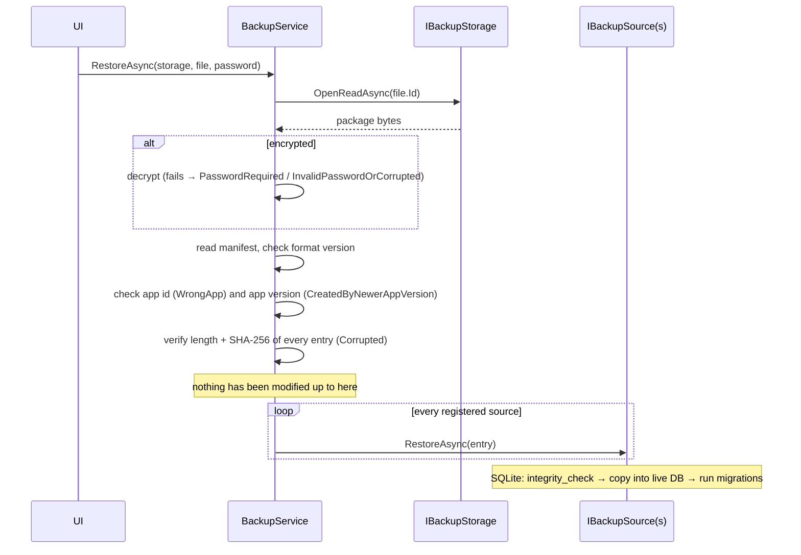

# Data and backup

Apps are **local-first**: all data is stored in a SQLite database on the device and the app works without network.
To make sure data is never lost, the app creates backup packages with optional password encryption that the
user keeps or shares. The libraries can also store them in cloud storage **owned by the user** (Google Drive or
OneDrive). In Zanance they are offered only in builds with configured OAuth clients, as an explicit choice of the
user, and local and cloud backups both offer optional password encryption (D-62 supersedes the mandatory cloud password in D-35).
The device remembers only the protection choice, defaulting to on; passwords are never saved. A password may be
reused, but encrypted backup creation requires entry and confirmation each time. Connected cloud account access
does not encrypt the portable file: anyone obtaining an unprotected package can read it.

First-run restore uses the same validation, preview, confirmation and safety-copy flow before any account is created.
Restored accounts complete onboarding without a duplicate account, preserving profile preferences. Empty backups
still need onboarding. Theme is device-wide and not restored from a package (D-62).

## Local database

| Topic | Rule |
|---|---|
| Engine | SQLite (Microsoft.Data.Sqlite) with EF Core 10 |
| Location | `FileSystem.AppDataDirectory/<app>.db` (private app storage) |
| Base class | `LocalDbContext` (Vafadar.Data) |
| Registration | `services.AddLocalDatabase<TContext>(path)` registers `IDbContextFactory<TContext>`, the auditing interceptor and the database as a backup source |
| Context lifetime | Short-lived contexts from `IDbContextFactory` (`await using var db = await factory.CreateDbContextAsync()`); there are no request scopes in a mobile app |
| Schema changes | Always through EF Core migrations; applied by `MigrateLocalDatabase<TContext>()` when the app creates its first window (`App.CreateWindow`), not while the app is built – Android builds it in `Application.onCreate`, also for a notification, with a time limit (D-46) |
| Identifiers | `Guid` version 7 (`Entity` base class): time-ordered, and unique across devices and restores – ready for sync |
| Audit fields | Entities implementing `IAuditableEntity` get `CreatedAt` / `UpdatedAt` (UTC) automatically |
| Moments in time | `DateTimeOffset`, stored as UTC ticks (`UtcTicksDateTimeOffsetConverter`) so SQL can filter and sort them |
| Calendar dates | `DateOnly` (stored as `yyyy-MM-dd` text, sortable) |
| Money | **`long` in minor units** (e.g. cents) plus a currency code. SQLite has no decimal type; EF stores `decimal` as text and cannot sum or compare it in SQL |
| Enums | Stored as integers; never renumber released values |

### Migrations

```powershell
# Add a migration (run from the repository root)
dotnet tool restore
dotnet ef migrations add <Name> --project src/Apps/Zanance/Vafadar.Zanance.Data

# Inspect the SQL a migration produces
dotnet ef migrations script --project src/Apps/Zanance/Vafadar.Zanance.Data

# After every model change: regenerate the compiled model the app loads at startup
dotnet ef dbcontext optimize --project src/Apps/Zanance/Vafadar.Zanance.Data `
    --startup-project src/Apps/Zanance/Vafadar.Zanance.Data `
    --output-dir CompiledModel --namespace Vafadar.Zanance.Data.CompiledModel
```

The `*.Data` projects contain an `IDesignTimeDbContextFactory`, so the EF tools do not need to start the MAUI app.

**Compiled model** (Zanance, D-44): building the EF model from `OnModelCreating` took about four seconds of every cold
start on an Android emulator. `Vafadar.Zanance.Data/CompiledModel` holds the generated model, which EF Core picks up
through its `DbContextModel` assembly attribute; the EF tools still build the model from code. A test
(`Compiled_model_matches_the_model_in_code`) fails when the compiled model is out of date. It is built on the calling
thread (`Microsoft.EntityFrameworkCore.Issue31751`): EF's default second thread hangs the app under Mono. At startup
`MigrateLocalDatabase` only runs `Migrate()` when the history lists a pending migration, because `Migrate()` also
compares the whole model with the migrations; the tests start from an empty database and keep that check.
Migrations must be backward compatible with existing user data: add columns with defaults, migrate data in the
migration, never drop user data silently.

## Backup design

### What a backup is

A backup is a single file, `pro.vafadar.zanance_20260925T143000Z.vbak`:

```text
┌────────────────────────── .vbak ───────────────────────────┐
│ optional encryption envelope (AES-256-GCM)                  │
│ ┌──────────────────── ZIP package ────────────────────────┐ │
│ │ manifest.json    format version, app id, app version,   │ │
│ │                  created at, device, entries + SHA-256  │ │
│ │ data/database.sqlite   consistent SQLite snapshot       │ │
│ │ data/<other source>    e.g. attachments (future)        │ │
│ └─────────────────────────────────────────────────────────┘ │
└─────────────────────────────────────────────────────────────┘
```

* **Sources** (`IBackupSource`) provide the content. `SqliteDatabaseBackupSource` uses SQLite's online backup API,
  which produces a consistent snapshot even while the app is writing (copying the file directly could capture a
  half-written state).
* **Storages** (`IBackupStorage`) only move files: `LocalFolderBackupStorage`, `GoogleDriveBackupStorage`,
  `OneDriveBackupStorage`. Adding another provider (e.g. Dropbox) means implementing four methods.
* **`BackupService`** orchestrates: create package → encrypt (optional) → upload → apply retention (keep the newest
  10 by default). Only one backup or restore runs at a time.

### Encryption

| Property | Value |
|---|---|
| Cipher | AES-256-GCM (authenticated: any modification is detected) |
| Key derivation | PBKDF2-HMAC-SHA256, 600,000 iterations, random 16-byte salt per backup |
| Header | `VBE1` · iterations · salt · nonce · tag, authenticated as associated data |
| Password normalization | Unicode NFC; Arabic Yeh/Kaf → Persian; Persian/Arabic-Indic digits → ASCII (the same password typed on different Persian keyboards works) |
| Password storage | **None.** A forgotten password cannot be recovered – the UI must say so clearly |

### Restore



* Everything is validated **before** any existing data is touched.
* A backup from an **older** app version is restored and then migrated to the current schema.
* A backup from a **newer** app version is refused ("update the app first"), because an older schema could lose data.
* Backups restore across platforms (Android ↔ iOS ↔ Windows): the app id is configured explicitly
  (`ZananceApp.AppId`), not taken from the platform package name.

### Storage providers compared

| | Google Drive | OneDrive |
|---|---|---|
| Location | Hidden `appDataFolder` | Visible `Apps/<app name>` folder |
| Permission (scope) | `drive.appdata` – only the app's own folder | `Files.ReadWrite.AppFolder` – only the app's own folder |
| User can see files | No (only storage used, under Drive → Settings → Manage apps) | Yes, and can download/delete them |
| Shared between apps | Per Google Cloud project (file names carry the app id, so apps can share a project) | Per Entra app registration (same) |
| Upload | Resumable upload (no practical size limit) | Simple upload (up to 250 MB) |
| Account | Any Google account | Personal Microsoft account and work/school accounts |

Both are free for the user within their existing quota and cost the developer nothing.

### Cloud backup in Zanance (D-35, D-50)

| Step | What happens |
|---|---|
| Offered | Only when the build has the OAuth client of the provider for that platform (`MicrosoftEntraClientId` for all; `GoogleOAuthClientIdAndroid`, `GoogleOAuthClientIdIos`, `GoogleOAuthClientIdWindows`). Both providers work on Android, iOS and Windows. A build without clients has no cloud section (and on Android no `INTERNET` permission) |
| Connect | The user taps *Connect*, reads where the backups go and that only the app folder is visible, then signs in with the provider's own screen ([authentication](authentication.md)) |
| Back up | *Back up now* follows the protection choice under *Create backup*: when on, enter and confirm a password; when off, upload a package without file encryption (D-62). Retention (`MaxBackupsToKeep`) applies in the cloud folder as well |
| Restore | *Show backups* lists the files; tapping one downloads it and runs the normal restore flow (password if encrypted, preview, safety copy, confirmation) |
| Disconnect | Signs out and removes the cached tokens (Google: the grant is revoked); backups stay in the user's account |

Backups are per local profile: each profile backs up its own database into its own **backup set**
(`BackupOptions.FileSet`, file names `{appId}~{profile}_{time}.vbak`; the main profile keeps the plain name). Listing,
retention and the last backup time count only the open profile's set, so one profile never prunes or shows another
profile's backups, locally or in the shared cloud folder. The cloud connection itself is shared by the profiles of a
device. There is no automatic cloud backup yet.

### Scheduling

* **Manual**: "Back up now" and "Restore" in each app's backup settings.
* **Automatic** (planned in `Vafadar.Maui.Backup`, not in Zanance yet): when the app starts or resumes and `IsAutomaticBackupDue()`
  (default: daily), a backup runs in the background to the storage the user configured. Later, Android WorkManager /
  iOS background tasks can run it while the app is closed.
* **Local export**: `CreatePackageAsync` produces the file so the user can share or save it anywhere (e-mail,
  USB, another cloud).

### Android system backup

Android's built-in Auto Backup (`android:allowBackup="true"`) additionally backs up app data to the user's Google
account and restores it on a new phone. It is kept enabled as an extra safety net (Zanance: owner decision D-16, including the financial data) and
disclosed in the privacy policy and the [privacy matrix](../privacy/privacy-matrix.md). iOS includes app data in
iCloud / computer backups by default.

### Limits and future work

* Packages are built in memory – fine for databases up to tens of megabytes. Streaming can be added if an app ever
  stores large media.
* Backup is not sync: restoring replaces the data on the device. Multi-device sync is discussed in
  [web-and-shared-data.md](web-and-shared-data.md).

## App access and screenshot preference (D-63)

Zanance stores a versioned PBKDF2-SHA256 app PIN verifier and durable attempt state in platform SecureStorage,
separately from all profile databases. No plain PIN is stored. The independent PIN gates the UI, pending links and
sensitive operations; it does not encrypt SQLite, attachments, safety copies or exports. The PIN and screenshot
choice are not in portable backups and restore does not overwrite this device gate. Android excludes SecureStorage
ciphertext from OS cloud backup/device transfer to avoid restoring ciphertext without its Keystore key. A restored
required marker without its verifier fails closed and requires device-authenticated recovery. Other OS-backup data
remains under the existing policy pending the commercial security decision. iOS keychain follows OS persistence
rules, including possible retention after uninstall; verify on a signed device before release.

D-65 plan/debt setup does not add database or portable-backup fields. Positive debt input maps to the existing
signed reference-date opening balance. A repayment reminder is an ordinary Schedule transfer with unknown principal
and automatic posting off until explicitly saved; it is not a ledger installment or an interest calculation.

## Restore discovery and portable display choices (D-67)

IBackupService.DiscoverBackupsAsync lists the current app id and its `~profile` file sets newest-first. It is used only
for user-facing restore discovery. ListBackupsAsync and retention stay current-set-specific; discovery never widens
a delete operation. Inspection still checks the package app id, version and checksums before replacement.

SettingsBackupSource backs up only LocalizationService.PortableKeys into display-settings.json. Null values clear
an explicit override on restore; arbitrary keys are ignored. Missing optional sources in older packages retain the
current settings. The app initializes localization on the UI thread after the restore completes. Device security
and authentication are never part of this source. No schema migration or compiled-model regeneration is needed.


## Proposed database encryption (SEC-01)

[ADR 0010](../adr/0010-database-encryption.md) is proposed for owner review. Independent proof code lives outside
application references under experiments/Zanance.Encryption. Main database connections and backups remain unchanged;
the existing unkeyed temporary snapshot/safety-copy paths must be redesigned before a production encryption claim.

## Goal contribution reminder persistence (D-70)

The existing ContributionPlan.ReminderEnabled opt-in is stored/replaced with its contribution plan and is already
part of database backup/restore; no schema change. Platform notification permission is not portable. The optional
planner evaluates current balance/funded earmark/held quantity and saved recurrence dates, then the device
coordinator groups, privacy-filters and replaces future requests. No contribution, transfer or ledger write occurs.
A reminder-only editor change clones the existing rule so calendar, anchor and ending are not rewritten.

## Period review reminder persistence (D-71)

Settings.ReviewReminderEnabled is profile-scoped and off by default. PeriodReviewReminder adds a non-null SQLite
INTEGER column with default false; compiled model is regenerated. The existing database backup captures the choice
and restore migration defaults old packages to off. Notification permission is device-local and is never imported.
Scheduling uses the review's display calendar, MonthStartDay and earliest account date; current ReviewProgress
suppresses completed periods. No ledger entry or review step is changed. Finishing uses UpdateSettingsAsync so
concurrent preference changes cannot be lost. Native requests share the bounded queue with other reminder types.

## Aggregate import linking (D-72)

Import overlaps require an explicit decision per aggregate, matched by account, kind, category and inclusive dates.
For an existing remainder only this import's accepted new details are subtracted; an incoming aggregate can cover
existing and new details. Repeated/present/consumed own-CSV ids count once. A detail cannot reduce two aggregates or
be assigned again by a later linked import. Foreign amounts, reimbursements, refund dependencies and plan/group
relationships require separate review; there is no guessed redistribution or automatic merge.

ImportAggregateLinks adds only ImportLinks (Id = batch id, versioned StateJson, audit times); regenerate the compiled
model after this additive migration. A linked import stores imported-row metadata, original/applied aggregates and
the exact covered details in a source-generated JSON journal. Explicit constructor binding preserves ledger ids in
trimmed builds. Journal writes, reductions/removals and accepted entries commit in one SQLite transaction. No new
file, credential, device-security preference or attachment-byte copy is created.

Undo is durable across restart and database backup/restore. Recheck applied aggregates and relevant details before
restoring originals and deleting batch entries. Later edits/dependent imports/refunds or missing identities reject
Undo without changes; dependent imports must be undone newest first. Ignore audit times in semantic comparison,
since a later successful Undo updates them. Full original creation times, identity, tags and other metadata survive.
Consumed aggregates keep their own-CSV ids and original import history through the journal. Orphan attachment cleanup
protects a consumed original aggregate while its Undo journal exists. Journals remain until that import is undone or
all profile data/the profile is deleted, and are included in database backups, not CSV exports. Ordinary imports
without aggregate changes use the existing batch mechanism. No production database-encryption policy changes.

## Large read snapshots (D-75)

GetEntriesAsync captures a short-lived DbContext for the current LocalDatabaseLocation before queuing one worker.
Microsoft.Data.Sqlite async I/O is synchronous (see the [provider documentation](https://learn.microsoft.com/dotnet/standard/data/sqlite/async)); the worker performs materialization so the caller's UI thread can continue.
The context is never queried concurrently and is disposed only after completion or cancellation. Capturing before
queueing prevents a later profile switch from redirecting the queued read. Writes, migrations, auditing and the
startup placement in App.CreateWindow remain unchanged. No model change or compiled-model regeneration is needed.

AccountEntryIndex is an in-memory routing index over an unchanged read snapshot, not persisted data or a copied
balance algorithm. Each endpoint receives the original transfer object once, in original order; LedgerCalculator
still applies opening-date, review, currency and overflow rules. Home, total balances and forecast starts use
those slices. Rebuild the index for a new ledger snapshot.

### Settings suggestion reads (D-106)

The three-complete-financial-month suggestion reads its exact inclusive date window through ZananceStore.GetEntriesAsync.
The existing entry-date index and captured off-UI SQLite context are retained. All entries within the window reach
the unchanged calculator; account/currency/plan/refund rules remain there. This is a read optimization only, with no
model/migration, archive/export/backup content or security change.

Repeat navigation (D-111) uses a detached in-memory EntryPlanDraft containing parsed minor units and original ISO
currencies. It never writes the ledger or a schedule; current accounts/currencies are rechecked before filling
Plan. Only explicit Plan Save stores its existing Schedule. The original transaction-only details remain on the
navigation stack; no new schema, migration or portable draft/backup data is introduced.

D-118 account writes capture commercial facts for the actual opened SQLite connection's file. When enabled after
approval, the owned writer transaction covers existing state, permission/count, SaveChanges and commit. Reject stale
or wrong-file snapshots and roll back failures before Changed. Provider capture uses cached state, with no network
or startup database work. Current registration is inactive; backup content/schema and all stored data are unchanged.
Read-only selection after imports/restores and the remaining ENT-02/03 boundaries are separate unfinished work.

D-119 extends the same actual-file write boundary to templates and saved filters. Quota/permission reads precede
new-row sort changes and confirmed duplicate removal; edits/replacements reuse existing slots. Failed replacement
rolls back the complete original query, and Changed follows commit. No schema, migration, backup content,
permission or SDK changes. Current test builds remain unrestricted; other ENT-02/03 boundaries are unfinished.

D-120 extends actual-file cached-access transactions to Goal Save, whole Plan batches and existing history splits.
Active/paused resources count; net slot growth and new paid tools are checked before write effects. Split/resume
uses the stored predecessor, preserves earlier rows and moves later links atomically. Failed relocation restores
all original metadata. No schema/migration, backup content, startup work, permission or SDK changes. Current
deployment remains unrestricted; contribution/allocation/occurrence and other ENT-02/03 paths remain unfinished.

D-121 extends actual-file cached-access transactions to current-period budget Save/confirmed Replace. Canonical
definitions ignore copied dates/calendars; existing updates count stored identity. Failed new limits restore the
complete prior budget/limits. No schema, migration, compiled model, backup format, permissions or paid portable data
change. Current registration is inactive. Explicit read-only selection/future activation remain unfinished:
[evidence](../../src/Apps/Zanance/docs/quality/budget-write-policy.md).

D-122 extends actual-file cached-access checks to holding writes. Existing transactions now cover full-history/id
validation, event/group/derived-price writes and access rechecks. Imports preserve owned data and Undo preserves
the complete group; neither revives paid facts. Explicit read-only classification remains ENT-03 work. No schema,
migration/compiled model, backup format, permission or SDK changes. Current registration is inactive:
[evidence](../../src/Apps/Zanance/docs/quality/holding-write-policy.md).

D-123 extends actual-file cached-access checks to earmarks, releases, contribution writes and goal deletion.
The whole editor saves goal, normalized Home pins and contribution draft in one writer transaction, including
inactive deployment. Preserve stored plan identity and complete rule/category metadata. Failures/access retirement
roll back all rows, with Changed only after commit. Contributions/earmarks never post money. No model/schema,
migration/compiled model, portable backup, permission or SDK changes. Explicit selected read-only/automation and
remaining ENT-02/03 paths stay open: [evidence](../../src/Apps/Zanance/docs/quality/goal-contribution-write-policy.md).

D-124 binds restore's actual context before asynchronous input and reuses it for native replacement/migration.
Cached optional callbacks check before native snapshot/replacement/output; no writer transaction wraps the SQLite
backup API. Zanance's specialized database source checks retained BackupRestore rights without quotas/paid facts,
preserving other registered sources. Import/Undo guard their existing actual-file writer and roll back journals on
SQL/access failure. No schema/migration/compiled-model, format, permission or SDK changes. Migration after native
replacement can still fail; preserve established safety-copy recovery and distinguish it from whole-package atomicity.
[Evidence](../../src/Apps/Zanance/docs/quality/recovery-write-policy.md).

D-125 brings category rules under cached exact-file rights and the actual writer before pattern matching.
New text/kind is automation; same-text/kind replacement and deletion preserve owned-data rights. Serialize
replacement even with deployment inactive; preserve existing-id CreatedAt and recheck after SQL before commit.
Failures restore the complete previous rule without Changed or ledger writes. No schema/migration/compiled model,
format, permission or SDK changes. Suggestion delivery and selected read-only classification remain open:
[evidence](../../src/Apps/Zanance/docs/quality/category-rule-write-policy.md).

D-126 acquires the actual ledger Save writer before reads, even with commercial deployment inactive.
Complete group classification includes untouched stored siblings and distinct holding/transfer groups. Validate
refunds against final batch state and edited purchases, widening exact minor units before totals. Entry, occurrence
paid-total and attachment ownership changes share commit/recheck/rollback with Changed only after commit.
No schema/migration/compiled model, portable format, permission or SDK changes. Delete/Undo and other commercial
paths remain unfinished: [evidence](../../src/Apps/Zanance/docs/quality/ledger-write-policy.md).

D-127 guards ledger Delete/Restore before reads under the actual writer, including inactive builds. The returned
in-memory deletion batch binds its original file and explicit stored refund relationships; no global mutable
refund map, guessed link or receipt-byte copy remains. Wrong-profile Undo refuses before writes. Missing entries,
refund links, occurrence states and paid totals commit together after cached recheck; failure retains retry data.
Receipts retain the existing orphan/startup-purge policy. This short offer is not a durable journal or portable
format change. Plain row enumerables restore rows without implicit refund links. No schema, SDK or permission
change: [evidence](../../src/Apps/Zanance/docs/quality/ledger-undo-write-policy.md).

D-128 binds the actual transaction notice to a guarded command. Failed Undo reports through existing native
feedback, retains the original deadline and makes no list refresh. Successful Undo followed by a failed refresh
does not reoffer the committed operation. Real application-command SQLite tests compare all 24 tables through
failure and retry; installed Release verifies the failure dialog with unchanged committed deletion and receipts.
No schema, migration, compiled model, SDK, permission or portable-format change:
[evidence](../../src/Apps/Zanance/docs/quality/transaction-undo-feedback.md).

D-129 makes the short committed deletion container independent of callers and EF retry mutations. Keep original
currencies and complete expected unlinked refund state only in that in-memory batch. Before restoring missing rows,
compare semantic/creation identities and account currencies under the existing writer; stale dependencies reject
the entire operation, preserving newer rows. Existing source-generated ledger metadata supports trimmed Release.
This is not a new durable journal or portable format. Receipt rows/bytes and the established purge policy remain.
No schema/migration/compiled-model/SDK/permission change: [evidence](../../src/Apps/Zanance/docs/quality/ledger-undo-conflicts.md).

## Scoped resource selection and retained bills (D-131)

CommercialWriteAccess holds an optional immutable value-equal account selection for its exact financial file/scope.
The actual SQLite writer evaluates original account states for new ledger work, including transfer destinations;
no preference/schema or backup field stores commercial selection or paid rights. Overdue correction classification
rereads the stored recurrence/slice/effective state and paid ledger. Advance settlement recomputes stored advances
and refunds and compares the reviewed plan/advance metadata and net paid total before the existing complete-batch
validator/writer commits. SQL or cached-access change rolls back with no Changed. Current registration stays inactive.

## Retained manual debt closure (D-132)

Selected-account enforcement classifies explicit Loan/Lent closure from the known current stored balance and
complete final batch under the actual SQLite writer. Exact payment/Fees effects extinguish the original principal;
edits/deletes/adjustments cannot manufacture it. New borrowing counterpart rights remain separate. Widen temporary
effect sums; keep stored money and the existing ledger calculator unchanged. No schema, backup or paid-data change;
current commercial registration remains inactive. See the app's quality/retained-debt-closing.md evidence.

## Atomic explicit occurrence links and correction writes (D-133)

PlanStore binds retained state corrections, repair and history-free deletion to CommercialWriteTransaction with
requireTransaction, exact-file cached membership, post-SQL freshness and Changed after commit. Explicit Link rereads
the stored rule/slice and entry relationships before updating markers and state within that writer. Complete SQL
or cached-access failure rolls back both. No extra ledger entry, changed actual monetary metadata or schema change.
New Settle/PayPart and generated-entry Unsettle still have separate boundaries; their atomic/automation follow-up
is not inferred from this slice. Current commercial registration remains inactive.

## Atomic new occurrence payments (D-134)

ZananceStore.SaveOccurrencePaymentAsync binds stored plan/rule/slice/state and actual linked partial money to
CommercialWriteTransaction before the shared private ledger save pipeline. Reuse Core effective occurrence
rules for classification; preserve explicit actual money/date. Save final state within the same transaction as
entries and partial paid totals. SQL failure or retired cached facts rolls back all writes before Changed.
Independent writers preserve one final settlement. Legacy repair remains for older interrupted data; no schema
or production-source activation. Generated-entry Unsettle and automation binding remain unfinished boundaries.

## Reopening the exact reviewed occurrence (D-135)

ZananceStore.ReopenOccurrenceAsync binds actual settled state/reviewed EntryId and actual entry markers to one
CommercialWriteTransaction. Generated payments reuse private DeleteEntriesUnderWriterAsync, preserving the
existing group/refund/receipt/paid-total/file-bound Undo rules and already atomic state reopening. Never reacquire
a second writer after Changed. Manual/imported money stays; ExecuteUpdate releases only the verified link with
the opened/suppressed state. Exact membership and post-SQL freshness apply, without selecting retained accounts.
No schema/activation change. Selected-plan automation and occurrence exception feedback remain unfinished.

## File-scoped pool retirement (D-137)

LocalDatabasePools.ClearFile normalizes the path and clears only the default and explicit ReadWriteCreate,
ReadWrite and ReadOnly connection strings used by the local factory/diagnostics. It does not enumerate arbitrary
variants. Their owners use SqliteConnection.ClearPool with their exact connection. MoveTo clears the previous
file; deleting an inactive profile clears its file before known sidecar/backup deletion. Restore instead clears
GetDbConnection on its captured context after CloseConnectionAsync and migrates that same context. Never use
ambient current location or ClearAllPools after asynchronous input. Actual authorization, integrity check, unpooled
snapshot handling and online backup remain unchanged. No schema or portable security-state change.

## Actual automatic occurrence writes (D-138)

PlanStore.TryPostAutomaticallyAsync uses ZananceStore.PostAutomaticOccurrenceAsync under CommercialWriteTransaction, rebuilding actual stored rule/state/accounts before SaveEntriesUnderWriterAsync. Actual linked partial/full entries override discovery assumptions; no new writer or post-commit state write. Posted/NeedsReview/NoLongerDue distinguish committed money, retained review and retired candidates. Enabled snapshots demand exact membership, selected original plan and AdvancedPlans; original states consume slots and choice never grants a capability. PlanSelection is immutable exact-scope cached input, never portable or persistent here. Current registration stays inactive. Generation/reminders, other selected bindings and selection persistence/UI remain unfinished. No model/migration change.

## Selected future plan work (D-139)

PlanStore.GetWorkSnapshotAsync captures the actual SQLite file's cached access, demands retained History, reads
complete original schedules/states and checks retirement before publishing PlanWorkSnapshot. PlanWorkPolicy owns
only private identity sets; it never changes financial objects or filters calculation inputs. Dated ended slices
follow only unique non-overlapping continuations. A selected resource grants no feature/membership/host right.
New generic/full/partial occurrence money checks original markers and selected/advanced plan work under the same
writer as account checks and ledger validation. Effective past-due reviewed payments keep D-131 rights. No schema,
compiled-model, portable preference, SDK, permission or commercial activation change. Actual reminder/snooze delivery
and choice persistence/UI remain open. [Evidence](../../src/Apps/Zanance/docs/quality/selected-plan-occurrences.md).

D-139 also applies D-82 navigation retirement to profile/onboarding root replacement, before old native handlers
are detached. Keep current forms, deferred display rebuilds and the startup lock cover unchanged.

## Scoped Plan notification work (D-140)

PlanWorkSnapshot retains the actual captured file and cached-rights guard inside Data, exposing only a local SHA256
notification identity. Validate before native effects and after native await; a retired publication cancels its
pending queue. Missing membership cancels pending delivery. Filter before planner/group caps; calculations continue
using complete originals. Versioned bounded links carry exact original members through native ReturningData.
Rebuild snoozes from fresh rows/rights/privacy, resolving an original date directly even after a move beyond the
range window. Legacy unscoped caches do not establish group or profile ownership. No database migration or portable
preference addition; selection persistence/activation and remaining resource bindings are still separate work.

## Durable financial selections (D-141)

Persist explicit account and plan choices in one additive profile-local ResourceSelections table, keyed by
resource kind and the verified financial scope kind/id. A fresh revision rejects stale and ABA drafts. Reviewed Save
rechecks actual file, membership/rights, original identities/names/states, row revision and capacity under the same
SQLite writer; no-op saves preserve revision and publish no Changed. Never archive/end or erase financial data to
represent read-only availability. Stored choices override cached fallback selections, never verified capabilities.

New account/unarchive and Plan creation join an existing bounded choice atomically when capacity remains. Explicit
archive/ending releases only its own chosen identity; a validated split transfers only the actual selected
predecessor slot. Pauses still count. Current work/reminder snapshots capture the stored revision and retire pending
publication after a change; choices trigger the existing reminder refresh. Retained corrections remain possible even
with malformed choice input, which grants no bounded new work until explicit reviewed repair.

Commercial registration remains inactive: no guessed main-profile identity, fake paid facts, new limits or purchase
activation. Inactive/unlimited loading writes nothing and requires no bounded choice. Choices are financial-profile
preference data in the normal database backup, not security, entitlement or credential facts; restore does not retag
a foreign financial scope. The chooser UI, remaining resource bindings and external/release gates remain open.

The additive AddResourceSelections migration creates only its composite-key choice table; all first-schema rows
and old history remain. Regenerate the compiled model after every model change. Whole-row comparison now covers
25 tables, including ResourceSelections. Historical D-140 24-table evidence remains revision-specific.

## Choice-form review metadata (D-142)

ResourceChoiceItem additionally retains account type/currency and Plan entry kind for the actual displayed identity.
Reviewed Save rechecks these original display facts under the same writer; changing one retires the old review.
These are projected existing columns, not new entities/columns or portable entitlement facts. No migration or compiled
model regeneration is needed here. The form writes only the D-141 choice row explicitly and never posts financial
entries or rewrites original states. Current registration remains inactive. [Evidence](../../src/Apps/Zanance/docs/quality/active-item-chooser.md).

## Goal selection writer (D-143)

ResourceSelections also uses the existing Goals quota key; no model/schema change or new migration/compiled model.
ResourceChoiceItem projects goal kind/currency from existing columns for optimistic review. Stored choices override
cached fallback under the actual file's SQLite writer. New/reopened goals join chosen slots atomically; completion,
archive/delete removes only their id. Invalid choices need explicit repair while corrections/releases stay possible.
Positive earmarks independently check feature and usable original goal/account choices; never ledger balances.
Release registration remains inactive. [Evidence](../../src/Apps/Zanance/docs/quality/goal-resource-choices.md).

## Goal work snapshot and native routing (D-145)

Read complete original goals, saved contribution rules and allocations from the actual opened database, with
new-work eligibility kept separate from original financial progress. Selection never changes funding/protection,
resumes a paused goal or grants a paid tool. Free balance-goal activity, advanced goal work and contribution reminders
are independent rights. Missing, empty, malformed, foreign and historical choices keep their original data.

New paid contribution work checks the actual chosen goal under the same SQLite writer. A paired new goal can join
its slot before that check; reject failed activity before pin/protection normalization. Retained amount corrections,
reminder disabling/removal and negative earmark releases stay available. These operations never post ledger money.

Prepare goal reminders only for eligible original progress before the pending cap. Keep saved opt-in, generic/details
privacy, fixed 09:00 device-local rule dates, existing permission and the shared bounded queue. Native returning data
contains bounded original goal/date members and an opaque actual-file identity. Taps resolve that file after unlocking,
open the existing single detail or Goals root, and never switch profiles or grant new work. Retained history remains
readable after a choice change. Existing legacy historical links remain supported.

Validate actual file, cached rights, persisted choice revision and original goal/rule/allocation input stamp before
and after native publication; clear a retired queue, including failed snapshot preparation. The stamp is transient,
invariant and reflection-free, not a new schema, portable preference or credential. Current commercial registration
remains inactive and unrestricted. Goal-view contribution affordances and other remaining bindings follow separately.

No EF model/schema change; no migration or compiled-model regeneration is required.

[Evidence](../../src/Apps/Zanance/docs/quality/goal-work-reminders.md).

## Reviewed goal-view writes (D-146)

Each actual detail command passes its captured GoalWorkSnapshot to the original store. The same SQLite writer rechecks file/rights/choice, all original goal/rule/allocation metadata (including equal-time note/pin changes) and account/holding units/availability before mutation. Stable identity comes from the actual factory-bound connection setting, since native SQLite DataSource resolution can differ between auto-closed reads and open writers. Another configured profile file is still rejected. Legacy callers keep their existing boundary; no model/schema change occurs. Native color/query partials are excluded from actual-source application tests. Complete original calculation inputs are never filtered by the new-work projection.

[Evidence](../../src/Apps/Zanance/docs/quality/goal-work-views.md).

## Reviewed paired goal and explicit budget writers (D-147)

Keep the original goal identity/state, archived references, hidden contribution method, complete saved recurrence
rule/end/calendar/holiday choices, all unchanged spending-cut categories and the retained price assumption. Metadata-only
corrections never create a contribution plan for a legacy goal without one. A new draft saves its explicit named monthly
anchor. Show the actual rule/end/next dates and original method even in Simple mode; multiple saved categories remain
explicit rather than silently becoming the first category.

Construction performs no database read. Cover complete initial/retry publication; preserve explicit dirty fields and their
numeric parse culture/unit. Live captions never replace selections or reinterpret raw input. Changed currency/measurement
facts require actual reentry. Explicit reload merges only dirty fields into fresh original values, displays the current
saved target/rule/note and requires the review action when original inputs changed. It never silently accepts an overwrite.
Shell's empty native modal-attachment query retains an already opened identity; another explicit identity is rejected.

Separate original corrections from new paid contribution/reminder configuration. Paused selected paid configuration stays
paused and never prompts or delivers a reminder. Retained corrections/disabling remain available. Production commercial
registration is still inactive and unrestricted. No choice, display change, opening, permission or navigation posts money.

The paired writer rechecks the captured actual file/rights/choice and complete goal/rule/allocation/reference stamps before
mutation. Clone the complete original goal; never mutate it before a successful write. A successful save retires the draft
before returning, so navigation failure cannot resubmit it. One busy guard spans consent, permission, write and navigation.
An explicit holding/quote-reference change confirms clearing only the previous assumed price; cancellation keeps the draft.

Apply to budget remains a separate explicit confirmation. Its original monthly category limit, full budget metadata/all
limits, financial period/day and category wording are rechecked inside the actual SQLite writer. Change only the confirmed
category limit, never a goal, contribution, allocation, account or ledger entry. Concurrent equal-time edits and duplicate
commands are rejected; unrelated name/display changes do not reenable the same already applied cut.

Canonical Build-AndroidApk.ps1 produces artifacts/android/zanance-d147-release.apk, package pro.vafadar.zanance,
nondebuggable Release, intact ZIP, full ARM64/x64 assembly stores and application AOT, verified v2/v3 signature with
the existing local test certificate. Bytes: 81491883. SHA-256: `d3aa44afc6f55aae1ea3b4a0fe82700c5120ad196343afcd7cdcfbdf0d6879aa`.
No schema/model/migration, portable preference, security policy, credential, SDK, paid grant or permission change.

Evidence: `src/Apps/Zanance/docs/quality/goal-editor-work.md`.

## Canonical budget choices (D-148)

BudgetDefinitions uses the existing exact-scope ResourceSelections row with a canonical definition encoding,
not hashed row ids. Each value contains currency, period kind and sorted original account identities; no dates,
paid or membership facts. BudgetChoiceStore captures complete original period/limit metadata and date/month-start
plus actual file/access/revision; Save rechecks under the SQLite writer. New budget changes transfer only the last
retired definition's chosen slot; deletion and SQL rollback include choice changes. Current registration stays
inactive. No EF property/schema/compiled-model or backup format change; restored scopes are never guessed/retagged.

## Reviewed budget display grouping (D-149)

The native row relays one real original period id to a captured definition, never stores a Guid hash or display
caption. CanonicalIdentity supplies scope-independent grouping only; persistence requires the captured verified
scope/file. Original reference account metadata joins the immutable read/publication/writer-time comparison,
including equal-time changes. No schema/model or backup-format change; production registration remains inactive.

## Guarded original budget alert batches (D-150)

The actual ZananceStore access source supplies a full BudgetChoiceSnapshot and separate current work rights.
Immutable alert candidates retain original monetary calculations; bounded complete original account/category/
ledger inputs and privacy are rechecked before/after native effects. Shared original carry follows canonical
account definition as well as period/currency/calendar. Device levels commit only after final batch validation;
failed batches remove exact attempted native ids. No schema/model or backup-format changes.

## Original budget notification identity (D-151)

Actual-file budget snapshot identity is a device-local digest, independent of stored entitlement scope and portable data. Typed original Guid resolution requires the current actual file and History rights after unlock and at page load. It never grants new work or changes money/preferences. See Zanance docs/quality/budget-reminder-routing.md.

## Paired budget form reviews (D-152)

BudgetEditorReview captures immutable original periods/limits and complete original accounts/categories/preferences, including the distinct absent Settings state. Reader publication and Save/Replace/Delete use the same complete validation overload; reviewed writes acquire the actual SQLite writer before checking. Caller mutation, changed references/preferences/limits/date/file/access/choice revision/value retire the review. BudgetEditPolicy is the shared correction/new-tool feature rule; it grants neither capacity nor membership. A detached Budget(Guid) constructor retains original identity without adding EF properties or schema. No migration, compiled-model, portable backup or credential change is introduced. Original budget navigation hands id plus opaque actual-file scope to the editor.

D-153: budget view actions reuse the complete BudgetEditorReview and paired writer overloads. Immutable displayed
source/replacement packets reject concurrent/retired data through confirmation. No schema, compiled-model, backup
format, security or credential change; inactive registration remains unchanged.


D-154: QuickResourceReview pairs complete original templates/queries/references/raw nullable preferences and
optional source entry with both resource choices. ResourceChoiceStore checks canonical value/revision and full
resource JSON packets. Actual reviewed Save/Delete writers serialize slot creation, confirmed replacement and
choice release in the same transaction; malformed values remain for explicit repair. No EF property/schema
changes are made. Saved queries grant only history; account/ledger writers still own new money.

## Original Home template destinations (D-155)

TemplateVisit holds the original reviewed actual-file/full packet only in memory. Data creation/resolution validates file/access/choices and complete original resources/references; the actual destination also validates its own publication. A same-id row in another file or a changed packet never replaces the original request. No EF property/schema/migration or portable preference/grant is added. Home reads the legacy layout fallback without creating Settings; only explicit customization writes it.

## Reviewed original device profile catalogue (D-156)

ProfileService reads the legacy original list/name until first explicit mutation, then reads the single
`profiles.work.catalogue` packet from device preferences. Format 1 has eight fields: version, nullable Base64
main name/list, encoded catalogue path, device scope, encoded exact original chosen ids, catalogue revision and
choice revision. The original main id stays empty; `~` is only its encoded choice sentinel. Full raw packet,
legacy values, current id/file and cached access are retained in an immutable review. Synchronous per-main-file
gates serialize reviewed catalogue mutations across service instances. One Set publishes catalogue/choice;
it is not a cross-process or physical power-loss guarantee. Original startup/backup-set readers use the same
packet. Malformed choice data requires explicit repair without erasing original catalogue metadata.
Separate choice revision prevents rename from repairing an invalid choice implicitly. Authentication success
alone is not a committed switch: recheck complete facts, commit current id, otherwise restore previous path.
No EF/schema/compiled model or portable backup change. Actual per-file financial policy binding remains open.

## Actual-file original profile work composition (D-157)

`DecorateZananceCommercialAccess` retains the existing unkeyed singleton source behind a private DI key and
preserves externally owned instance versus container-owned factory/type lifetime. `ProfileCommercialAccessSource`
depends on that original port, existing device preferences, cached device facts and the stable main path; it never
depends on ProfileService or opens a database. Current inactive capture returns before any catalogue/device read.
An enabled personal capture requires matching independent verified tiers and actual paths. Shared membership is
unchanged. The exact original catalogue file mapping, not the current preference, supplies activity eligibility.

`PersonalProfileWork` stores nullable original identity (null unknown, empty actual main), independent new-work
eligibility/review need and a complete length-prefixed nullable-field SHA-256 review stamp in CapabilityContext.
Existing CommercialFileAccess equality and paired-writer/snapshot guards retire that context on catalogue,
legacy metadata, choice revision/value or device-provider changes. Financial scope and all resource choices
remain the verified original values. New work uses PlanPolicy; complete financial history and calculations never
filter by profile availability. Separately verified backup/restore/correction rights survive malformed catalogue
metadata without repairing it or guessing an identity. No EF/schema/compiled-model or portable-format change.
Remaining operation/import/native acceptance and production activation are separate.

## Original catalogue reminder publication (D-158)

The actual app passes ProfileService through IProfileCatalogueChanges to ReminderService after construction.
One lifetime owns financial/resource/catalogue/native-action subscriptions. Coalesced delay uses TimeProvider;
PendingRefresh is the actual task including final native/database guards. Async disposal drains it before an
independent owned database is removed. No database/provider read occurs merely to subscribe.

PlanWorkSnapshot projects period-review permission from its captured original context. Revalidation uses the
same actual path/access, complete immutable preference packet and a nullable first-account-date scalar query;
missing Settings remains missing. Original live display and local day retire stale batches. Every SDK Show result
is accepted explicitly. Partial pending batches are withdrawn and existing delivered requests remain separate.
Snooze preferences commit after native acceptance and complete current-input checks. No EF/compiled model or
portable schema change. Broader original Plan/Goal financial-input retirement remains a following slice.

## Coherent original reminder financial inputs (D-159)

Plan/Goal snapshots retain full original packets and raw resource choices. ReminderFinancialSnapshot reads
complete original accounts and only the needed dated ledger/quantity data in a deferred SQLite transaction.
The same reader validates original rules, financial packets, preferences and first-data date before/after
native publication. Native preparation alone rejects modified in-memory packets; existing explicit reviewed
Goal draft writers remain unchanged. No model/migration or portable format change.
See `src/Apps/Zanance/docs/quality/reminder-input-work.md`.

## Original write feedback and file-local transient names (D-160)

The presentation layer translates CommercialWriteRejectedException without reimplementing financial or
commercial authorization. Original atomic writers still decide and revalidate scope/capacity. Keep saved-return
failures distinct from pre-write rejection. Quick-resource name drafts compare original file identity inside
Data; they never become preferences or financial rights. No schema/model/migration or portable format change.
See `src/Apps/Zanance/docs/quality/commercial-feedback.md`.

Original file guards use the actual connection configuration; Android open-connection aliases cannot
retire the same file. DatabaseFileIdentity preserves exact foreign-file rejection without new I/O or grants.

## Captured pre-Save readiness (D-161)

Core WorkRestriction is a captured explanation, not authorization. GoalWorkPolicy preserves its original
rights/selected counts; Data retains malformed bounded choices explicitly. BudgetChoiceSnapshot.CanSave
delegates to its original net-definition SaveRestriction computation. Presentation translates those facts
without another quota algorithm; atomic writers still revalidate actual-file rights. No model/schema change.
See `src/Apps/Zanance/docs/quality/pre-save-readiness.md`.

## Read-only original access presentation (D-162)

CommercialAccessStore obtains DatabaseFileIdentity.ConfiguredPath without opening SQLite or creating rows.
Its original cached CommercialFileAccess packet is checked at read/publication, including activation changes.
Comparison uses pure Core policy with an independent fictitious scope that never reaches a real writer/provider.
Captured tier does not establish purchase/cadence/renewal/role facts. No schema/model/migration or portable change.
See `src/Apps/Zanance/docs/quality/product-plan-comparison.md`.

## Original editor copies and committed publication (D-163)

Entity edit-copy methods preserve original fields/IDs; Schedule clones the existing mutable rule. No EF
property/model metadata or schema changes. Actual Account/Plan commit precedes original notification; its
typed failure carries accepted-write semantics without hiding the subscriber error or retrying. Application
flows use original native ports and actual writers.
See `src/Apps/Zanance/docs/quality/editor-write-feedback.md`.

## Reviewed atomic original archive (D-164)

A deferred reader captures original account/related plans; a required actual writer rechecks full packets,
file, day and cached access before the shared Account/Plan policies. State, Plans, exact default and choices
commit together with no settings creation, ledger money or schema change. Original stores publish after
commit; typed failure retains the accepted outcome.
See `src/Apps/Zanance/docs/quality/account-archive.md`.

## Original editor readiness reader (D-165)

Account and Plan forms now explain original feature/capacity/selection decisions before an attempted
Save. The read-only review uses each original writer's actual configured file and cached access. Active
reads capture complete original rows and persisted choices in a deferred SQLite reader; inactive test
access performs no financial-row/choice read or paid activation. A missing persisted choice counts all
original eligible rows, matching the writer instead of a cached fallback subset. Original correction,
retained advanced-rule and historical net-slot behavior stays available.

The original advanced Plan classification is shared through Core PlanEditPolicy. Save and readiness build
the same detached candidate; readiness does not parse money, validate financial input, mutate original
state or grant a write. Explicit Refresh access keeps every raw amount/date/note/reminder/selection.
A failed or retired read disables Save with translated feedback; an actual writer rejection still retains
the draft and requires explicit fresh review. Atomic writers remain the final authority. No EF property,
schema/migration, permission, SDK/network, credential or portable-format change. Test limits stay inactive.

## Original committed data-file outcomes (D-166)

Original ledger import, holdings import and durable Undo now retain the original accepted result across
post-commit change-subscriber failure. A typed completed notification carries the exact counts/batch or
Undo result; original atomic writers, metadata, overlap rechecks, rights and rollback stay unchanged.
The application retires the accepted reviewed payload before any history/failure follow-through and
removes an accepted Undo row before fallible reload. A retained old command cannot repeat that batch.
A complete history read publishes only after success, preserving other original rows on failure.

Structured pre-write rejection is shown beside the retained preview in all six languages. Successful
follow-through failures state the completed outcome instead of pretending it rolled back. Picker
cancellation keeps the existing file/preview/choices. One busy lifetime spans Undo consent/write and
export authentication; explicit fresh review retires failed original evidence without silently saving.
Picker, existing app-lock confirmation and UTF-8 BOM cache/share effects are native adapters. Actual
non-UI application sources are compiled and tested through explicit ports, never stand-in MAUI controls.
Pinned complete feedback/review/import actions reserve a growing row outside the viewport. Original
history identity and growing Undo action have separate rows. No new feature policy, paid activation,
schema/model/migration, SDK/permission/network, credentials or portable-format change.

## Restore completion checkpoint (D-167)

BackupRestoreSession records all original sources returning before native display/onboarding/lock/work/
root effects. Retire accepted input immediately; completion retry does not enter safety/primary restore.
Later-source BackupException can follow a committed earlier source: uncertain replacement requires fresh
inspection/consent, not an invented rollback claim. Native effects use IBackupRestoreRuntime; original
source/safety/automatic-post/security policy stays authoritative. No model or portable-format change.
See [evidence](../../src/Apps/Zanance/docs/quality/restore-outcomes.md).

## Coherent forecast work and immutable snapshots (D-169)

ForecastWorkStore uses a deferred original SQLite reader with unsaved Settings defaults and captured
actual-file access. Snapshot batches use CommercialWriteTransaction; accepted notification outcomes
carry exact ids. ForecastWorkspace retires accepted drafts before fallible follow-through. New scopes
contain only the saved currency; SnapshotComparer excludes foreign accounts in legacy scopes without
mutating stored metadata. No migration or portable format change.
See [evidence](../../src/Apps/Zanance/docs/quality/forecast-work.md).

## Original receipt read reviews (D-170)

ReceiptWorkStore captures actual-file cached access and existing expense/attachment in a deferred
reader. Complete entry JSON and metadata/content fingerprint reject same-timestamp mutation. Recheck
current factory file/access before publication and before typed EntryEditor application. Neither the
review nor bounded recognition original is portable; saved compact attachment policy is unchanged.
No writer, migration or monetary/parser algorithm is added. [Evidence](../../src/Apps/Zanance/docs/quality/receipt-work.md).

## Original loan financial review and writer (D-171)

LoanWorkStore uses a coherent deferred reader with nullable original Settings and complete financial
packets. SaveLoanInstallmentAsync revalidates and computes the original installment inside the existing
CommercialWriteTransaction/SaveEntriesUnderWriterAsync. Recheck after inserts excluding only exact own
new ids; reject trigger/input retirement. Only this writer uses typed committed SaveResult, preserving
ordinary ledger notification semantics. No schema or portable format change.
[Evidence](../../src/Apps/Zanance/docs/quality/loan-work.md).

## Original report snapshots and portable PDF (D-172)

ReportWorkStore uses one deferred SQLite reader and complete original inputs, immutable packet/day
and cached actual-file access. It does not create Settings or filter financial facts by quota activity.
Original carry and goal progress reuse existing calculators. Original contribution Save optionally
validates this packet before/after the same writer transaction, excluding only its accepted rule.
ReportExportSession holds native consent/render/cache/share and rejects retired file/data/scope;
the detached original projection never mutates the live page. Basic balances and per-account currency
remain portable data, separate from paid wealth analysis. No schema or key/provider policy is added.

## SQLCipher portable boundary preparation (D-186)

Memory-only export/read-only import/encrypted staging primitives are implemented independently;
current backup composition is unchanged. See [portable boundary](sqlcipher-portable-snapshot.md).
Do not activate without per-profile keys, access and crash-safe verification/commit/recovery.

## Generation protocol model (D-188)

[Explicit checkpoints](sqlcipher-generation-checkpoints.md) bind ordered selection to one profile
and two distinct generations. This model does not persist keys/files, change app composition or
certify crash durability. Actual coordinator/restart/recovery acceptance remains required.

## Resumable generation coordination (D-189)

DatabaseGenerationMigration and IDatabaseGenerationMigrationSession coordinate the captured
writer lease, idempotent native effects and stored readback. Native key/selector/cleanup adapters
are still required; existing application and portable backup composition are unchanged.
See [protocol and remaining durability obligations](sqlcipher-generation-checkpoints.md).

## Accepted encryption recovery policy (D-192)

Automatic local profile keys, optional separate recovery and Zanance backup recovery are approved.
Android/iOS sensitive data leave OS backup/transfer with completed encryption integration, not an
interim measure. Portable password choice remains optional. See [device keys](sqlcipher-device-keys.md).

## Android key primitive (D-193)

Original Android Keystore adapter authenticates bound DEKs and refuses missing keys without
replacement. Separate Release process proof passes; no main activation or schema change.
See [device keys](sqlcipher-device-keys.md) for exact envelope/access/lifetime/evidence scope.
Durable storage, migration/recovery and approved final OS backup policy still require integration.

## Android opaque envelope persistence (D-194)

Original private-file key store creates exclusively and flushes file/directory; bounded
no-follow reads authenticate original binding. This is not a live selector or backup conversion.
[Device-key guide](sqlcipher-device-keys.md) records process proof and remaining crash/recovery gates.
