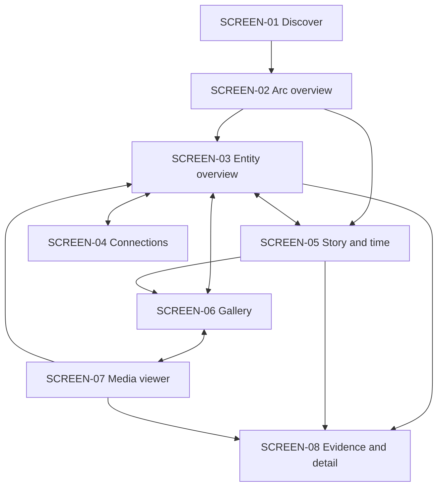

# 18 — Discovery Flows and Design Brief

**Product:** Dastan  
**Version:** 0.6  
**Date:** 2026-11-15  
**Status:** Screen/flow implementation contract for the bounded M0 slice; detailed layout remains proposed  
**Validation status:** Prospective tasks and pass conditions; no user tests or product implementation are claimed

## 1. Purpose, authority, and bounded scope

**Accepted:** The user selected the name **Dastan**. The primary audience is the curious general public. A concise first impression, meaningful visual views, connected stories, and contextual images and videos support exploration. The common identity, time, evidence, access, and media rules remain applicable. Documentation is English; interface-language choices are separate.

**Provisional flagship:** A bounded Rostam and Sohrab arc from the Shahnameh. The selected edition, actual source-backed records, narrative positions, and usable media belong to [document 17](17-flagship-content-and-source-plan.md). This brief does not assign historical dates or assert story facts that the content sample has not established. A family connection may itself be a spoiler and must not be assumed visible merely because the graph can express it.

[The release PRD](16-discovery-pilot-prd.md) is authoritative for the release boundary. This document specifies six main exploration flows and eight screen contracts for the runnable M0 slice and subsequent R0 pilot. [Document 20](20-implementation-plan.md) owns the finite coding work order. Several contracts may share a page, panel or responsive component; eight contracts do not require eight independent applications or layout systems. It does not select a final layout, palette, logo, rendering library, backend, or production schema. Dastan is the selected name; domain availability and legal naming clearance have not been verified.

The main visitor journey remains small: discover an arc, understand a subject, follow a connection, change the view, open relevant media, and optionally inspect context or a source. Authoring, moderation, account administration, a general social feed, and large-scale catalogue management stay outside the main screen sequence. Synthetic cross-domain checks exercise reuse without adding separate company, sport, or private-family launch sections.

## 2. Shared navigation and context contract

Every relevant view uses a consistent context: collection or arc, focused entity, selected world and edition, reading position, applicable period or ordering frame, active relationship filters, gallery inclusion/time basis, and a return path. Preserve compatible values when switching views. Explain an incompatible value rather than silently substituting one.

Current publication and access permission are evaluated independently of saved context. A history entry, gallery link, or previously viewed screen never restores revoked permission. If the user lowers a spoiler boundary, returning to an earlier view reapplies the current boundary rather than restoring cached revealing text.

The following diagram records navigation relationships, not a chosen page layout. The evidence sheet is an overlay or contextual destination whose close/back action returns to its origin. Spoiler and edition controls are available context controls rather than a ninth mandatory page.

## 3. Main discovery flows

### FLOW-01 — Themed entry, essential overview, and a next thread

**Intent:** “This looks interesting; help me understand it and find something connected.”

Enter through a curated arc card, a permitted image, or a public link. SCREEN-02 identifies the work and selected arc, offers a brief introduction and a useful starting position, and exposes a small set of meaningful subjects. Select one to open SCREEN-03. The entity overview shows a concise identity, context, and a few essential facts, then a labeled connection such as participation in a recorded event or appearance in the selected story.

Following the connection updates the focus and records the route back. Explain why the next subject is relevant. Do not require a search query, account, complete article, or source checklist before this route becomes useful. A material uncertainty or edition qualification stays visible in the short presentation.

**Completion:** The visitor can identify the subject, explain one connection, and return to the previous focus. Related requirements: `R-EXP-01`, `R-EXP-02`, `R-EXP-04`, `R-EXP-06`, `R-PUB-06`.

### FLOW-02 — Explore connections or a family/lineage view

**Intent:** “Who is connected to this subject, and what does the connection mean?”

Open SCREEN-04 from an entity. Start with a small, meaningful neighborhood. Choose a relationship list, focused graph, or family/lineage specialization where the available data supports it. The latter is appropriate for story genealogy and later personal-family use; it is not a universal layout for companies or teams.

Select a labeled edge to read a short explanation and, optionally, its supporting source. Expand a chosen participant or change the relationship filter without loading an overwhelming full graph. Keep direction, role, time, and narrative context when they affect meaning. Filter the graph before layout so hidden nodes do not survive as revealing gaps, shapes, counts, or degree changes.

**Completion:** The visitor distinguishes the relationship type and reaches another permitted entity without inferring friendship, causation, or identity from proximity. A spoiler-sensitive family relationship appears only when the selected content boundary permits it. Related requirements: `R-DOM-04`, `R-PER-01`, `R-PER-02`, `R-STORY-04`, `R-EXP-03`.

### FLOW-03 — Follow story order or inspect a temporal view

**Intent:** “What happens around this point, and how do the paths connect?”

Open SCREEN-05 from the arc or an entity. For the provisional flagship, the initial ordering is the content sample's identified narrative order. A step, chapter, or appearance lane is not a calendar year, lifespan, or continuous presence claim. Event associations distinguish actors who are present, people only mentioned, settings and objects. Display their recorded role/presence rather than treating every association as attendance.

Offer another supported mode, such as an event sequence or participant lanes, with a clear label. An in-world chronology is available only to the extent the source-backed sample establishes it. If only partial ordering is known, keep that limitation. A calendar mode requires a valid mapping and must not manufacture BCE dates. Select a recorded event to open its participants, context, or media; returning restores the position and visible lanes.

**Completion:** The visitor can explain what the axis or sequence means and distinguish a story-position span from elapsed time. Related requirements: `R-TIME-02`, `R-TIME-06`, `R-STORY-03`, `R-PUB-05`, `R-EXP-03`, `R-EXP-05`.

### FLOW-04 — Contextual gallery, media viewer, connected entity, and back

**Intent:** “Show me images or videos related to this, and let me follow their story.”

Open SCREEN-06 from an entity, event, story position, or supported period context. State the gallery's basis, such as media about this arc or created during a selected period. Open an item in SCREEN-07, actually view the image or play the available video, read its short contextual caption, then follow a permitted link to a depicted subject, creator, place, or event. Back restores the gallery's selection, ordering, and useful position.

Keep capture or creation time separate from depicted time and publication/share time. A modern illustration of an older story must be labeled as such. At the sample's default introductory reading boundary, the level-2 original illustration and video remain hidden, including their posters and captions; show a useful permitted-empty state. Explicit advancement enables their viewing exercise. Missing licensed media produces an honest unavailable or placeholder state, not an invented archival image. A placeholder describes a planned interaction and is not counted as a sourced media item.

For the later personal capability, the same route can start from recent authorized shares. Its ordering uses share activity rather than the old asset's capture date. All routes respect the current asset and contextual-association permissions.

**Completion:** The visitor understands why the item belongs, follows a correct link, and returns without losing context. Related requirements: `R-MED-01` through `R-MED-08`, `R-EXP-05`.

### FLOW-05 — Optional context, source, or alternative account

**Intent:** “Tell me a little more, or show what supports this detail.”

From an entity, selected relationship, event, or media item, open SCREEN-08. Identify the specific statement or caption being explained, then expose the selected edition, source locator, relevant uncertainty, and any competing account needed to understand it. A source link and an editorial explanation are distinguishable.

The short overview and expanded detail must agree. The visitor can close the sheet without resetting the graph, reading position, gallery, or media context. External references should be clearly identified; warn before opening a full-story source when it would exceed the current reading boundary. The blueprint does not promise that an unavailable external source can be opened or that external pages obey Dastan's spoiler controls. Detailed editorial actions remain outside this casual-reading flow.

**Completion:** The visitor can identify the basis for a selected fact and return to exploration. Inspecting evidence remains optional; important qualifications are not hidden until this step. Related requirements: `R-GOV-01`, `R-DOM-08`, `R-EXP-02`, `R-PUB-07`.

### FLOW-06 — Change reading position, spoiler visibility, or edition

**Intent:** “Show what I can safely explore at this point in the story.”

Use the shared context control from an applicable view. Select a reading boundary or explicitly choose full-story visibility. Explain the effect in general terms without revealing a later event in the control itself. Recompute the visible overview, graph, sequence, gallery, suggestions, captions, and counts using the new boundary.

A lower boundary removes previously visible future details from restored views as well. A different edition retains the reading position only where a valid mapping exists. Otherwise ask the visitor to choose an appropriate position or present a clearly explained starting context; do not equate chapter numbers from unrelated versions.

**Completion:** The visitor can tell which edition and reading boundary apply. Restricted or later content is not exposed through titles, previews, source snippets, URLs, counts, or recommendations. Related requirements: `R-STORY-02` through `R-STORY-04`, `R-EXP-05`, `R-MED-05`.

## 4. Screen contracts

The contracts describe necessary information and actions, not pixel positions or final component styling.

| Screen | Essential first layer | Primary actions | Context and state requirements |
|---|---|---|---|
| **SCREEN-01 Discover** | Dastan identity; a compelling available theme or arc; a short explanation and permitted visual | Open the theme or a useful public entry; optional simple search | Do not present empty subject categories as completed launch content; allow useful reading without family setup |
| **SCREEN-02 Arc overview** | Arc title, work/edition context, concise introduction, current reading boundary, a few available starting subjects | Start the story; open an entity; choose reading position | Disclose the bounded collection; do not promise complete Shahnameh coverage |
| **SCREEN-03 Entity overview** | Name, type, brief contextual description, selected visual, essential facts and labeled next connections | Follow a connection; switch to graph, story, or gallery; open detail | Person, work, company, and team templates remain typed; preserve material uncertainty and distinguish fictional context |
| **SCREEN-04 Connections** | Focused visible graph or lineage view; labeled edges; equivalent relationship list | Select an edge; move focus; expand a permitted neighborhood; change a meaningful filter | Filter for access and spoilers before layout and counting; expansion is reversible |
| **SCREEN-05 Story and time** | A clearly named order/axis; visible step or range; selected participants or lanes | Move through the story; inspect an event; select a supported mode; open related media | Differentiate reading order, event order, appearance span, actual duration, and calendar time |
| **SCREEN-06 Gallery** | Inclusion rule and time basis; permitted images/video cards; concise contextual labels | Open an item; narrow media type where useful; change a supported sort; return to origin | Count only permitted items; distinguish empty, missing media, and unknown date without exposing private inventory |
| **SCREEN-07 Media viewer** | Image or appropriate video state; short caption; origin/representation label; relevant date and credit | View/play when available; follow permitted entity links; open detail; return to gallery | Keep context, useful position, and applicable playback position; do not treat a deep link as permission |
| **SCREEN-08 Evidence and detail** | Selected fact/association, source or explanation, edition/context, relevant qualification | Open an available source; inspect alternative detail; close/return | Scope evidence to the selected statement; apply the same access and spoiler rules to snippets and locators |

## 5. Required state behavior

| State | Intended response | Avoid |
|---|---|---|
| Empty permitted selection | Explain the current selection and offer a meaningful filter or route back | Claiming no such information exists anywhere; announcing hidden item counts |
| Unknown or uncertain time | Use a readable qualification and preserve the original temporal meaning | Assigning January 1, a midpoint, or upload time as a factual event date |
| Incompatible view/frame | Explain why the selected mode cannot represent the context and offer a compatible mode | Silently changing the story edition, period, axis, or time basis |
| Unavailable media or source | Keep useful context and explain availability without claiming playback or verification | An unlabeled invented substitute, broken player presented as usable, or a claim of source access not performed |
| Access denied or revoked | Use a non-revealing unavailable state; recheck all dependent routes | Leaking private names, captions, posters, file URLs, or item existence through detailed errors |
| Spoiler-limited content | Present the permitted neighborhood and a general reading-position control | Naming a hidden relationship or telling the visitor how many future revelations exist |
| Loading or processing | Preserve orientation and offer available text/list content | A blank screen that loses the selected entity or a spinner suggesting absent media exists |
| Recoverable failure | Keep the last safe context, with retry or back where meaningful | Replacing an error with an empty-result assertion or losing the navigation trail |

M0 implements the relevant public navigation, empty, loading, invalid-link, spoiler and media-error states. Later private denial/revocation cases remain clearly identified synthetic model checks; a simulation does not establish production authorization, delivery reliability or performance. Test failures and unavailable providers must not be reported as successful empty results.

## 6. Mobile and accessibility contract

On a phone, prioritize one focus and a manageable visual neighborhood. A vertical story sequence, selected lane, readable relationship list, or gallery can preserve meaning better than shrinking a wide desktop graph. Switching presentation must not change the represented facts. RTL text layout does not automatically reverse time or graph-edge meaning: label chronology direction, preserve relation direction and keep mixed-script names, dates and source references readable.

Every core action needs a keyboard-accessible and non-precision-drag alternative. Use text labels alongside color and shape; give graph relationships a readable list equivalent. Image descriptions, informative control names, visible focus, adequate contrast, and captions or identified caption availability support media use. Keep sound off unless the user deliberately starts it, and respect reduced-motion preferences in M0 and later releases.

A drawer or viewer must place focus meaningfully and return it to the invoking control when closed. A back action restores a useful location rather than merely opening the top of a previous page. Reading position and source details must remain understandable without relying on animation or hover.

## 7. Prospective prototype tasks and pass conditions

These tasks are **not performed tests**. Use source-backed sample records for the flagship and explicitly synthetic fixtures for the model checks. Record the specific prototype version, content version, participant context, and observed outcome when tests are eventually run.

| Task | Starting condition and action | Observable pass condition |
|---|---|---|
| **TASK-01 — First useful glimpse** | A new visitor opens the available arc card, without knowing a character name to search | They can identify what they are viewing, choose a meaningful next step, and reach it without mandatory account setup or reading a long article |
| **TASK-02 — Explain a connection** | From an entity, open the focused graph or lineage specialization and select a permitted relationship | The label and short explanation convey the correct relationship and context; the visitor can follow it and return; spatial closeness is not treated as factual meaning |
| **TASK-03 — Interpret story time** | Switch between the supported story sequence and participant/time view | The selected mode is clear; no invented calendar date or lifespan appears; a partial ordering or unsupported mode is explained honestly |
| **TASK-04 — Gallery to entity and back** | Explicitly advance to the sample's level-2 reading boundary, view the original family illustration and play the local video; follow a depicted-subject or event link, then return | The media loads/plays with its context, credits and applicable captions/transcript; return preserves gallery/filter context and useful position; missing media receives an honest state and is not counted as working viewing |
| **TASK-05 — Optional evidence** | Open detail for one selected statement or media caption, then close it | The evidence identifies the specific assertion and source context, agrees with the overview, and returns to the prior exploration state |
| **TASK-06 — Lower the spoiler boundary** | After inspecting a later position, choose an earlier one and revisit entity, graph, story, gallery, and back history | Later revelations do not survive in visible data, suggestions, previews, snippets, or counts; the edition and active boundary remain clear |
| **TASK-07 — Reuse the model** | Inspect `FIX-COMPANY-01` and `FIX-TEAM-01` at their specified historical/season contexts | Rename, acquisition, club, team, season, and role remain distinct; past states do not acquire later roles or owners; no person-only fields are required for organizations |
| **TASK-08 — Old media, new share, then revocation** | Inspect `FIX-FAMILY-MEDIA-01` as the allowed viewer, then after the stated revocation and as the non-audience friend | Recent ordering follows share activity, memory time stays old, an approved tag does not enlarge access, and all inspected routes reflect current permission; offline recall is not falsely promised |

For tasks 01–06, assess whether people understand the result, not merely whether controls can be clicked. Document 16 proposes a small formative participant group and a directional success threshold. Confirm that protocol, the task wording, and any additional measures before a study; these proposals are not observed results. Tasks 07–08 are design/model checks and can be inspected without recruiting visitors or building a private social application.

## 8. Synthetic common-core checks

The companion [cross-domain fixtures](../../../../../test/Apps/Dastan/Fixtures/cross-domain-fixtures.json) are entirely synthetic and contain no real personal data or actual media files. They are review inputs, not a selected production schema, evidence for real-world claims, or completed test results.

| Fixture | What it checks | Related existing scenarios |
|---|---|---|
| `FIX-COMPANY-01` | One company changes name, then is acquired while retaining a distinct identity; a manager's earlier tenure remains historical | SC-01 and the identity/role rules |
| `FIX-TEAM-01` | Club versus senior/youth teams, season-specific roles, a role change over time, and a team-specific honor | SC-02 |
| `FIX-FAMILY-MEDIA-01` | An old photo and a newer video are newly shared; a person tag is approved; an unrelated accepted friendship adds no audience rights; later revocation applies across routes | SC-10, SC-11, SC-13, SC-17, SC-19 |

Fixtures use the same conceptual vocabulary as the flagship: entities, typed relationships, events, temporal expressions, media associations, and policy. They do not imply that all domains or personal capabilities must be released alongside the provisional story arc.

## 9. Design handoff

The coding handoff uses the bounded arc, text witness and records in document 17. Select usable media, first-layer copy and initial modes, then implement the connected route rather than create disconnected static screens. M0 must support collection, entity and event/story gallery entry, a focused graph with list alternative, shared narrative sequence/role-aware lanes, media viewing, evidence and meaningful back/deep-link behavior. New device claims and human usability results require actual execution.

Keep visual decisions coherent and reversible: one type scale, spacing system, restrained color palette and responsive shell are sufficient for the initial implementation. Dastan text branding and a provisional original PWA icon allow the journey to run before a final logo direction is chosen. UI copy belongs in the repository's required localization resources; working source summaries must identify their language rather than masquerade as completed translations. Use the same records and tasks to assess the resulting interface.

Content assertions remain owned by document 17, release scope by document 16, and general media/access semantics by documents 04, 06, 07, and 15. Change those owning contracts when an assumption changes, then update this brief and its tasks. Dastan's selected name is stable for this stage; the flagship, detailed layouts, and implementation choices remain explicitly provisional where identified.
